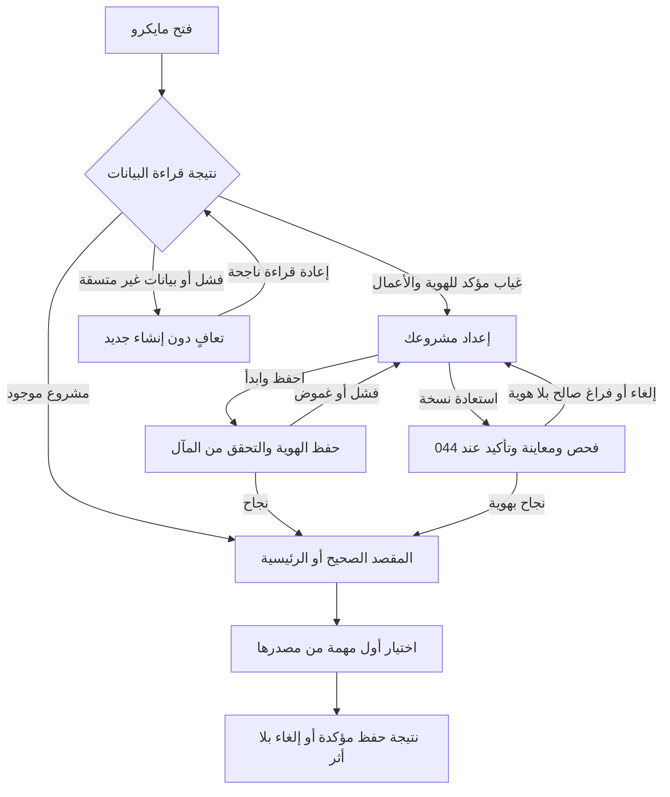

# JRN-001 — أول تشغيل وأول مهمة في مايكرو

**النسخة:** V3 · **التاريخ:** 2026-10-26 — عمّان · **المرحلة:**3 ، تصميم الرحلات المتصلة.
**الحالة:** معتمد من المالك في نطاق CONS-DEC ذات الصلة؛ التفاصيل غير المغطاة بحدودها. التنفيذ والاختبار لم يبدآ، ولا إغلاق شامل.

**سبب تقديمها:** طلب المالك البدء بالرحلات مع التنبيه إلى أول تشغيل وما يترتب عليه. لذلك تسبق هذه الرحلة طلب العميل؛ تصحيح ترتيب العمل لا يلغي رحلة الطلب المقررة بعدها. تغيير تفاصيل الواجهة يثبت في ملف المكوّن، وهذه الوثيقة تربطها من الدخول للنتيجة والعودة.

**المراجع:** [فهرس الرحلات](00-JOURNEYS-INDEX-AR.md) · [NAV-01](../00-System-Navigation-Master-AR.md) · [001 البداية](../../03-New-Design/UNIT-001-إعداد-المشروع.md) · [002 بيانات البداية](../../03-New-Design/UNIT-002-استكمال-بيانات-المشروع.md) · [003 الرئيسية](../../03-New-Design/UNIT-003-مشروعي-الآن.md) · [038 الإعدادات](../../03-New-Design/UNIT-038-الإعدادات.md) · [039 بيانات المشروع](../../03-New-Design/UNIT-039-بيانات-المشروع-والمالك.md) · [044 النسخ](../../03-New-Design/UNIT-044-النسخ-الاحتياطي-والاستعادة.md).

## DATA-01 — بوابة البيانات المشتركة لكل النظام —2026-10-26

**الحالة:** مواصفات المنتج والقواعد المالية المعتمدة مرجع وظيفي؛ لا مخطط بيانات موحدًا مفحوصًا أو تصريح تنفيذ مستقل لهذا الملف. مراجعة التخزين والعلاقات والقواعد التقنية تشمل45 UNIT و10 رحلات، ثم يثبت العقد المشترك قبل تنفيذ الآثار المتأثرة. [DATA-01: النطاق والخطة والبوابة](../../01-Standards/02-System-Data-and-Financial-Readiness-AR.md#data-01-gate).

**المرحلة الحالية:** محلية على الجهاز. التوافق مع سحابة وAuthentication وAuthorization اتجاه مستقبلي للفحص، وليس إطلاقًا لها الآن. لا جداول مفروضة لكل مكوّن، ولا حساب دخول/أدوار/مزامنة/قفل جديد. تبقى حالة كل قدرة وإلغائها أو تأجيلها نافذة.

## مقابل JRN-010 —2026-10-26

بعد الاسم، يظهر اختيار البداية من اليوم أو الماضي فيJRN-010 اختياريًا؛ لا فتح002 إلزاميًا أو إضافة أرصدة/أطراف لتجاوز البداية. استعادة نسخة044 مدخل مختلف، لا إضافة مجاميع أو دمج تاريخ.

**المصدر:** [الرحلة010](10-Account-Completion-and-Return-AR.md) و[002](../../03-New-Design/UNIT-002-استكمال-بيانات-المشروع.md#accounts-completion-20261026). هذه مقابلة ربط محددة، لا إعادة اعتماد فحوص الرحلة أو تشغيلها، ولا تغيير لمعرفاتها السابقة.

## اعتماد القرارات وتحديث أثرها على الرحلة —2026-10-26

**دليل الاعتماد:** قال المالك: «أنا موافق مية بالمية على كل اقتراحاتك»، ثم طلب صراحة تحديث القرارات التسعة أولًا. تاريخ التثبيت 2026-10-26، عمّان. يشمل الاعتماد التوصيات CONS-DEC01..09 ونطاقها وحدودها؛ لا يحتاج إعادة سؤال نفس القرارات. لا يتحول إلى اعتماد كل عبارة قديمة أو اختيار تفاصيل تخزين أو تصريح تنفيذ منتج.

**سجل تاريخي عند تثبيت القرارات التسعة، قبل اعتماد ACC-01/JRN-010 الأحدث أعلاه؛ لا يعمل كتعليمات حالية:** موضوع العودة بعد الانقطاع ومحاكاة جلسة النقاش ما زالا للنقاش، وليسا معتمدين أو مضافين في هذه الدفعة. «سجّل الموجود الآن» معتمد سابقًا ضمن CONS-DEC03 فقط؛ لا يثبت رحلة تعافٍ من انقطاع أو تحديد فترات مفقودة أو تسوية ديون/مخزون جماعية أو تاريخ تقريبي للعمليات. لا نُنشئ ملفًا لهذه الرحلة أو نصًا واجهيًا لها الآن.

**درجات الحالة:** المعنى والنطاق المعتمدان ثابتان؛ التهيئة الهندسية والمواصفة الإضافية للقياس/المرتجع عند لزومها، ثم التنفيذ، ثم التحقق والإغلاق حالات مستقلة. لا كود معدل أو اختبار ناجح من اعتماد الملف.

**المرجع:** [القرارات المعتمدة](../02-Consistency-Review-and-Decisions-AR.md#cons-decisions-approved-20261026).

| القرار | ما أصبح معتمدًا في هذا النطاق | الحالة |
|---|---|---|
| CONS-DEC01 | اعتماد التجربة المختصرة: اسم المشروع وحده للبداية، ونوع النشاط اختياري. الرئيسية للأفعال والمتابعة واللمحة، والمالية مدخل مختصر مع وظائف منظمة، والطلبات قائمة وتقويم لنفس المصادر. الإضافي عند الحاجة، ولا نموذج تفاعلي مستقل الآن. التحصيل لمستحق واحد محدد دون توزيع تلقائي، وحفظ الطرف أو المنتج لإعادة الاستخدام صريح واختياري. | معتمد من المالك؛ التنفيذ لم يبدأ |
| CONS-DEC02 | إظهار المعلومات المعلومة مع حدودها؛ نتيجة الفترة الكاملة غير محددة عند نقص بيانات مؤثرة. النتيجة الجزئية تسمى بنطاقها ولا تقدم ربح الفترة أو حدًا أدنى له. التقدير والاستبعاد الصريح مختلفان عن المجهول. التكلفة التسعيرية لا تكتب مصروفًا أو حق مالك تلقائيًا، ونفس الجزء المالي يحتسب مرة واحدة. تنسق سياسة 503 والقراء والميزانية والمخزون والمعدات وحقوق المالك قبل التنفيذ. | معتمد من المالك؛ التنفيذ لم يبدأ |
| CONS-DEC03 | اعتماد نطاق «سجّل الموجود الآن» كقياس نقد حالي مؤرخ عند الحاجة، مستقل عن افتتاح تاريخي أو إيراد أو مساهمة مالك. لا استنتاج للماضي ولا تسوية إلى صفر. هذه قدرة معتمدة تحتاج عقد قياس وتغطية وتصحيح وقراءة ونقل قبل إتاحتها. الحرس الحي يفرق المعلوم والمجهول وفشل القراءة؛ لا مال أو مصدر تمويل مختلق لتجاوز نقص الرصيد. | معتمد من المالك؛ التنفيذ لم يبدأ |
| CONS-DEC05 | إضافة مال المالك وسحبه بقصد صريح، لا بتوجيه تلقائي من وجود سياسات مستحقات. الإضافة ليست إيرادًا، والسحب الشخصي ليس مصروف تشغيل. المستحقات اختيارية وتسويتها مرتبطة بمستحق محدد، والإرجاع بأصل السحب وأثره. لا قرض أو استشارة سحب آمن جديدة. إصلاح وحدة 100 دينار→10000 وحدة صغرى مرة واحدة، لا تحويل جماعي للقديم. | معتمد من المالك؛ التنفيذ لم يبدأ |

**المسار المستهدف بعد الاعتماد:** اسم المشروع ثم أول مهمة دون إعداد مالي إجباري؛ الاستكمال الحالي عند 022/025 عند الحاجة، لا افتتاح وهمي أو رحلة عودة بعد انقطاع. الاستعادة هي 044 نفسها.

**البوابات والقبول:** كل بوابة أدناه كانت تنتظر موافقة على أحد هذه القرارات أصبحت تنتظر التجهيز والتحقق في حد القرار نفسه؛ لا سؤال مالك متكرر ولا حذف للبوابة. المخطط والكاتب والقارئ والتصحيح والمعرفة والرجوع والنسخ، ثم اختبار الهاتف، باقية. قبول النطاق لا يجعل القياس الجديد أو المرتجع جاهزين للتنفيذ.

**حالة المتن السابق:** خطواته وفحوصه محفوظة؛ الحكم الأقدم المتعارض مع بطاقة معتمدة تاريخي في هذا الحد. الرحلة ليست كودًا منفذًا أو نتيجة اختبار؛ الإضافات المستقلة لم تعتمد تلقائيًا.228 قبولًا مخططًا ومعرفات J001..J009 محفوظة.

## A. النتيجة المطلوبة وحدود الرحلة

«أفتح مايكرو، أبدأ مشروعي أو أستعيد بياناتي، ثم أستطيع تنفيذ أول مهمة دون إعداد مالي طويل أو تكرار تعريف».يوجد نجاحان منفصلان:

- **بدء مكتمل:** هوية المشروع محفوظة ومقروءة، والرئيسية أو مقصد الدخول القانوني متاح. لا يلزم حفظ عملية مالية كي نعتبر البداية مكتملة.
- **أول مهمة مفيدة:** حفظ بيع أو مصروف صحيح عند صاحبه، أو مسودة طلب صحيحة قابلة للاستكمال. إتمام دورة الطلب وتسليمه وتحصيله ضمن JRN-002 التالية، ولا نخفي هذه الحدود بتسمية مسودة طلب بيعًا مكتملًا.

الرحلة تغطي الجديد والعائد وحامل النسخة وفشل القراءة واستكمال بيانات قديمة عند الحاجة. لا تسجيل حساب أو اشتراك أو PIN أو إعداد قدرات إلزامي أو بيانات تجريبية فعلية أو خدمات مستقبلية جديدة في النطاق الحالي.

## B. خريطة الدخول والنتيجة

السهم من غموض الحفظ إلى D يعني بقاء الإدخال وحالة التحقق، لا إعادة إتاحة إنشاء هوية قبل فحص المآل. البيانات القائمة بلا هوية واضحة ليست فراغًا جديدًا. نجاح استعادة خالية من الهوية يعيد D فقط إذا ثبتت صلاحية وفراغ النسخة وفق 044 ، لا لأن مدققًا لم يفهمها.

## C. خطوات الاستخدام العادي

| الخطوة/المالك | ما يراه المستخدم وما يفعله | البيانات والأثر | إلى أين؟ |
|---|---|---|---|
| S00 — بوابة الدخول |انتظار قراءة واضح ومختصر إن احتاجت؛ لا نموذج بداية خاطف قبل معرفة الحالة |قراءة الهوية والأعمال والحالة؛ لا إنشاء ملف أو صفر نقد أو محفظة من التصفح |مشروع قائم إلى S03 ، فراغ مؤكد إلى S01 ، فشل/عدم اتساق إلى E01 |
| S01 —001 |عنوان **إعداد مشروعك**؛ حقل **اسم المشروع** فارغ؛ **احفظ وابدأ**؛ **استعادة نسخة احتياطية**؛ مساعدة! |الاسم المطلوب الوحيد؛ لا مالك/بريد/هاتف/رصيد/قرض/مورد/كتالوج إجباري. مثال الاسم placeholder لا قيمة محفوظة |حفظ إلى S02 ، استعادة إلى R01 ، الإغلاق يحفظ مسودة الاسم بحسب 001 |
| S01a —001/038 ، اختياري |**ماذا تقدم عادةً؟ — اختياري**:منتجات/خدمات/كلاهما؛ يمكن تركه دون جواب |تفضيل 038 الواحد، محايد عند عدم الإجابة؛ يساعد بدء 005/007/029 ويقبل التجاوز داخل العملية. لا سؤال «بسيط أم متقدم» |نفس S01 دون صفحة أخرى أو شرط إضافي |
| S02 —001/039/038 |حفظ صريح واحد وتقدم مفهوم؛ الاسم الفارغ يوضح خطأه قربه |حفظ الهوية مرة والتحقق من النتيجة. التفضيل اختياري؛ نجاح الهوية وفشل حفظ التفضيل حالتان منفصلتان، لا إعادة إنشاء |نجاح هوية إلى S03 ؛ فشل يحفظ المدخلات، وغموض يتحقق قبل أي محاولة كتابة أخرى |
| S03 —003 |الرئيسية باسم المشروع، وإجراءات بيع/مصروف/طلب جديد، والمتابعة واللمحة بحالاتها الحقيقية |لا فتح 002 تلقائيًا، ولا محفظة/رصيد 0 أو مساهمة مالك أو عميل/منتج افتراضي. الفراغ يصف السجلات لا الواقع كله |أول مهمة S04 أو قراءة/إغلاق عادي |
| S04 —004/005 أو 015 أو 007 |يفتح المستخدم المهمة التي يريدها مباشرة؛ النموذج الأصلي يطلب المعلومات اللازمة فقط |لا إعادة اسم المشروع أو تفضيل عام أو حفظ جهة قبل كل مهمة. لا نموذج إدخال جديد خاص بالمبتدئ |حفظ عند المصدر إلى S05 أو إلغاء إلى S03 |
| S05 — صاحب المهمة ثم 003 |نجاح المصدر المؤكد مع إمكان فتح السجل/إكمال الطلب عند انطباقه؛ العودة تحدث القراءة |لا حدث من الرجوع أو تكرار الضغط. نجاح الحفظ وفشل تحديث اللمحة منفصلان. حفظ مسودة لا قبض أو اتفاق أو حجز تلقائي |المصدر أو الرئيسية بسياقها، وتبقى الرحلة قابلة للاستكمال من المصدر |

### C1. المحتوى القصير في شاشة البداية

التوصية تعرض سطرًا واحدًا **«تُحفظ بيانات مشروعك على هذا الجهاز.»** قرب النموذج. لا فقرة تخويف أو نافذة إقرار أو درس مالي. بقية الشرح خلف! باسم وصول **معلومات الإعداد وحفظ البيانات**:إمكان تغيير الاسم لاحقًا، معنى الحفظ المحلي، وحفظ نسخة من الإعدادات عند الحاجة.

هذا تعديل معلن للمقترح السابق 001 الذي وضع معنى الحفظ المحلي كله داخل المساعدة؛ السبب أن المستخدم قد يفهم أنه أنشأ حسابًا متزامنًا بمجرد كتابة الاسم. السطر يوضح قرار البدء ولا يطلب خطوة إضافية، وهو مقترح للمراجعة لا معيار يفرض صياغته حرفيًا.

الرسائل الأساسية تعيد استخدام 001: **اكتب اسم مشروعك. / جارٍ الحفظ… / تعذر حفظ مشروعك. أعد المحاولة. / تم إعداد مشروعك.** النجاح مرة بعد حفظ مثبت، لا عند كل رجوع للتطبيق. إذا ثبت حفظ الهوية وفشل التفضيل نقول بإيجاز إن المشروع بدأ وتعذر حفظ تفضيل النوع مع طريق إعادة المحاولة في 038 ، ولا نعلن فشل إنشاء المشروع أو نخفي خطأ التفضيل خلف!.

### C2. أقل معلومات في أول مهمة

| اختار المستخدم | ما يطلبه المصدر | ما لا نفرضه بسبب أنه جديد |
|---|---|---|
| تسجيل بيع |إجمالي البيع، حالة القبض الفعلية، المقبوض الجزئي عند اختياره، معرفة التكلفة، والتاريخ/وجهة المقبوض عند الانطباق وفق 005 |لا طلب أو منتج محفوظ أو عميل لبيع مدفوع. عند دين يحتاج تعريفًا بسيطًا لصاحبه وفق 037 لا ملفًا دائمًا/هاتفًا |
| تسجيل مصروف |المبلغ ووصف المصروف، وحالة الدفع ومصدره والتاريخ بحسب 015 ؛ حصة المشروع إن انطبق أنها مشتركة |لا ميزانية أو مخزون أو مورد محفوظ أو تسجيل مصروفات مستقبلية لمجرد اختيار يتكرر |
| طلب جديد |وصف صالح ومدخلات 007 الضرورية، ومحفوظ اختياري أو مخصص؛ يتوسع للتكلفة والاتفاق عند الحاجة |لا كتالوج/عميل إلزامي أو تكلفة 0 مصنعة أو موعد اليوم من الرئيسية. اقتراح اليوم فقط إذا جاء من تقويم CAL-01 |

بعد قراءة ناجحة بلا أماكن نقد، يتبع 005/015 عقد **لم يحدد مكان النقد** حيث يسمح المصدر. لا تنشئ 001 صندوقًا افتتاحه 0 كي تمر العملية. إذا احتاج الكاتب إعدادًا محددًا حقًا يفتح مصدره مرة ويعود بالمدخلات، ولا يتجاوزه أو يخترع محفظة؛ التحقق من هذا التكامل بوابة J001-G03.

مثال مراجعة لا تشغيل:بيع 15.00 وقبض 15.00 مع تكلفة غير معروفة، وبلا رصيد بداية موثق. السجل والمقبوض من مصدر 005 مرة، والنتيجة بمعرفة القارئ. لا تعلن 003 أن إجمالي النقد الحقيقي 15.00 أو الربح 15.00 لمجرد وجود القبض؛ رصيد البداية المجهول والمبلغ الذي لم يحدد مكانه لهما معناهما عند 022/024.لا تعتمد هذه الرحلة سياسة نتيجة جزئية أو تصحيح افتتاح صفري.

## D. مسارات الاستثناء والاستكمال

### R01. لدي نسخة احتياطية

من 001 يفتح **استعادة نسخة احتياطية** تجربة 044 نفسها قبل كتابة اسم جديد أو إنشاء هوية. اختيار الملف وفحصه والمعاينة والتأكيد خطوات ذات معانٍ مختلفة؛ الاختيار لا يكتب.

المعاينة تبين اسم المشروع وتاريخ النسخة ومحتواها المختصر وأثر الاستبدال. التحقق من الإصدار والعلاقات وحدود الملف، وحماية الموجود ونسخة الرجوع الدائمة وعزل المسودات عند 044 قبل الالتزام. لا تخفف الحماية لأن الدخول من 001 أو لأن المستخدم يظن الجهاز جديدًا؛ الفراغ يثبت من المصدر لا من عنوان الشاشة. تطبق الحماية على ما يوجد فعلًا، ولا ينشأ مشروع وهمي لعمل نسخة حالية فارغة.

| المآل | النتيجة |
|---|---|
| إلغاء منتقي الملف/المراجعة |إلى 001 بالاسم والتفضيل المؤقتين السابقين؛ لا هوية أو مبلغ جديد |
| ملف غير صالح/إصدار غير مدعوم |سبب واضح عند 044 والأصل محفوظ؛ لا تفسير الفشل كملف فارغ أو ترحيل/إصلاح مالي صامت |
| فشل حماية الموجود/قراءة المخزن |منع الاستبدال والتعافي؛ لا زر «ابدأ جديدًا»يمحو الموجود للخروج من الخطأ |
| نجاح بهوية صالحة |يدخل المشروع المستعاد بهويته وتفضيلاته ومراجع أعماله، ولا تكتب فوقه قيم شاشة 001 السابقة |
| نسخة صالحة فارغة وبلا هوية بعد أثر موضح |إلى 001 ؛ ليست كل نسخة بلا حقل مفهوم نسخة فارغة |
| انقطاع أو نتيجة استبدال غير مؤكدة |قراءة مآل القصد والنسخة عند 044 ؛ لا إعادة تأكيد عمياء أو نصف بيانات أو replay لبيع/افتتاح |

تفضيل قديم أو غير موجود لا يتحول لمنتجات تلقائيًا، والاستعادة لا تعيد PIN أو مشاركة ملغاة أو قرضًا جديدًا أو قدرة متوقفة بلا توافقها. صلاحية استعادة الهيكل والحقول والرجوع محكومة H-D01..05 وقرارات 044 ، لا تعتبر منجزة بإكمال الرسم.

### E01. فشل القراءة أو بيانات أعمال بلا هوية واضحة

تعرض حالة تعافٍ مفهومة وإعادة المحاولة في موضعها، ولا تقدم شاشة إنشاء مشروع كأن الجهاز فارغ. قراءة سليمة لاحقة تحدد المسار. فحص 033 إذا كان ملائمًا، والاستعادة 044 فقط ضمن حماية البيانات الممكنة؛ لا افتراض أن تعطل قراءة الموجود يبيح استبداله أو مسحه.

وجود مشروع قائم يتجاوز 001.تعديل اسمه في 038/039 لا يعيد إنشاءه أو createdAt أو مال المالك أو الأرصدة. مسودة اسم من 001 لا تطغى عليه. في رابط مصدر داخلي، يفتح المقصد الصحيح عند صلاحية الهوية والمصدر والحرس، ولا يفرض المرور بالرئيسية أو يشغل فعلًا ماليًا من المعاملات. الرابط المفقود/غير الصالح رسالة وبديل قانوني، لا إنشاء طلب افتراضي.

### L01. مشروعي يعمل قبل استخدام مايكرو

لا نسأل الجميع عن كل مالهم أو نعرض معالجًا ماليًا إجباريًا بعد حفظ الاسم. يبقى 002 **بيانات البداية** اختياريًا من 038 ، ويظهر الوصول السياقي من الرقم الناقص إلى صاحبه عند الحاجة.

- نقد قبل السجلات:022 رصيد البداية بمعناه وتاريخه، لا مساهمة مالك أو بيع جديد. من يعرف النقد الموجود اليوم فقط يذهب إلى نطاق 025 عند جهوزيته، ولا يعيد تأريخ العد كافتتاح قديم.
- مشتريات/مستحقات/مخزون سابق:002 يوجه إلى مصادرها المؤهلة، لا حقول افتتاح مكررة أو ملف استعادة بديل. لا تسجيل بيع/مصروف اليوم لتمثيل دين قديم بلا عقده.
- عدم إدخال شيء لا يثبت الصفر أو عدم وجود دين أو أن الواقع خالٍ. يعرض القارئ ما يعرفه وحدوده، ولا يطلب استكمال كل القدرات كي يسمح بمهمة مستقلة.
- عند إدخال بيان سبق تسجيله يفتح مصدره وتصحيحه، لا يضاف مرة أخرى لأن مدخل 002 سمي «استكمالًا».قبول صفر افتتاح موثق وقرارات 022/025 والافتتاح والنتيجة تبقى بدرجاتها؛ لا نعالجها بواجهة جديدة.

### B01. الرجوع والإلغاء والانقطاع

قبل حفظ الهوية:تحفظ مدخلات 001 وفق مسودته المنفصلة، وفشل حفظ المسودة لا يدعي أنها باقية بعد الإغلاق. حفظ جارٍ يمنع طلبًا متزامنًا أو استعادة تنافسه. إذا كانت نتيجة الكتابة مجهولة يتحقق وجود الهوية ومآلها قبل الإعادة.

بعد حفظ الهوية:الفتح العادي إلى الرئيسية، والرابط القانوني إلى مصدره. لا شاشة إعداد متكررة أو رسالة نجاح قديمة. لم يحفظ أول بيع/مصروف؟يرجع بلا سجل جديد، وتبقى المسودة فقط إذا كان مالكها يدعم ذلك ويثبت حفظها. لا استئناف تلقائي لحفظ مالي معلق من startup.

بعد استعادة مشروع مختلف:مسودات النماذج القديمة معزولة وفق 044 ولا تستأنف في الهوية الجديدة دون توافق. لا محو صامت للعمل المؤقت ولا نسخ عميل/مبلغ/موعد قديم إلى عملية جديدة. داخل الطلب والمال يرجع أقرب إطار وفق REVIEW-3D ، والتفضيلات من 038 وليس من قيمة URL.

لا نافذة خدمات مستقبلية أو تثبيت PWA أو طلب أذونات غير لازمة يعترض الإعداد وأول مهمة. أي مدخل تثبيت قائم يبقى اختياريًا عند طلب المستخدم/موضعه الملائم، لا شرطًا لتسجيل عملية. هذا اختيار توقيت مقترح لا ادعاء أن التثبيت أو الإشعارات منفذان.

## E. البيانات والمخرجات والتغييرات عن المقترح المحلي

| القيمة/القرار | المالك/الافتراضي | الحدود والأثر |
|---|---|---|
| اسم المشروع |001 ينشئ، 039 يحرر الهوية نفسها؛ فارغ قبل التأكيد |مطلوب، trim ورفض الفراغ بحسب 001 ؛ لا حد طول أو لغة جديد اعتباطي |
| منتجات/خدمات/كلاهما |038/F03 ؛ غير محدد محايد |اختياري ظاهر الوسم، لا اختيار مسبق أو تفسير workMode القديم كنوع بيع |
| اسم المالك/بريد/هاتف/حساب |ليست متطلبات جديدة في 001 |لا ربط دخول/سحابة أو مال مالك من اسم العرض |
| الأرصدة والافتتاح |أصحابها 020/022/027/028 وغيرهم عبر 002 |لا أحداث أو 0 افتراضي أو نسبة اكتمال من إنشاء الهوية |
| المدخل السابق/قصد الفتح |عقد NAV القانوني المحدود |لا أسماء أو مبالغ أو صلاحية كتابة في الرابط، ولا إنشاء المصدر إذا لم يوجد |
| مسودة 001/التفضيل المؤقت |مالكاهما، مع مصدر/مآل صالحين |لا تطبيق مالي من بقايا معالج قديم، ولا طغيان على ملف مستعاد |

الجديد المقترح في الربط:تقديم أول تشغيل في خطة الرحلات؛ تثبيت الفروق بين فراغ وفشل وهوية قائمة؛ تجسيد السؤال الاختياري 038 داخل نفس شاشة 001 ؛ سطر حفظ محلي واحد ظاهر؛ ومآلات الوصول لأول مهمة دون تهيئة مالية. كلها توصيات تجربة/تكامل معلنة؛ لا تعتمد موافقة«ابدأ»كل تفاصيلها أو أي سياسة عمل معلقة.

## F. اتفاقات الملفات والبوابات

| البوابة | ما يجب إثباته قبل التنفيذ/الجزء المعتمد عليها |
|---|---|
| J001-G01 —001/039/بوابة الدخول |غياب مؤكد مقابل فشل/إرث بلا هوية؛ هوية واحدة ومآل حفظ قابل للتحقق، وتوافق القراءة والمسودة والرجوع والرابط القانوني |
| J001-G02 —001/038 |تفضيل F03 واحد ومحايد وتجاوز محلي؛ مآل نجاح الاسم وفشل التفضيل لا ينشئ هوية ثانية أو يطمس تفضيلات/قدرات أخرى |
| J001-G03 —003/004/005/015/007/022 |أول مهمة أصلية دون محفظة/كتالوج/جهة مفروضة حيث يسمح المصدر؛ التحقق والمعرفة ومجهول الافتتاح وعدم تحديد المكان وحفظ المدخلات والتكرار عند أصحابها |
| J001-G04 —001/044/033 |استعادة قبل الإنشاء، معاينة وتأكيد وحماية الموجود وعزل المسودات وإثبات المآل؛ لا PIN أو نصف استعادة، وبوابات 044 لا تغلق من هذه الرحلة |
| J001-G05 —002/038/القراء |وصول اختياري من السياق وصدق 0/المجهول/الخطأ؛ لا افتتاح من الهوية أو عد اليوم، وقرارات 022/025/503 وغيرها محفوظة |
| J001-G06 —الهاتف والإتاحة |تجربة لوحة المفاتيح والتركيز والرسائل و RTL و 0–9 والتكبير على 360/390/430 ، ثم تجربة أشخاص من الجمهور؛ لا تحقق فعلي هنا |

لا يفرض الرابط تعديل كل جار:هذه الجولة توائم 001/002/003/038/044 حيث تغير الربط.039/033/022/005/015/007 قرئت لفحص العقد؛ تعديل كودها أو توسيعها مشروط بالعقد المتغير فعلًا. المراجع المصدرية القديمة تخص خط الأساس المثبت، لا HEAD أو الإنتاج الحالي.

## G. فحوص الرحلة المطلوبة لاحقًا — مخططة، غير منفذة

| الفحص | السيناريو والنتيجة المطلوبة |
|---|---|
| J001-AC01 | فراغ مؤكد يفتح 001 دون إنشاء من القراءة؛ مشروع قائم يفتح مقصده ولا يعيد الإعداد |
| J001-AC02 | فشل القراءة أو أعمال بلا هوية واضحة لا يصبح أول استخدام ولا ينشئ مشروعًا أو يمحو مالًا |
| J001-AC03 | اسم فارغ/مسافات، ومثال placeholder ، ونص عربي/لاتيني: تحقق واضح ولا حفظ غير مقصود |
| J001-AC04 | الاسم وحده يبدأ دون سؤال مالي أو طبقة أو جهة أو كتالوج أو عملة أو PIN ؛ النوع اختياري ومحايد |
| J001-AC05 | منتجات/خدمات/كلاهما من 038 نفسه؛ التجاوز المحلي لا يغير التفضيل العام أو يعيد تصنيف التاريخ |
| J001-AC06 | نجاح الاسم وفشل التفضيل يدخل بالهوية مرة، مع حالة صادقة وطريق إصلاح؛ لا إعادة تأسيس |
| J001-AC07 | نقر حفظ متكرر/تحديث/انقطاع قبل الرد: مآل معلوم وهوية واحدة، لا افتتاح أو حق مالك من التكرار |
| J001-AC08 | إلغاء/إغلاق/استعادة مسودة 001 وفشل حفظها: الاسم لا يمحى أو يدعى حفظه كذبًا، ولا قيم مالية قديمة تطبق |
| J001-AC09 | إلغاء أول بيع/مصروف/طلب يعيد 003 بلا حدث أو مسودة فارغة، وتبقى البداية مكتملة |
| J001-AC10 | أول بيع مدفوع بلا جهة/منتج/محفظة سابقة يتبع 005 ومعرفة 022 ؛ لا صندوق 0 أو ربح/رصيد كامل مختلق |
| J001-AC11 | أول مصروف بمبلغ ووصف يتبع 015 ؛ التصنيف لا يحل محل الوصف، ولا ميزانية أو دورة مدفوعة تلقائيًا |
| J001-AC12 | أول طلب مخصص يحفظ مسودته الصحيحة من 007 دون كتالوج أو قبض؛ لا موعد من الرئيسية، ويستكمل في JRN-002 |
| J001-AC13 | حفظ مهمة ناجح وفشل تحديث 003: النجاح الحقيقي وخطأ القراءة منفصلان؛ لا إعادة سجل أو قبض |
| J001-AC14 | استعادة 044 من 001 قبل الاسم، وإلغاء المنتقي/المراجعة يعيدان المدخلات دون كتابة |
| J001-AC15 | نسخة صحيحة بهوية مختلفة تستعيد معرفاتها وتفضيلاتها مرة؛ لا قيم 001 فوقها أو إعادة افتتاح/بيع |
| J001-AC16 | ملف غير صالح أو إصدار غير مدعوم أو فشل حماية الموجود لا يستبدل جزئيًا ولا يعامل كفراغ |
| J001-AC17 | نسخة صالحة فارغة بلا هوية تعيد 001 بعد أثر موضح؛ أعمال بلا هوية غير مفسرة تبقى في التعافي |
| J001-AC18 | المسودات القديمة بعد الاستعادة تعزل وتسترد حسب 044 ؛ لا مبلغ أو عميل أو موعد ينقل لهوية أخرى |
| J001-AC19 | نقد/دين/مخزون سابق يصل 002 وأصحابه اختياريًا؛ لا 0 من عدم الإدخال، ولا افتتاح من عد اليوم |
| J001-AC20 | رابط سجل/رابط قديم بعد تحقق الهوية يفتح الأصل أو بديلًا قانونيًا؛ لا سجل مفقود يعاد إنشاؤه |
| J001-AC21 | تغيير الاسم من 039 والعودة يحفظ المعرف والتاريخ والمال، ولا يعرض 001 كتأسيس جديد |
| J001-AC22 | عودة عادية/استئناف التطبيق لا تعيد نجاح الإعداد أو كتابة معلقة أو تفعيل قدرة أو قفل ملغى |
| J001-AC23 | سطر الحفظ المحلي ومعلومات! وأخطاء الاسم/الحفظ مفهومة؛ لا شرح طويل أو استعادة من فتح المساعدة |
| J001-AC24 | هاتف 360/390/430 ولوحة مفاتيح و RTL و 0–9 وقارئ شاشة وتكبير: الحقل والفعل والحالات والعودة قابلة للوصول دون قص |

هذه 24 فحصًا في مساحة أسماء J001 ، لا إضافة إلى 427ACD أو 38DUP أو دليل نجاح مستخدم. اكتمال تصميم الرحلة واعتمادها وتجهيز كودها ونجاح الاختبار حالات منفصلة.

## H. الأدلة والاختيارات والحدود

| النوع | الدليل/الموقف |
|---|---|
| متحقق وثائقيًا |قراءة أحدث 001/002/003/038/039/044/033/022/005/015/007 و NAV والفهرس قبل التحديث؛ تسلسل الاسم ثم الرئيسية دون إعداد مالي إجباري، والاستعادة من 044 الواحدة |
| قرار سابق |ORG-001 الاسم المطلوب الوحيد، ORG-002 الاستكمال الاختياري، و 038/F03 المحايد؛ إلغاء PIN ومنع تكرار المدخلات وعدم فرض جهات |
| توصية جديدة |تجسيد السؤال الاختياري داخل 001 وسطر محلي واحد، وحسم مآلات الدخول والتفضيل والاستعادة وأول مهمة كتجربة موحدة |
| فرضية تجربة |هذا الحد من الأسئلة يقلل التشتت وييسر أول مهمة؛ لم يختبر مستخدمون أو نموذج تفاعلي أو هاتف |
| غير متحقق |حالة HEAD/الإنتاج، ذرية المخازن، انقطاع حقيقي، قارئ شاشة، استعادة بيانات فعلية، ومدى نجاح الجمهور |

**المصادر الرسمية:** [GOV.UK—Question pages](https://design-system.service.gov.uk/patterns/question-pages/) إرشاد يسند سبب كل سؤال ووسم الاختياري وعدم تكرار المدخل؛ لا يفرض على Micro معالجًا من صفحة لكل سؤال. [WCAG2.2/4.1.3](https://www.w3.org/TR/WCAG22/#status-messages) و[شرحه](https://www.w3.org/WAI/WCAG22/Understanding/status-messages.html) معيار AA لرسائل الحالة القابلة للإدراك تقنيًا دون تلقي تركيز، ولا يثبت وحده إتاحة الرحلة أو نجاح حفظ. اطلاع 2026-10-25 ، ولا ادعاء مطابقة. التسلسل والتسميات اختيارات Micro ، والمعايير V6/24 مطبقة بحسب الانطباق؛ أي مشكلة خارجها تفحص وتوثق.

**التالي:** عرض الرحلة المبسطة على المالك وتثبيت الاتجاه، ثم JRN-002 للطلب من إنشائه حتى التسليم وتحصيل المتبقي، مع الرجوع والإلغاء والفشل والتكرار. لا تبدأ كتابة المنتج أو خدمة مستقبلية من اكتمال هذا الملف، ولا تعاد جولة جرد شاملة.
