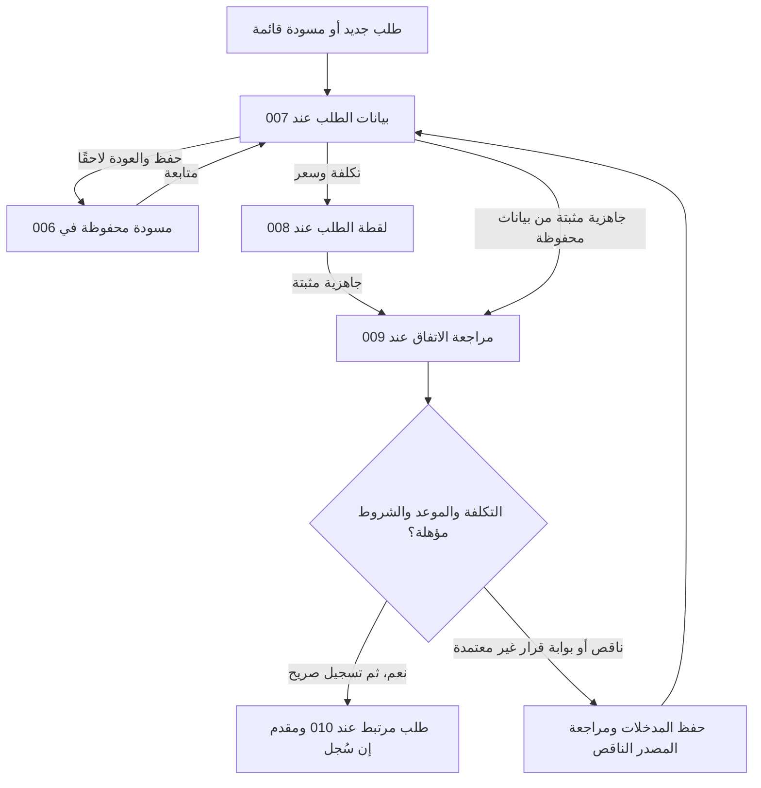
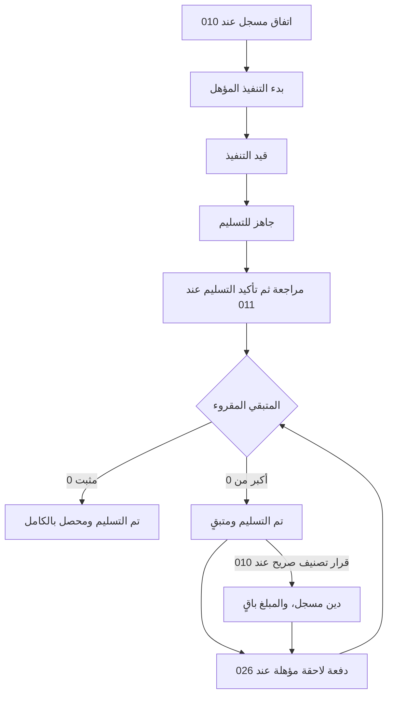

# JRN-002 — طلب العميل من الإنشاء إلى التسليم والتحصيل

**النسخة:** V4 · **التاريخ:** 2026-10-26 — عمّان.
**الحالة:** معتمد من المالك في نطاق CONS-DEC ذات الصلة؛ التفاصيل غير المغطاة بحدودها. التنفيذ والاختبار لم يبدآ، ولا إغلاق شامل.

**للقراءة السريعة:** A يشرح التجربة المقصودة، B و C يحددان الخطوات وما يُدخل وما يُحفظ، D و E للرجوع والحالات الاستثنائية، F للملكية ومنع التكرار، G للبوابات، H لفحوص التنفيذ اللاحق. وثائق المكونات تملك سلوك كل جزء؛ هذه الوثيقة تربط الأجزاء دون إنشاء مصدر مالي آخر.

**المراجع:** [فهرس الرحلات](00-JOURNEYS-INDEX-AR.md) · [التنقل](../00-System-Navigation-Master-AR.md) · [أول استخدام](01-First-Use-and-First-Task-AR.md) · [006 الطلبات](../../03-New-Design/UNIT-006-العمل.md) · [007 المسودة](../../03-New-Design/UNIT-007-مسودة-الطلب.md) · [008 تكلفة الطلب](../../03-New-Design/UNIT-008-التكلفة.md) · [009 الاتفاق](../../03-New-Design/UNIT-009-الاتفاق-والعربون.md) · [010 متابعة الطلب](../../03-New-Design/UNIT-010-تفاصيل-الطلب.md) · [011 التسليم](../../03-New-Design/UNIT-011-مراجعة-التسليم.md) · [012 المواعيد](../../03-New-Design/UNIT-012-المواعيد-والمتابعات.md) · [026 الدفعة اللاحقة](../../03-New-Design/UNIT-026-تسجيل-دفعة-على-مستحق.md).

## DATA-01 — بوابة البيانات المشتركة لكل النظام —2026-10-26

**الحالة:** مواصفات المنتج والقواعد المالية المعتمدة مرجع وظيفي؛ لا مخطط بيانات موحدًا مفحوصًا أو تصريح تنفيذ مستقل لهذا الملف. مراجعة التخزين والعلاقات والقواعد التقنية تشمل45 UNIT و10 رحلات، ثم يثبت العقد المشترك قبل تنفيذ الآثار المتأثرة. [DATA-01: النطاق والخطة والبوابة](../../01-Standards/02-System-Data-and-Financial-Readiness-AR.md#data-01-gate).

**المرحلة الحالية:** محلية على الجهاز. التوافق مع سحابة وAuthentication وAuthorization اتجاه مستقبلي للفحص، وليس إطلاقًا لها الآن. لا جداول مفروضة لكل مكوّن، ولا حساب دخول/أدوار/مزامنة/قفل جديد. تبقى حالة كل قدرة وإلغائها أو تأجيلها نافذة.

## مقابل JRN-010 —2026-10-26

الطلبات القائمة ومقدماتها من002 تستعمل نفس دورة الطلب ومراجعة التسليم؛ لا مقدم جديد أو طلب مكرر أو موعد وهمي أو كتالوج إجباري.

**المصدر:** [الرحلة010](10-Account-Completion-and-Return-AR.md) و[002](../../03-New-Design/UNIT-002-استكمال-بيانات-المشروع.md#accounts-completion-20261026). هذه مقابلة ربط محددة، لا إعادة اعتماد فحوص الرحلة أو تشغيلها، ولا تغيير لمعرفاتها السابقة.

## اعتماد القرارات وتحديث أثرها على الرحلة —2026-10-26

**دليل الاعتماد:** قال المالك: «أنا موافق مية بالمية على كل اقتراحاتك»، ثم طلب صراحة تحديث القرارات التسعة أولًا. تاريخ التثبيت 2026-10-26، عمّان. يشمل الاعتماد التوصيات CONS-DEC01..09 ونطاقها وحدودها؛ لا يحتاج إعادة سؤال نفس القرارات. لا يتحول إلى اعتماد كل عبارة قديمة أو اختيار تفاصيل تخزين أو تصريح تنفيذ منتج.

**سجل تاريخي عند تثبيت القرارات التسعة، قبل اعتماد ACC-01/JRN-010 الأحدث أعلاه؛ لا يعمل كتعليمات حالية:** موضوع العودة بعد الانقطاع ومحاكاة جلسة النقاش ما زالا للنقاش، وليسا معتمدين أو مضافين في هذه الدفعة. «سجّل الموجود الآن» معتمد سابقًا ضمن CONS-DEC03 فقط؛ لا يثبت رحلة تعافٍ من انقطاع أو تحديد فترات مفقودة أو تسوية ديون/مخزون جماعية أو تاريخ تقريبي للعمليات. لا نُنشئ ملفًا لهذه الرحلة أو نصًا واجهيًا لها الآن.

**درجات الحالة:** المعنى والنطاق المعتمدان ثابتان؛ التهيئة الهندسية والمواصفة الإضافية للقياس/المرتجع عند لزومها، ثم التنفيذ، ثم التحقق والإغلاق حالات مستقلة. لا كود معدل أو اختبار ناجح من اعتماد الملف.

**المرجع:** [القرارات المعتمدة](../02-Consistency-Review-and-Decisions-AR.md#cons-decisions-approved-20261026).

| القرار | ما أصبح معتمدًا في هذا النطاق | الحالة |
|---|---|---|
| CONS-DEC01 | اعتماد التجربة المختصرة: اسم المشروع وحده للبداية، ونوع النشاط اختياري. الرئيسية للأفعال والمتابعة واللمحة، والمالية مدخل مختصر مع وظائف منظمة، والطلبات قائمة وتقويم لنفس المصادر. الإضافي عند الحاجة، ولا نموذج تفاعلي مستقل الآن. التحصيل لمستحق واحد محدد دون توزيع تلقائي، وحفظ الطرف أو المنتج لإعادة الاستخدام صريح واختياري. | معتمد من المالك؛ التنفيذ لم يبدأ |
| CONS-DEC02 | إظهار المعلومات المعلومة مع حدودها؛ نتيجة الفترة الكاملة غير محددة عند نقص بيانات مؤثرة. النتيجة الجزئية تسمى بنطاقها ولا تقدم ربح الفترة أو حدًا أدنى له. التقدير والاستبعاد الصريح مختلفان عن المجهول. التكلفة التسعيرية لا تكتب مصروفًا أو حق مالك تلقائيًا، ونفس الجزء المالي يحتسب مرة واحدة. تنسق سياسة 503 والقراء والميزانية والمخزون والمعدات وحقوق المالك قبل التنفيذ. | معتمد من المالك؛ التنفيذ لم يبدأ |
| CONS-DEC05 | إضافة مال المالك وسحبه بقصد صريح، لا بتوجيه تلقائي من وجود سياسات مستحقات. الإضافة ليست إيرادًا، والسحب الشخصي ليس مصروف تشغيل. المستحقات اختيارية وتسويتها مرتبطة بمستحق محدد، والإرجاع بأصل السحب وأثره. لا قرض أو استشارة سحب آمن جديدة. إصلاح وحدة 100 دينار→10000 وحدة صغرى مرة واحدة، لا تحويل جماعي للقديم. | معتمد من المالك؛ التنفيذ لم يبدأ |
| CONS-DEC06 | الوقائع المالية التي حدثت تسجل بتاريخ اليوم أو تاريخ سابق حقيقي؛ المستقبل موعد أو تذكير أو اتفاق لا قبض/دفع منجز. تاريخ البيع أو الاتفاق منفصل عن كل دفعة ووقت توثيقها. تعديل التكرار يؤثر افتراضيًا على الدورات المستقبلية غير المعالجة؛ السابق يراجع صراحة. ربط مصروف مسجل بدورة لا يكتب مصروفًا جديدًا. لا تاريخ وهمي أو إعادة تأريخ تلقائية للقديم. | معتمد من المالك؛ التنفيذ لم يبدأ |
| CONS-DEC07 | سعر نهائي موجب للبيع المعتاد، بنفس القاعدة في الإنشاء والتعديل. المستخدم حر في السعر، ولا تفرض نسبة ربح أو عتبة هدف كسعر إلزامي. الانخفاض عن الهدف ليس خسارة مؤكدة؛ يظهر أثر التكلفة ومعرفتها بصدق. المعاملة المجانية خارج المسار المعتاد حتى تصميمها صراحة، ولا سعر وهمي للتحايل. هامش من سعر البيع يختلف عن الزيادة على التكلفة. | معتمد من المالك؛ التنفيذ لم يبدأ |
| CONS-DEC08 | اعتماد ضرورة تصميم الإلغاء الحقيقي ورد المقدم/المبلغ من مصدره والمرتجع الكامل المؤهل قبل الإطلاق؛ المرتجع الجزئي والتقسيم المعقد مؤجلان إلى عقد مستقل. الموافقة على النطاق لا تعني جاهزية مواصفة الرد أو العكس أو المخزون. التصحيح الخاطئ مختلف عن رد مال حقيقي، ولا رد يتجاوز المقبوض أو عودة مخزون من مجرد رد المال أو إغلاق طلب يحبس حق العميل. | معتمد من المالك؛ التنفيذ لم يبدأ |

**المسار المستهدف بعد الاعتماد:** طلب واحد من الوصف والتكلفة والسعر حتى الاتفاق والتسليم والتحصيل. جواز المجهول وبلا موعد ثابت، والسعر الموجب والتوصيل المبسط والرد من المصدر بحسب النطاق المعتمد؛ لا جاهزية مرتجع من موافقة النطاق.

**البوابات والقبول:** كل بوابة أدناه كانت تنتظر موافقة على أحد هذه القرارات أصبحت تنتظر التجهيز والتحقق في حد القرار نفسه؛ لا سؤال مالك متكرر ولا حذف للبوابة. المخطط والكاتب والقارئ والتصحيح والمعرفة والرجوع والنسخ، ثم اختبار الهاتف، باقية. قبول النطاق لا يجعل القياس الجديد أو المرتجع جاهزين للتنفيذ.

**حالة المتن السابق:** خطواته وفحوصه محفوظة؛ الحكم الأقدم المتعارض مع بطاقة معتمدة تاريخي في هذا الحد. الرحلة ليست كودًا منفذًا أو نتيجة اختبار؛ الإضافات المستقلة لم تعتمد تلقائيًا.228 قبولًا مخططًا ومعرفات J001..J009 محفوظة.

## اعتماد J002-DEC01/02 — 2026-10-25

**مصدر القرار:** موافقة المالك «موافق» بعد عرض القرارين المحددين في خلاصة رحلة الطلب؛ تُسجل للقرارين فقط، لا اعتمادًا شاملًا للرحلة أو كل السياسات والبوابات.

| القرار | المعتمد | ما يراه المستخدم وما يُحفظ |
|---|---|---|
| J002-DEC01 — تكلفة غير معروفة | يجوز تسجيل اتفاق الطلب دون معرفة التكلفة؛ لا إجبار زيارة 008 أو إدخال 0/بند صوري | اختيار واضح **أحدد التكلفة لاحقًا** عند الحاجة، ومعاينة **التكلفة غير معروفة**. يُحفظ مرجع معرفة مجهولة متوافق مع 008/009 ضمن عقد التحويل؛ لا ربح 0 أو ربح معلوم من سعر البيع وحده |
| J002-DEC02 — موعد غير محدد | يجوز تسجيل الاتفاق دون موعد تسليم؛ لا تاريخ اليوم أو 00:00 أو جدول بتاريخ فارغ | **موعد التسليم — اختياري**؛ عند تركه يعرض الملخص **لم يحدد بعد** ويحفظ حالة غير محددة. الطلب في القائمة ومدخل بدون موعد، لا يوم مختلق في التقويم؛ يضاف الموعد لاحقًا من 012 دون إعادة الاتفاق أو المقدم |

الكلفة المجهولة ليست كلفة صفر، وموعد لم يحدد ليس فشل قراءة أو موعدًا تالفًا. لا شرح أو تنبيه طويل؛ الحالة المؤثرة مختصرة بجوار معلومتها، والمساعدة العامة خلف! متاح. إذا كانت معلومات صالحة موجودة فلا تمحى أو تحول إلى مجهولة لمجرد اختيار افتراضي أو استعادة قديمة؛ التعديل الصريح وأهليته عند صاحبه.

**ما أُغلق:** السؤال القيمي عن جواز الاتفاق بتكلفة مجهولة وجوازه بلا موعد. **ما بقي:** تجهيز المجال والقراء والمخطط والنسخ والاستعادة والرجوع وقبول الرحلة؛ لا تشغيل قبل توافقها. U007-D07 وجزء المجهول من U009-D01 و U009-D02 اعتمدت بهذا النطاق؛ U007-D06 وبقية U008-D01..03/U009-D01/D03 وسياسة 503 وغيرها لا تعتمد تلقائيًا. لا 0 أو قيمة وهمية لتجاوز الحرس الحالي قبل تنفيذ بديله المعتمد، ولا طلب موافقة مالك جديدة على نفس القرارين.

## A. تجربة واحدة سهلة، تُستكمل بحسب الحاجة

«أسجل ما طلبه العميل، أضع تكلفته وسعره عندما أعرفهما، أثبت الاتفاق والمبلغ الذي استلمته، ثم أتابع التنفيذ والتسليم وما بقي لي».

المستخدم يتعامل مع **طلب واحد**، لا يتعلم أسماء المكونات أو ينسخ بياناته بينها. قبل الاتفاق يكون ما حفظه مسودة؛ بعد الاتفاق يتابع الطلب نفسه بهويته وروابطه. للمسودة والطلب معرفاهما الفعليان عند الحاجة، مع رابط تحويل واحد؛ لا ندّعي أنهما جدول أو معرف واحد في التخزين.

1. **طلب جديد:** يكتب المنتج أو الخدمة، أو يختار محفوظًا إن أراد. العميل اختياري. يستطيع حفظ مسودة والعودة لاحقًا.
2. **التكلفة والسعر:** يدخل مبلغ التكلفة مباشرة أو يحسبه من المكونات، ثم سعر البيع. يظهر الربح المتوقع وحدود الحساب. التفاصيل تفتح للمنتج الذي يعمل عليه فقط.
3. **مراجعة الاتفاق:** يرى وصف الطلب وقيمته وموعده والمبلغ المستلم مقدمًا إن وجد، ثم يؤكد مرة واحدة. لا يعيد كتابة السعر والعميل.
4. **متابعة التنفيذ:** حالة واضحة وإجراء مناسب لها؛ المواد والوقت عند الحاجة، دون إجبار المستخدم على تشغيل المخزون أو حساب ساعات.
5. **تسجيل التسليم:** يراجع المتبقي، ويدخل ما استلمه الآن إن وجد، ويؤكد التسليم. لا يعيد تسجيل العربون أو البيع في المالية.
6. **تحصيل المتبقي:** من الطلب نفسه، يدخل المبلغ الذي استلمه أو يختار كامل المتبقي؛ يبقى الطلب مسلّمًا ويقل المستحق، دون إيراد جديد من التحصيل.

هذه خطوات مهمة وليست معالجًا إلزاميًا من 6 صفحات. حفظ المسودة نهاية مفيدة بذاتها، والتكلفة التفصيلية اختيارية. اعتمد المالك جواز الاتفاق بتكلفة غير معروفة وبلا موعد وفق J002-DEC01/02 ؛ لا يعودان سؤال قرار. يتبقى تجهيز شروط المجال والقراء ومآل الحفظ في G02 ، مع إبقاء بقية السياسات بدرجاتها.

### A1. ما يظهر دون إغراق الشاشة؟

| موضع الاستخدام | الظاهر اللازم | عند الحاجة فقط |
|---|---|---|
| إنشاء/تعديل المسودة | وصف أو منتجات الطلب، عدد واضح، عميل اختياري، حفظ المسودة، فعل متابعة مسمى | تفاصيل تخصيص، اختيار محفوظ، حساب المكونات، استعادة إدخال سابق صالح |
| التكلفة والسعر | اسم المجموعة وعددها، تكلفة وسعر بأساس ظاهر، ملخص ربح متوقع | مكونات الوحدة، تكلفة دفعة كاملة، وقت العمل، حصة تشغيل يحددها المستخدم، مساعدة تسعير |
| الاتفاق | ملخص ما اتُّفق عليه، الموعد أو حالته المسموح بها، المقبوض مقدمًا، المتبقي، **تسجيل الاتفاق** | تعديل معلوم في مصدره؛ معلومات اتفاق ثانوية؛ مكان القبض عند وجود مبلغ |
| تفاصيل الطلب | الحالة والموعد والوصف، قيمة الطلب والمستلم والمتبقي، فعل الحالة | تفاصيل التكلفة والمدفوعات والمكونات والسجل والتصحيحات المؤهلة |
| التسليم/التحصيل | المبلغ والمصدر والأثر قبل وبعد والتأكيد المحدد | مكان النقد، مواد التسليم إن انطبقت، سبب تصحيح عند طلب تصحيح |

المساعدة العامة خلف زر ! مسمى ومتاح؛ الخطأ الحالي، ونقص المعرفة المؤثر، والمبلغ الذي سيُسجل تبقى ظاهرة باختصار. لا شريط تنبيهات طويل أو شرح ثابت لكل مرحلة، ولا رسالة «لم يسجل عربون» مكررة حين يوضح المستلم ذلك.

## B. خرائط الدخول ودورة الطلب

### B1. من أين يبدأ ويعود؟

| المدخل | ما يفتح | العودة الصحيحة |
|---|---|---|
| الرئيسية 003 — طلب جديد | 007 بقصد جديد، دون تاريخ مفترض | الرئيسية إذا كانت إطار الإنشاء؛ لا انتقال قسري إلى جذر الطلبات عند الإلغاء |
| الطلبات 006 — طلب جديد | 007 نفسه | القائمة ببحثها ومرشحاتها وموضعها المشروع |
| يوم مختار في التقويم 006/012 | 007 مع موعد تسليم **مقترح** ظاهر قابل للتعديل/الإزالة | اليوم والعرض والفترة السابقة؛ الاقتراح لا يحجز موعدًا من الفتح أو حفظ المسودة |
| مسودة محفوظة في 006 | 007 بمعرفها ونسختها | القائمة/التقويم أو إطار الفتح الفعلي؛ لا مسودة جديدة من «متابعة» |
| طلب قائم من 006 أو 003 أو 037 أو 017 أو متابعة 012/018 | 010 بالطلب الأصلي | المصدر الفعلي الذي فتحه؛ وجهة الصفحة في الشريط لا تمحو إطار الرجوع |
| رابط مسودة تحولت سابقًا | الطلب المرتبط بعد التحقق | سياق قانوني؛ لا إعادة اتفاق أو إنشاء نسخة جديدة |
| رابط مفقود/غير مؤهل | حالة محددة مع رجوع آمن | لا استبداله بطلب فارغ أو فعل مالي تلقائي |

داخل الطلب: الرجوع من 008 أو 009 أو 011 أومحرر 012 يعيد أقرب سياق طلب/مسودة أولًا؛ بعدها يعود إلى المدخل الخارجي. تحفظ الأوراق حقولها وفق مالكها، وتغلق الورقة الأعلى قبل الخروج من المهمة. لا مبالغ أو أسماء عملاء أو صلاحية كتابة في الرابط.

### B2. من المسودة إلى الاتفاق

سهم الجاهزية لا يسمح بتجاوز شرط الكاتب الحالي قبل تجهيز البديل المعتمد. المسار المعتمد من حيث جواز تكلفة غير معروفة أو موعد غير محدد يمر بعد تجهيز المجال والقراء والتحقق ضمن J002-G02 ؛ لا انتظار لاعتماد القرارين مرة أخرى. حفظ مدخلات الاتفاق للخروج ليس **تسجيل الاتفاق** ولا قبضًا خفيًا.

### B3. التنفيذ والمال مساران متصلان مختلفان

حالة التنفيذ لا تتحول إلى «محصل بالكامل» من اسم settled وحده. القبض الكامل مقدمًا لا يسلم الطلب، والتسليم دون قبض لا يصفر المستحق. بدء التنفيذ من confirmed والاستئناف من التأجيل/المراجعة يحتاجان أهلية U010-D02 ؛ الرسم لا يفعّل انتقالًا غير مسموح. لا حجز شركة توصيل أو تسجيل تسليم من مجرد تسليم الطرد لناقل.

## C. خطوات العمل والمدخلات والمخرجات

| الخطوة وصاحبها | ما يدخله المستخدم أو يعيد استخدامه | ما يُحفظ/يُعرض | الفعل والنتيجة التالية |
|---|---|---|---|
| S01 —007/029/037 | منتج أو خدمة مخصصة، أو محفوظ مختار صراحة؛ عدد المجموعة؛ عميل اختياري محلي أو محفوظ | بيانات النموذج أولًا؛ مسودة عند حفظ صريح ومعطى حقيقي. العدد الافتراضي وحده ليس محتوى | **حفظ المسودة** أو متابعة مسماة تحفظ آخر التعديل ثم تفتح الجزء المؤهل |
| S02 —008 ومحرك 031 | تكلفة المجموعة بمبلغ مباشر أو مكونات، وسعر البيع للوحدة؛ أساس وحدة/كمية كاملة واضح | لقطة تكلفة وسعر مقترح للطلب؛ معرفة ونطاق وتاريخ ومصدر. لا اتفاق أو مصروف أو قبض | **حفظ التكلفة والسعر** ثم الرجوع إلى نفس سياق الطلب |
| S03 —009 | يعرض الوصف والعميل والكمية/المجموعات والسعر السابق؛ موعد أو حالته المعتمدة؛ مبلغ مستلم مقدمًا اختياري | معاينة إجمالي الاتفاق والمستلم والمتبقي، ثم تحويل واحد وربط المسودة والطلب والمقدم/الجدول اللازم | **تسجيل الاتفاق**؛ يفتح 010 بمعرف الطلب الحقيقي، ورسالة نجاح تخص النتيجة الملتزمة |
| S04 —010/012 | بدء التنفيذ ثم الجاهزية عند أهليتهما؛ تعديل موعد من 012 ؛ مقدم إضافي إن استلم فعلًا | حالة وأحداث حقيقية؛ الموعد الحالي من 012 ؛ المقدم قبل التسليم عند 010. لا استهلاك أو قبض من التصفح | فعل واحد واضح للحالة؛ لا مطالبة بساعات/مواد ممن لم يخترها |
| S05 —011/028 | مبلغ استلمه الآن إن وجد؛ مكانه اختياري؛ استهلاك مواد متتبعة مختار عند انطباقه | معاينة السعر والمستلم السابق والجديد والمتبقي وأثر المواد، ثم تسليم واحد بمآل مالي معلوم | **تأكيد التسليم**؛ نتيجة مختصرة ثم فتح 010 ، ولا استدعاء 026 مرة ثانية لنفس قبض التسليم |
| S06 —010/026 | مصدر الطلب ثابت؛ مبلغ مستلم جديد أو كامل المتبقي، ومكان معلوم/لم يحدد | دفعة عند مالك الطلب، ومتبقٍ أحدث؛ لا تكرار إجمالي الدين أو اختيار العميل من جديد | **تسجيل الدفعة**؛ يعود إلى 010 محدثًا؛ الدين الآخر للعميل لا يصفّر |
| S07 —010/017/016 | قراءة النتيجة والسجل، أو طلب تصحيح مؤهل | نفس الأحداث والنسخ والتوقيت والمعرفة عند أصحابها | لا بيع مباشر 005 أو إيراد/مصروف يدوي ثانٍ لتكرار الطلب في المالية |

### C1. المنتج المخصص والمحفوظ والكميات

- **المخصص يبدأ مباشرة**؛ لا زيارة 029 أو حفظ كتالوج شرطًا لإنشاء طلب. اختيار محفوظ ينسخ لقطة واضحة للطلب، وتعديلها لا يعدل المنتج الأصلي أو طلبًا قديمًا.
- **حفظ لاستخدامه مرة أخرى** فعل منفصل اختياري عند 029 ؛ حفظ المسودة أو الاتفاق لا ينفذه تلقائيًا. لا إنشاء نسخة محفوظة جديدة عند كل إعادة استخدام.
- مجموعة واحدة لعشرة صناديق متشابهة: مكونات **صندوق واحد** ثم عدد 10 ؛ لا 10 نماذج مكونات. لصندوق مختلف مجموعة ثانية بكمية ومكونات وسعر مستقلين، ويمكن النسخ والتعديل صراحة.
- عدد المجموعة، وعدد مكوّن داخل الوحدة، وكمية مادة مخزنية معانٍ مختلفة. لا يجمع عدد منتجات وخدمات بوحدات مختلفة في «كمية طلب» واحدة تصلح للضرب. توافق حقل الكمية القديم ولقطته بوابة J002-G01 ؛ لا إعادة تفسير التاريخ.
- تكلفة دفعة كاملة تبقى إجماليها الأصل؛ تكلفة 10.00 لثلاث وحدات لا تصبح 10.02 من تقريب الوحدة. تغيير الكمية يستدعي مراجعة نطاق التكلفة؛ لا مضاعفة آلية لكل مبلغ قديم.

### C2. التكلفة والسعر والمعلومات التي قد تُنسى

أول حقل مفيد هو التكلفة المباشرة، وبجواره **احسبها من المكونات** لمن يحتاج. لا استبيان طرق قبل البدء، ولا إجبار مواد أو وقت أو مخزون. المستخدم يضع سعر البيع؛ المساعدة الاختيارية لا تختار السعر عنه.

عند مراجعة التكلفة يمكن سؤال قصير واحد عن وقت العمل مع إضافة أو مشمول/لا ينطبق، ومداخل تغليف/حصة تشغيل عند الحاجة. لا أسئلة إيجار وكهرباء وراتب في كل صف، ولا نسبة تشغيل أو أجر افتراضي أو قراءة مصاريف فعلية خلف الكواليس. الاستبعاد المقصود والمجهول والصفر المدخل عمدًا لا يندمجون في معنى واحد.

التفصيل والمبلغ الإجمالي لنفس النطاق بديلان، لا يُجمعان. تغيير الطريقة يحفظ العمل السابق وفق 008 ويجعل المصدر النشط واضحًا. التكلفة الناقصة تعطي ملخصًا بحدوده؛ لا «ربح نهائي». إذا كانت التكلفة غير معروفة، يمكن حفظ المسودة والسعر المقترح؛ جواز تسجيل الاتفاق بهذه الحالة معتمد J002-DEC01 ، والتنفيذ بعد تجهيز G02 دون إجبار لقطة تكلفة رقمية.

**السعر يُدخل مرة:** في النموذج الجديد ذي المجموعات يراجع 009 الإجمالي المشتق من أسعار المجموعات والإضافات. **تعديل السعر** يعيد محرره في السياق نفسه، ثم يعيد المعاينة؛ لا حقلا إجمالي اتفاق يدوي ومجموع منتجات متنافسان. السعر يصبح متفقًا عند تسجيل 009 ، وليس عند حفظ 008. مواءمة هذا الفرق مع حقل 009 القديم وقراءة 010/011 بوابة G01 ، دون مسح سعر اتفاق تاريخي أو تعديله من لقطة تكلفة أحدث.

### C3. التوصيل والإضافات — تطبيق القرار الأخير

أسفل جميع مجموعات الطلب مرة واحدة:

| المدخل | أبسط تفاعل | الحد المالي |
|---|---|---|
| **تكلفة توصيل على المشروع** | خيار يفتح المبلغ؛ إذا فعّله يبقى المبلغ لازمًا وصحيحًا | تكلفة تخص المشروع مرة واحدة؛ لا يعني أنه دفعها. توصيل يدفعه العميل خارج حساب المشروع لا يدخل النموذج |
| **إيرادات ومصاريف أخرى** | إضافة صف إيراد أو مصروف؛ مبلغ عند إضافة الصف، ووصف اختياري | إعداد قيمة الطلب وتكلفته، لا قبض/دفع من الكتابة أو حفظ المسودة |

لا سؤال عمّن يدفع أو تقسيم حصص أو رسوم عميل جديدة، ولا علاقة تشغيلية بخدمة التوصيل المستقبلية. شروط 009 القديمة عن التقاسم مستبدلة بهذا الاتجاه في **الإنشاء الجديد فقط**. رسوم أو قبض توصيل قديم تبقى بمصدرها ومعناها، ولا تحذف من التاريخ أو المبالغ المستحقة.

الإيراد الإضافي هنا مبلغ يخص هذا الطلب، لا مال مالك أو قرض أو عربون أو تحصيل طلب آخر. المصروف الإضافي لا يعيد تكلفة مكون أو شراء/فاتورة سبق تغطيتها. منع الازدواج المنظم يحتاج معرف مصدر وتغطية؛ تشابه نص «نقل» و«توصيل» وحده لا يثبت أنهما الواقعة نفسها. وقت المالك وحصة مصروف فترة قد يخدمان التسعير دون أن يصيرا مصروفًا فعليًا ثانيًا. سياسة الإسقاط والاعتراف عند G08 و 503 ، ولا تضاف كتابة مالية مستقلة تلقائيًا بسبب هذا القسم.

### C4. ملخص واضح عند الاتفاق والتسليم

عند 009: وصف ومجموعات الطلب، إجمالي ما اتُّفق على تحصيله، موعد التسليم أو حالته القانونية، المستلم مقدمًا إن سجل، والمتبقي بعده. قبل الاتفاق لا يقال «دين مستحق» لمجرد وجود متبقٍ. لا تكلفة مفقودة 0 ولا موعد اليوم بديلًا عن المجهول.

عند 011: **المستلم سابقًا** قراءة فقط، و**مبلغ استلمته عند التسليم** إدخال جديد اختياري؛ الفراغ لا يسجل قبضًا. مكان النقد يظهر مع مبلغ موجب ويمكن تحديده لاحقًا حيث يسمح العقد. لا إنشاء صندوق افتتاحه 0 لتجاوز نقص إعداد. السعر المعدل أو المواد المتغيرة يبطلان المعاينة السابقة؛ يبقى النص المدخل مع خطئه ولا يخفض القبض آليًا ليلائم سقفًا جديدًا.

عند 026: لا اختيار عميل أو مصدر آخر في المسار السياقي. مبلغ 0 أو أكبر من المتبقي يرفض؛ لا توزيع تلقائي للزائد على ديون أخرى أو رصيد دائن جديد. قبل التسليم يسجل المقدم عند 009/010 ؛ عند التسليم ينسق 011 قبضه؛ بعد التسليم ينسق 026 الدفعة المؤهلة. التشابه في الحقل لا يجعل هذه الأحداث حدثًا واحدًا قابلًا للتبديل.

### C5. مثال مالي للشرح والفحص لاحقًا، لا تشغيل منفذ

| الحدث | المستلم التراكمي | المتبقي | الأثر الذي لا يُكرر |
|---|---:|---:|---|
| اتفاق بقيمة 15.00 ومقدم 5.00 |5.00|10.00| نقد+5.00 مرة؛ لا تسليم أو ربح من المقدم |
| تنفيذ ثم تسليم دون مبلغ جديد |5.00|10.00| واقعة التسليم مرة؛ لا قبض 10.00 ولا تصفير المستحق |
| تسجيل المتبقي دينًا بقصد صريح |5.00|10.00| تصنيف للمستحق، لا نقد أو إيراد جديد |
| تحصيل 10.00 لاحقًا |15.00|0.00| نقد+10.00 مرة؛ لا إعادة إيراد البيع أو تسليمه |

إذا استلم 10.00 عند التسليم بدلًا من لاحقًا، يسجله 011 في نفس تأكيد التسليم، ويغلق المتبقي؛ لا يحتاج تسجيل 026 لنفس المبلغ. مثال 15.00 يثبت فرق السعر والقبض والمتبقي، ولا يختار سياسة الاعتراف أو نتيجة فترة ناقصة.

مثال التسعير المعتمد في 031:10 صناديق، تكلفة المكونات 7.00 وسعر الوحدة 10.00 ⇒ تكلفة 70.00 وقيمة 100.00. توصيل المشروع 3.00 وإيراد إضافي 5.00 ومصروف إضافي 2.00 ⇒ قيمة 105.00 وتكاليف مدرجة 75.00 وربح متوقع 30.00 وهامش 28.57%. النسبة من قيمة البيع، لا زيادة على التكلفة ولا متوسط هوامش المنتجات. **هذا ملخص تسعير، وليس صافي ربح الفترة أو دليل دفع المصروفات.** الاعتراف والتغطية والدقة يحكمها 031/008/013/016 وسياساتها المفتوحة.

## D. الاستثناءات والعودة والتصحيح

| الحالة | السلوك المطلوب والمخرج |
|---|---|
| فتح إنشاء فارغ ثم رجوع | لا مسودة محفوظة أو طلب أو موعد. بيانات حقيقية غير محفوظة تُحمى وفق 007 ؛ لا حفظ مالي من مغادرة |
| مسودة محفوظة ثم تعديل ثم إلغاء | يميز تجاهل التعديل عن حذف المسودة؛ لا محو للنسخة المحفوظة أو لقطة التكلفة |
| رجوع من مكونات منتج/عميل/موعد | يعيد المنتج والطلب والمدخلات؛ لا قائمة جديدة أو تعيين موعد من إعادة فتح اليوم |
| إغلاق التطبيق أو تحديثه | استعادة صريحة للمدخلات بهوية/نسخة صالحتين؛ لا استئناف آلي لكتابة مالية. إن فشل حفظ المدخلات لا يدعى بقاؤها |
| عودة إلى 007 بعد تحول المسودة | يفتح الطلب المرتبط أو حالة عدم اتساق؛ لا تعديل المسودة القديمة أو إنشاء اتفاق آخر |
| قراءة فاشلة/سجل مفقود | خطأ/تعذر/فقد كل بمعناه، مع إعادة محاولة أو رجوع؛ لا نموذج فارغ بدل فشل، ولا 0 بدل تعذر مالي |
| تعارض نسخة أو نافذتين | مقارنة المصدر الحي وإبقاء المدخلات وإعادة معاينة الفرق؛ لا استبدال بيانات أحدث أو نسبة قبض النموذج إلى نتيجة مستخدم آخر |
| حفظ معلوم الفشل | المدخلات باقية، سبب واضح، وإعادة محاولة مؤهلة |
| حفظ مجهول المآل | يتحقق من نفس القصد والنتيجة قبل كتابة أخرى؛ لا مفتاح جديد يتجاوز الشك ولا نجاح/فشل مخترع |
| اتفاق/قبض محفوظ ومكان النقد لم يكتمل | النجاح المالي معلوم مستقل عن المكان؛ استكمال 024 من هوية المبلغ المحفوظ فقط، لا إعادة 009/026 |
| تسليم محفوظ وتحديث المواعيد فشل | «سُجل التسليم؛ تحتاج المواعيد إلى تحديث»؛ إصلاح 012 فقط، لا إعادة 011 أو القبض |
| نجاح المصدر وفشل قراءة الرئيسية/المالية | يوضح النجاح وخطأ العرض منفصلين، ويعيد القراءة لا السجل |
| دفع كامل قبل التسليم | يبقى مسار التنفيذ؛ التسليم لاحقًا دون قبض جديد، ولا حقل نشط لدفعة 0 |
| تأجيل/needs_review | سبب مثبت وإجراء استئناف مؤهل عند 010 ؛ تعديل الموعد عند 012. لا إعادة مرحلة مختلقة أو تجاوز قفل تسليم قائم |
| إلغاء قبل التسليم | قصد صريح وأثر مختصر عند 010 ؛ لا حذف تاريخ أو رد عربون/إعادة مواد تلقائيًا. المبلغ السابق يحتاج قراره المؤهل ومراجعة مستقلة |
| إلغاء مع مال سابق أو قرار احتفاظ | يبقى غير المحسوم ظاهرًا؛ لا تصنيف المحتفظ ربحًا أو مال مالك افتراضيًا. سياسة المعالجة وتصحيح المال عند 010 ببواباتها |
| اكتشاف خطأ بعد التسليم | مدخل تصحيح المصدر، مع أثره على الاعتراف والقبض والتخصيص والمخزون والتاريخ. لا تحرير حر للاتفاق ولا حذف بيع لتعديل دفعة |
| رد فعلي مقابل إصلاح تسجيل خاطئ | يحدد المقصود قبل الكتابة؛ رد المال ليس تغيير مكانه، وتصحيح التسليم لا يثبت رجوع المنتج أو رد مال حصل فعلًا |
| استعادة نسخة مشروع آخر | مسودات النماذج القديمة تعزل وفق 044 ؛ لا نقل عميل/مبلغ/موعد إلى هوية مختلفة |

النجاح الفعلي يظهر مرة بعد التزامه. رابط نجاح قديم أو إعادة ضغط أو رجوع لا يعرض قبضًا جديدًا. نتيجته الملتزمة — لا حقول النموذج الحالية — مصدر رسالة النجاح وإصلاح المكان.

## E. المخزون والوقت والموعد: قدرات عند الحاجة

المادة غير المتتبعة تدخل حساب التكلفة دون حركة كمية. استخدام مرجع مادة في 008 أو 029 ليس شراءً أو استهلاكًا. عند تشغيل 028 ، تسجل واقعة الاستهلاك عند مالكها أو ضمن إجراء تسليم مؤهل، دون تكرار ما سجل سابقًا. إعداد التكلفة لا يساوي تنفيذ الاستهلاك.

| المثال/الحالة | ما يحدث |
|---|---|
| لا يتابع مخزونًا أو وقتًا | يكمل المهمة المالية المؤهلة دون حقول صورية؛ لا 0 يزعم أنه لم يعمل أو يستهلك |
| مخطط 5 وسجل يدويًا 2 | اقتراح المتبقي 3 بعد قراءة المصدر، لا استهلاك 5 ثانية |
| مطلوب 8 ومتاح 5 | يعرض الاستهلاك والنقص بمعنييهما وفق قرار 011 المعتمد عند التنفيذ؛ لا يسجل 8 استهلاكًا كأنه متاح |
| لا يعرف الكمية أو المادة مفقودة/قراءتها فاشلة | حالة ومخرج واضحان؛ لا استنتاج نقص أو حذف صف أو إعلان «لا مواد» بدل الفشل |
| تقدير وقت/ساعة في التسعير | لا سجل وقت فعلي أو راتب مدفوع أو مصروف فترة من الحساب وحده |
| موعد مقترح من تقويم | مسودة فقط حتى حفظ المصدر المؤهل؛ لا حجز سعة من حفظ 007 |
| موعد قائم تغيّر |012 يملك الجاري، وأصل 009 محفوظ باسمه؛ لا تاريخان جاريان متنافسان |
| طلب بلا موعد وفق J002-DEC02 | يصل من مدخل بدون موعد والقائمة والمتابعة المناسبة؛ لا يوضع اليوم أو 00:00 |

التقويم شهر/أسبوع/يوم واليوم والبحث والتصفية وفق CAL-01 ؛ لا مدة أو سعة أو تداخل أو سحب موعد جديد في هذه الرحلة. مهام إكمال مسودة وتكلفة وتحصيل لا تتحول كلها إلى مواعيد؛ 012/018 يقرآنها وفق نوعها ومعرفها. انتهاء التنفيذ التشغيلي لا يخفي دينًا ماليًا؛ «السابق» ليس مرادفًا «محصل بالكامل».

## F. مصدر الحقيقة وما نزيله ولماذا

| المعنى/الفعل | أين يبقى؟ | ما يزال من التكرار والسبب الحرفي | شرط الإزالة والعودة |
|---|---|---|---|
| تعريف الطلب والمجموعات |007 ثم رابط التحويل إلى 010 ؛ 008 لقطة التكلفة و 009 الاتفاق | حقل وصف/اسم عميل/مسودة ثانية في كل جزء؛ لأنها نفس معلومات الطلب، وإعادة إدخالها تنتج اختلافات | تجهيز القراءة والتعديل السياقي وحفظ النص القديم المختلف، لا حذف محتوى قديم |
| سعر المجموعات والإجمالي | سعر مقترح عند 008 ، ومتفق عند 009 | إجمالي يدوي منافس للمجموع في النموذج الجديد؛ لأنه قد يخالف أسعار الوحدات والإضافات | مراجعة واحدة وإصدار مطابق وتحويل معلوم؛ السعر القديم محفوظ، و G01 قبل تغيير الكاتب |
| تكلفة وإجمالي وتفصيل |008 بمحرك 031 ، لكل نطاق مصدر نشط | جمع مبلغ إجمالي فوق مكوناته؛ لأنه يعد التكلفة نفسها مرتين | حفظ النطاق والمعرفة والنسخة قبل التبديل؛ 029 اقتراح، و 031 المستقل لا يكتب طلبًا |
| التوصيل وإضافات الطلب | مصدر واحد عند 007/008 يقرأه 009/010/011 | تكرار تكلفة التوصيل في كل منتج أو عند التسليم؛ لأنه يحمل الطلب نفس التكلفة أكثر من مرة |031 والعقد الجديد وقراء التاريخ جاهزون؛ لا عودة لرسوم عميل/تقاسم جديد |
| العميل/المنتج المحفوظ |037/029 اختياريان؛ لقطة صالحة للطلب | فرض حفظ ملف أو حفظ كل مخصص تلقائيًا؛ لأنه يحول مهمة واحدة إلى إدارة سجل غير مطلوب | لا حذف تعريف/ربط تاريخي أو دمج أسماء أشخاص؛ تعريف دين بسيط عند الحاجة |
| المقدم وقبض التسليم والتحصيل |009/010 ثم 011 ثم 026 ، كل مع أهلية مالك الطلب | استدعاء تحصيل ثانٍ لنفس المبلغ أو تسجيل بيع 005 بعد الطلب؛ لأنه يكرر النقد/الإيراد | هوية حدث وقصد ومآل محفوظ؛ 024 يستكمل المكان فقط، ولا منتقي عام داخل قبض سياقي |
| الموعد والقائمة والمتابعة |012 للجاري؛ 006 و 003 و 018 عرض | إدخال موعد آخر من كل سطح؛ لأنه يخلق مواعيد مختلفة لنفس الالتزام | صلاحية المصدر ومآل الإصلاح والرجوع؛ الاقتراح وأصل الاتفاق ليسا موعدًا جاريًا ثانيًا |
| المخزون الفعلي |028/إجراء 011 المؤهل، بمعرف واقعة | استهلاك آلي من لقطة تكلفة أو استهلاك المخطط كاملًا بعد اليدوي؛ لأنه يكرر الكمية وتكلفتها | قراءة السابق والمرتجع والتغطية؛ لا 0 أو حذف حركة يدوية عند إلغاء الطلب |
| النتيجة والسجلات |013/016/017 من الأحداث الأصلية ومعرفاتها | إيراد/مصروف عام ثانٍ لنفس صف الطلب أو إدراج ربح التسعير كربح فترة؛ لأنه يكرر الأثر أو يغير معناه | G08 مع 015/008/028/503 ؛ لا حذف مصروف لمجرد تشابه الوصف |

تستعمل عائلات DUP القائمة داخل ملفات المكونات، ولا تنشأ عائلة تكرار جديدة من هذا الجدول. التكرار في **العرض السياقي** قد يخدم المهمة؛ ما نمنعه هو مصدر بيانات/قرار/كتابة متنافس. إزالة مدخل تتبعها جاهزية بديله وحفظ المعرف والمدخلات والتاريخ والرجوع، ولا يكفي إخفاء زر لإغلاقها.

## G. بوابات الاعتماد والتجهيز قبل التنفيذ

| البوابة | المخرجات المطلوبة وصاحبها | الحالة الآن |
|---|---|---|
| J002-G01 — المجموعات والسعر والدقة |007/008/009/010/011 مع 031/029: نطاق الكميات، السعر المقترح والمتفق، مجموع واحد، دقة الدفعة وترحيل القديم وتوافق 044 | اتجاه تجربة 031 معتمد؛ المخطط والكتاب والقراء والدقة يحتاجون تجهيزًا. ليست إزالة حقل 009 القديمة منفردة |
| J002-G02 — شروط الاتفاق والتكلفة |J002-DEC01/02: جواز تكلفة مجهولة أو موعد لم يحدد معتمدان؛ تجهيز U007-D07 وجزء المجهول U009-D01 و U009-D02 مع 008/010/012 والقراء و 044. تفاصيل الوصف ونموذج المعرفة وحرس التسعير وسياسة النتيجة تبقى بدرجاتها | **اعتماد القرارين مكتمل؛ التجهيز والاختبار لم ينجزا.** لا يشترط موافقة جديدة عليهما، ولا تعميم الموافقة على U007-D06 أو كل U008-D01..03/U009-D01/D03/503. لا قيم وهمية لتجاوز الكاتب قبل تهيئته |
| J002-G03 — التوصيل والإضافات |031/007/008/009/011: تكلفة المشروع مرة، لا أجرة عميل/تقاسم جديد، إضافات ذات مصدر/نطاق، وحفظ الموروث | اتجاه معتمد؛ توجيه 009-D04 القديم متجاوز في واجهة الإنشاء بنطاقه فقط، والتوافق المالي يحتاج تجهيزًا |
| J002-G04 — الحالة والموعد والمتابعة |010-D02 مع 006/009/012/018: أهلية confirmed والاستئناف، الموعد الجاري/الأصل/الاقتراح، وإصلاح الجدول دون إعادة تسليم | CAL-01 بنطاقه معتمد؛ بقية عقود الأهلية/الإصلاح والوقت المتقدم بدرجاتها، لا اختبار |
| J002-G05 — المال والحتمية والتعافي |009/010/011/026/022/024: قبول مبلغ/سقف/مصدر، هوية قصد وحدث، التزام محروس ومآل معروف، قبض سابق وتخصيص ناقص، تعارض نافذتين |026-D01..05 وتفاصيل الكتابة والتصحيح قائمة ببواباتها؛ لا ادعاء ذرية جديدة من تصميم شاشة |
| J002-G06 — تنفيذ المواد والوقت |010/011/028/008: متتبع/غير متتبع، السابق غير المعكوس، النقص/المجهول، اختيار الأثر، وتغطية التكلفة | اختياري للمستخدم؛ شروط 011 وسياسات الحساب/النقص غير المحسومة لا تعتمد تلقائيًا |
| J002-G07 — الإلغاء والتصحيح والتاريخ |010/011/026/024/028: تمييز رد حقيقي وتصحيح تسجيل، معالجة المقدم، عكس تسليم مؤهل، عدم إحياء موعد قديم أو رد يدوي تلقائي | مخارج تصحيح مشروطة بعقودها؛ لا تقبل الكتابة الجديدة دون مخرج تصحيحها والتحقق المشترك |
| J002-G08 — النتيجة والإسقاط والرحلة |008/015/013/016/017/028/503 مع NAV: تسعير مقابل فعلي، إضافات وتغطية من مصدر واحد، حدود المعرفة، الرجوع والهاتف والإتاحة | سياسة 503 وغيرها تبقى بدرجتها؛ لا اعتماد مالي أو تنفيذ أو مطابقة إتاحة من هذه الوثيقة |

**حالتان لا يختصرهما الرسم:** نجاح تحويل الطلب وفشل بدء التنفيذ التالي إن كانا فعلين مجالِيّين منفصلين يظل مسجلًا بحقيقته؛ يعاد المتبقي المؤهل فقط ولا يعاد الاتفاق. كذلك كتابة القبض الناجحة لا تنقلب فشلًا كاملًا بسبب تخصيص أو قراءة لاحقة. يثبت المنفذ العقد الفعلي في كل بوابة قبل التنفيذ، ويبحث أي تناقض جديد دون حصر المراجعة بهذه القائمة.

## H. فحوص قبول الرحلة — مخططة وغير منفذة

| الفحص | السيناريو والنتيجة المطلوبة |
|---|---|
| J002-AC01 | دخول جديد من 003/006: لا سجل من الفتح؛ الرجوع يعيد المدخل الحقيقي |
| J002-AC02 | إنشاء من يوم التقويم: اقتراح مرئي قابل للإزالة؛ حفظ المسودة لا يحجز موعدًا |
| J002-AC03 | فتح مسودة محفوظة ثم حفظ تعديل: نفس المسودة، ولا أمر جديد بسبب الرجوع/التحديث |
| J002-AC04 | نموذج فارغ أو عدد افتراضي وحده: لا مسودة فارغة؛ معطى حقيقي يكفي بحسب 007 |
| J002-AC05 | مخصص بلا عميل/منتج محفوظ: لا فرض 029/037 ولا حفظ كتالوج من حفظ الطلب |
| J002-AC06 | اختيار منتج/عميل موجود من مصدر آخر: اختيار صحيح بلا تكرار ملف أو توريث سعر/موعد/دفع قديم |
| J002-AC07 |10 صناديق بمكونات الوحدة، ثم إضافة نوع آخر: ضرب مرة ونطاق مستقل، ونسخ لا يعدل الأصل |
| J002-AC08 | إجمالي تكلفة ثم تفصيل لنفس النطاق: مصدر نشط واحد، والبيانات السابقة لا تضيع أو تجمع مرتين |
| J002-AC09 | تكلفة دفعة 10.00 لثلاث وحدات ثم تغيير العدد: دقة الإجمالي ومراجعة النطاق، لا 10.02 أو إعادة تفسير تاريخ |
| J002-AC10 | حفظ تكلفة وسعر ثم فتح 009: لا إعادة إدخال؛ تغيير السعر يعيد مصدره ويجدد المعاينة قبل الاتفاق |
| J002-AC11 | تكلفة مجهولة/جزئية/صفر صريح/خطأ قراءة: حالات مختلفة؛ الاتفاق بالمجهول مسموح بالقرار J002-DEC01 بعد تجهيز G02 ، دون ربح مختلق |
| J002-AC12 | وقت/تشغيل للتسعير أو تكلفة مشمولة: لا راتب/مصروف/مواد فعلية جديدة أو ازدواج تغطية |
| J002-AC13 | توصيل المشروع وإضافات بعد مجموعتين: مرة للطلب، مبلغ فعال لازم، لا رسوم عميل/تقاسم جديد |
| J002-AC14 | طلب موروث برسوم توصيل/كميات قديمة: المبلغ والمعنى والتاريخ محفوظة بلا حذف أو مضاعفة |
| J002-AC15 | موعد مفقود/اقتراح/موعد قائم/فشل قراءة: لا اليوم أو 00:00 ؛ الاتفاق بلا موعد معتمد J002-DEC02 ويختبر بعد تجهيز G02 |
| J002-AC16 | اتفاق 15.00 ومقدم 5.00: طلب مرتبط واحد، نقد 5.00 مرة، متبقٍ 10.00 ، لا تسليم أو إيراد من المقدم |
| J002-AC17 | نقر/تحديث/انقطاع عند التحويل: استرداد نفس القصد قبل تكراره، ورفض تغيير بياناته على المفتاح نفسه |
| J002-AC18 | غادر 009 قبل التسجيل أو حفظ مدخلات للخروج: لا اتفاق أو قبض مخفي، والمدخلات تستعاد بقصد صالح |
| J002-AC19 | عودة إلى رابط المسودة بعد تحويلها: الطلب المرتبط أو عدم اتساق، لا اتفاق جديد أو سحق الحالة المتقدمة |
| J002-AC20 |confirmed/تأجيل/needs_review: فعل مؤهل وسبب صحيح، لا حالة معلقة بلا مخرج أو تجاوز تسليم قائم |
| J002-AC21 | بدء التنفيذ/الجاهزية دون مخزون أو وقت: لا سجلات مواد/وقت 0 ولا قبض أو تسليم من تغيير الحالة |
| J002-AC22 | مقدم إضافي قبل التسليم: عند 010 وأهلية المصدر، لا تحويله إلى تحصيل دين 026 |
| J002-AC23 | تسليم 15.00 ، سابق 5.00 ، جديد 10.00: إجمالي 15.00 ومتبقٍ 0 ، قبض وتسليم مرة، لا 026 لنفس المبلغ |
| J002-AC24 | تسليم بمبلغ فارغ أو قبض سابق كامل: لا قبض جديد أو 0 ، ولا دين مسجل أو دفع ثانٍ تلقائي |
| J002-AC25 | تغيير السعر أثناء مراجعة التسليم: إعادة معاينة وسقف حي؛ لا قص مبلغ مدخل أو معاينة قديمة صالحة |
| J002-AC26 | مخطط 5 وسابق يدوي 2: المتبقي 3 فقط؛ مادة غير متتبعة لا تتحول إلى مخزون |
| J002-AC27 | مطلوب 8 ومتاح 5 ، أو مادة مفقودة/قراءة فاشلة: فصل الاستهلاك والنقص والمجهول، وحرس القرار قبل التنفيذ |
| J002-AC28 | تسليم حفظ وتحديث موعد فشل: إصلاح 012 فقط؛ لا إعادة 011 أو المقبوض/المخزون |
| J002-AC29 | متبقٍ 10.00 ؛ تصنيفه دينًا: يبقى 10.00 ولا نقد/إيراد؛ تعريف بسيط إن لزم لا ملف دائم/هاتف |
| J002-AC30 | تحصيل 10.00 بعد التسليم: نقد+10.00 مرة ومتبقٍ 0 ، لا إيراد/تسليم ثانٍ أو تصفير دين آخر |
| J002-AC31 | دفعة 0 أو 11 على متبقٍ 10 ، وتعارض قراءة أحدث: رفض واضح بلا توزيع زائد أو فقد النص |
| J002-AC32 | قبض كامل اختفى من المنتقي أو جواب سابق مجهول: يسترد نفس الحدث قبل شرط القائمة ولا يقبض ثانية |
| J002-AC33 | قبض مؤكد ومكانه لم يكتمل: يستكمل 024 من الحدث والمبلغ المحفوظين، لا من حقل متغير أو إعادة الأصل |
| J002-AC34 | إلغاء مع مقدم/مواد أو تصحيح تسليم/دفعة: المعاينة والتاريخ وقرار المال، لا رد/عكس شامل/حذف تلقائي |
| J002-AC35 | رجوع 007/008/009/010/011/012 من 003/006/017 والتقويم: أقرب إطار ثم المدخل الفعلي، مع البحث والفترة والمدخلات |
| J002-AC36 | فشل قراءة أو مخزن أو نسخة مستعادة أو نافذتان: لا 0/طلب فارغ/كتابة على هوية أخرى، وتعافٍ يحفظ المآل |
| J002-AC37 | الرئيسية والمالية والسجل بعد الأحداث: مصدر واحد وتوقيت ومعرفة صحيحان، لا بيع/إيراد/مصروف يدوي ثانٍ |
| J002-AC38 | رسائل نجاح قديمة أو فشل عرض بعد حفظ: رسالة النتيجة الحقيقية مرة، والقراءة لا تعيد الكتابة |
| J002-AC39 | هاتف 360×800/390×844/430×932 و RTL و 0–9 ولوحة مفاتيح: الأفعال والمبالغ والرجوع دون قص أو إخفاء حقل الخطأ |
| J002-AC40 | لوحة مفاتيح/قارئ شاشة/تكبير: ترتيب وتركيز وأسماء ! وأخطاء وحالات وملخص قبل الالتزام؛ لا لون وحده أو حقول متكررة لازمة |

هذه 40 فحصًا في مساحة J002 ، وليست إضافة إلى 427ACD أو 38DUP أو أدلة نجاح تشغيلية. التنفيذ والاعتماد والاختبار وإغلاق المكوّن حالات منفصلة. لا يغلق أي جزء قبل فحوصه المحلية وما تغير معه من المشترك، ولا تعاد إعادة تصميم كل جار لمجرد ورود اسمه.

## I. الدليل والحدود والخطوة التالية

| التصنيف | ما نعرفه الآن |
|---|---|
| متحقق وثائقيًا | قراءة أحدث 006–012 و 026/029/031/037 و 003/013/016/017/018/022/028/038 والتنقل والفهرس والتتبع؛ ليست مشاهدة تشغيل المنتج الحالي |
| قرارات سابقة | تجميع تجربة الطلب، التوصيل الذي يتحمله المشروع فقط، الجهات والكتالوج اختياريان، أدوات التخطيط مستقلة، إلغاء 040/042 ، نطاق CAL-01 ؛ كل في حدود اعتماده |
| توصية هذه الجولة | ربط الدخول والحفظ والأهلية والعودة والنتائج، مراجعة السعر من مصدره، منع إعادة قبض التسليم وتكرار الإسقاط، ومخرجات واضحة للخطأ والإلغاء |
| اعتماد جديد محدد |J002-DEC01/02: يجوز اتفاق بتكلفة غير معروفة أو بلا موعد، وفق موافقة المالك 2026-10-25 ؛ لا يعاد طرحهما كقرار مفتوح |
| يحتاج حسمًا/تجهيزًا |بقية السياسات والمخططات والبوابات G01..08 حسب نوعها، ومنها معرفة النتيجة والتغطية والاعتراف وحرس التسعير؛ لا يشملها اعتماد القرارين ولا تزال متطلبات التنفيذ والاختبار لازمة |
| فرضية تحتاج تجربة | هذا التنظيم يخفف إعادة الإدخال والتشتت ويجعل أول طلب أسهل؛ لم يختبر بنموذج تفاعلي أو أشخاص من الجمهور بعد |
| غير متحقق | HEAD/الإنتاج، حداثة أسماء الملفات البرمجية من خط الأساس، الذرية الحقيقية والتزامن وفشل التخزين والهاتف وقارئ الشاشة |

**المعايير والمصادر الرسمية — اطلاع 2026-10-25:** [WCAG2.2/3.3.7](https://www.w3.org/TR/WCAG22/#redundant-entry) معيار A لإعادة استخدام المعلومات المطلوبة في العملية نفسها، مع استثناءات المعيار؛ [شرحه](https://www.w3.org/WAI/WCAG22/Understanding/redundant-entry.html) تفسيري وليس مطلبًا لتخزين كل جلسة إلى الأبد. [WCAG2.2/3.3.4](https://www.w3.org/TR/WCAG22/#error-prevention-legal-financial-data) معيار AA للحالات المنطبقة، مع [شرح خيارات المنع](https://www.w3.org/WAI/WCAG22/Understanding/error-prevention-legal-financial-data.html): تصحيح/مراجعة وتأكيد/قابلية عكس بحسب الحالة، ولا يفرض نافذة تأكيد على كل حفظ. [GOV.UK—Check answers](https://design-system.service.gov.uk/patterns/check-answers/) إرشاد للمراجعة قبل الإرسال وتعديل الإجابات؛ نأخذ الغرض ونقترح ملخصًا بجوار التأكيد دون فرض صفحة إضافية. ليست هذه مصادر لسياسة اعتراف مالي أو قالب بصري لمايكرو، ولا تثبت الوثيقة وحدها مطابقة إتاحة. المعايير V6/24 سارية بحسب الانطباق، وأي خلل خارجها يفحص ويثبت عند صاحبه.

**التالي:** القراران J002-DEC01/02 مثبتان؛ التالي JRN-003 للبيع المباشر والتحصيل. بقية الفروق المؤثرة والبوابات المطلوبة تحسم وتجهز في موضعها، ولا يعاد طلب اعتماد القرارين. تكليف التنفيذ يأتي بعد مواءمة واعتماد النطاق المشترك، لا من اكتمال هذه الوثيقة وحدها. أول تشغيل JRN-001 محفوظ، وتفصيل خدمة التوصيل المستقبلية يبقى خارج هذا العمل.

**تحديث V2 —2026-10-25:** اعتماد J002-DEC01/02 فقط؛ 40 قبولًا مخططًا و 8 بوابات كما هي، دون كود أو تشغيل أو اعتماد لبقية السياسات.
