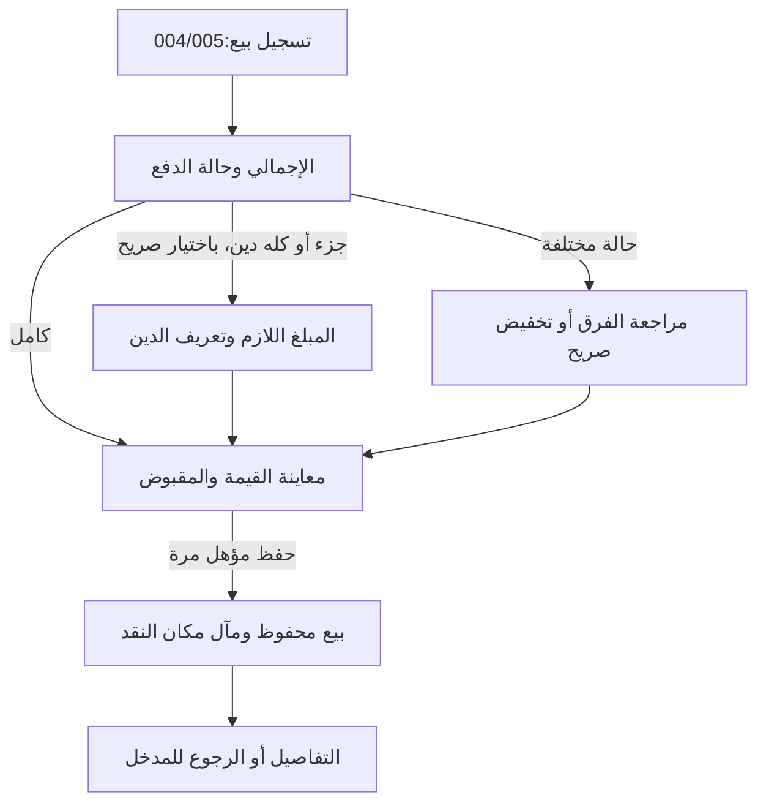
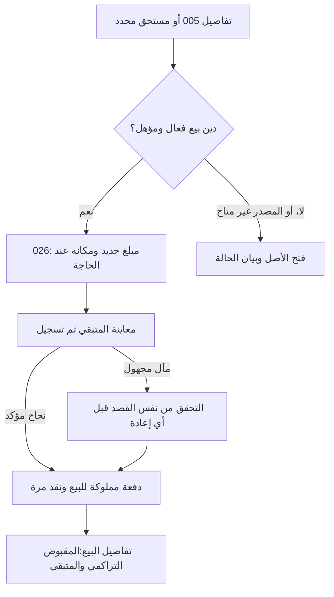

# JRN-003 — البيع المباشر وتحصيل المتبقي

**النسخة:** V3 · **التاريخ:** 2026-10-26 — عمّان.
**الحالة:** معتمد من المالك في نطاق CONS-DEC ذات الصلة؛ التفاصيل غير المغطاة بحدودها. التنفيذ والاختبار لم يبدآ، ولا إغلاق شامل.

**المهمة:** «أُسجل بيعًا تم، وما استلمته منه وما بقي على العميل، ثم أحصل الباقي أو أصحح خطأً في السجل دون تسجيل البيع مرتين».

**طريقة القراءة:** A التجربة الأبسط، B الدخول والمسارات، C المدخلات والأثر، D الحالات الاستثنائية والتصحيح، E الملكية وإزالة التكرار، F بوابات التنفيذ، G فحوص القبول. ملف المكوّن يملك سلوكه، وهذه الوثيقة تربط أصحاب البيانات والأفعال.

**المراجع:** [فهرس الرحلات](00-JOURNEYS-INDEX-AR.md) · [التنقل](../00-System-Navigation-Master-AR.md) · [أول استخدام](01-First-Use-and-First-Task-AR.md) · [رحلة الطلب](02-Customer-Order-Lifecycle-AR.md) · [004 العرض المختصر](../../03-New-Design/UNIT-004-التسجيل-السريع.md) · [005 البيع](../../03-New-Design/UNIT-005-البيع-المباشر.md) · [026 الدفعة](../../03-New-Design/UNIT-026-تسجيل-دفعة-على-مستحق.md) · [017 السجل](../../03-New-Design/UNIT-017-سجل-العمليات.md) · [024 مكان النقد](../../03-New-Design/UNIT-024-تحديد-مكان-النقد.md) · [037 العملاء](../../03-New-Design/UNIT-037-العملاء-والموردون.md).

## DATA-01 — بوابة البيانات المشتركة لكل النظام —2026-10-26

**الحالة:** مواصفات المنتج والقواعد المالية المعتمدة مرجع وظيفي؛ لا مخطط بيانات موحدًا مفحوصًا أو تصريح تنفيذ مستقل لهذا الملف. مراجعة التخزين والعلاقات والقواعد التقنية تشمل45 UNIT و10 رحلات، ثم يثبت العقد المشترك قبل تنفيذ الآثار المتأثرة. [DATA-01: النطاق والخطة والبوابة](../../01-Standards/02-System-Data-and-Financial-Readiness-AR.md#data-01-gate).

**المرحلة الحالية:** محلية على الجهاز. التوافق مع سحابة وAuthentication وAuthorization اتجاه مستقبلي للفحص، وليس إطلاقًا لها الآن. لا جداول مفروضة لكل مكوّن، ولا حساب دخول/أدوار/مزامنة/قفل جديد. تبقى حالة كل قدرة وإلغائها أو تأجيلها نافذة.

## مقابل JRN-010 —2026-10-26

تفصيل بيع أو تحصيل ضمن فترة سابقة يحفظ تغطية المجموع والقبضة والذمة والتكلفة مرة؛ لا ملخص بتاريخ اليوم أو مجموع قبض قديم بدفعة وهمية.

**المصدر:** [الرحلة010](10-Account-Completion-and-Return-AR.md) و[002](../../03-New-Design/UNIT-002-استكمال-بيانات-المشروع.md#accounts-completion-20261026). هذه مقابلة ربط محددة، لا إعادة اعتماد فحوص الرحلة أو تشغيلها، ولا تغيير لمعرفاتها السابقة.

## اعتماد القرارات وتحديث أثرها على الرحلة —2026-10-26

**دليل الاعتماد:** قال المالك: «أنا موافق مية بالمية على كل اقتراحاتك»، ثم طلب صراحة تحديث القرارات التسعة أولًا. تاريخ التثبيت 2026-10-26، عمّان. يشمل الاعتماد التوصيات CONS-DEC01..09 ونطاقها وحدودها؛ لا يحتاج إعادة سؤال نفس القرارات. لا يتحول إلى اعتماد كل عبارة قديمة أو اختيار تفاصيل تخزين أو تصريح تنفيذ منتج.

**سجل تاريخي عند تثبيت القرارات التسعة، قبل اعتماد ACC-01/JRN-010 الأحدث أعلاه؛ لا يعمل كتعليمات حالية:** موضوع العودة بعد الانقطاع ومحاكاة جلسة النقاش ما زالا للنقاش، وليسا معتمدين أو مضافين في هذه الدفعة. «سجّل الموجود الآن» معتمد سابقًا ضمن CONS-DEC03 فقط؛ لا يثبت رحلة تعافٍ من انقطاع أو تحديد فترات مفقودة أو تسوية ديون/مخزون جماعية أو تاريخ تقريبي للعمليات. لا نُنشئ ملفًا لهذه الرحلة أو نصًا واجهيًا لها الآن.

**درجات الحالة:** المعنى والنطاق المعتمدان ثابتان؛ التهيئة الهندسية والمواصفة الإضافية للقياس/المرتجع عند لزومها، ثم التنفيذ، ثم التحقق والإغلاق حالات مستقلة. لا كود معدل أو اختبار ناجح من اعتماد الملف.

**المرجع:** [القرارات المعتمدة](../02-Consistency-Review-and-Decisions-AR.md#cons-decisions-approved-20261026).

| القرار | ما أصبح معتمدًا في هذا النطاق | الحالة |
|---|---|---|
| CONS-DEC01 | اعتماد التجربة المختصرة: اسم المشروع وحده للبداية، ونوع النشاط اختياري. الرئيسية للأفعال والمتابعة واللمحة، والمالية مدخل مختصر مع وظائف منظمة، والطلبات قائمة وتقويم لنفس المصادر. الإضافي عند الحاجة، ولا نموذج تفاعلي مستقل الآن. التحصيل لمستحق واحد محدد دون توزيع تلقائي، وحفظ الطرف أو المنتج لإعادة الاستخدام صريح واختياري. | معتمد من المالك؛ التنفيذ لم يبدأ |
| CONS-DEC02 | إظهار المعلومات المعلومة مع حدودها؛ نتيجة الفترة الكاملة غير محددة عند نقص بيانات مؤثرة. النتيجة الجزئية تسمى بنطاقها ولا تقدم ربح الفترة أو حدًا أدنى له. التقدير والاستبعاد الصريح مختلفان عن المجهول. التكلفة التسعيرية لا تكتب مصروفًا أو حق مالك تلقائيًا، ونفس الجزء المالي يحتسب مرة واحدة. تنسق سياسة 503 والقراء والميزانية والمخزون والمعدات وحقوق المالك قبل التنفيذ. | معتمد من المالك؛ التنفيذ لم يبدأ |
| CONS-DEC03 | اعتماد نطاق «سجّل الموجود الآن» كقياس نقد حالي مؤرخ عند الحاجة، مستقل عن افتتاح تاريخي أو إيراد أو مساهمة مالك. لا استنتاج للماضي ولا تسوية إلى صفر. هذه قدرة معتمدة تحتاج عقد قياس وتغطية وتصحيح وقراءة ونقل قبل إتاحتها. الحرس الحي يفرق المعلوم والمجهول وفشل القراءة؛ لا مال أو مصدر تمويل مختلق لتجاوز نقص الرصيد. | معتمد من المالك؛ التنفيذ لم يبدأ |
| CONS-DEC06 | الوقائع المالية التي حدثت تسجل بتاريخ اليوم أو تاريخ سابق حقيقي؛ المستقبل موعد أو تذكير أو اتفاق لا قبض/دفع منجز. تاريخ البيع أو الاتفاق منفصل عن كل دفعة ووقت توثيقها. تعديل التكرار يؤثر افتراضيًا على الدورات المستقبلية غير المعالجة؛ السابق يراجع صراحة. ربط مصروف مسجل بدورة لا يكتب مصروفًا جديدًا. لا تاريخ وهمي أو إعادة تأريخ تلقائية للقديم. | معتمد من المالك؛ التنفيذ لم يبدأ |
| CONS-DEC07 | سعر نهائي موجب للبيع المعتاد، بنفس القاعدة في الإنشاء والتعديل. المستخدم حر في السعر، ولا تفرض نسبة ربح أو عتبة هدف كسعر إلزامي. الانخفاض عن الهدف ليس خسارة مؤكدة؛ يظهر أثر التكلفة ومعرفتها بصدق. المعاملة المجانية خارج المسار المعتاد حتى تصميمها صراحة، ولا سعر وهمي للتحايل. هامش من سعر البيع يختلف عن الزيادة على التكلفة. | معتمد من المالك؛ التنفيذ لم يبدأ |
| CONS-DEC08 | اعتماد ضرورة تصميم الإلغاء الحقيقي ورد المقدم/المبلغ من مصدره والمرتجع الكامل المؤهل قبل الإطلاق؛ المرتجع الجزئي والتقسيم المعقد مؤجلان إلى عقد مستقل. الموافقة على النطاق لا تعني جاهزية مواصفة الرد أو العكس أو المخزون. التصحيح الخاطئ مختلف عن رد مال حقيقي، ولا رد يتجاوز المقبوض أو عودة مخزون من مجرد رد المال أو إغلاق طلب يحبس حق العميل. | معتمد من المالك؛ التنفيذ لم يبدأ |

**المسار المستهدف بعد الاعتماد:** بيع مدفوع/جزئي/آجل، ثم تحصيل من مستحق واحد دون إيراد جديد. السعر موجب، وتاريخ القبض مستقل، والنتيجة بحدود التكلفة، وتصحيح الخطأ ليس مرتجعًا حقيقيًا.

**البوابات والقبول:** كل بوابة أدناه كانت تنتظر موافقة على أحد هذه القرارات أصبحت تنتظر التجهيز والتحقق في حد القرار نفسه؛ لا سؤال مالك متكرر ولا حذف للبوابة. المخطط والكاتب والقارئ والتصحيح والمعرفة والرجوع والنسخ، ثم اختبار الهاتف، باقية. قبول النطاق لا يجعل القياس الجديد أو المرتجع جاهزين للتنفيذ.

**حالة المتن السابق:** خطواته وفحوصه محفوظة؛ الحكم الأقدم المتعارض مع بطاقة معتمدة تاريخي في هذا الحد. الرحلة ليست كودًا منفذًا أو نتيجة اختبار؛ الإضافات المستقلة لم تعتمد تلقائيًا.228 قبولًا مخططًا ومعرفات J001..J009 محفوظة.

## A. أبسط تجربة مقترحة

### A1. البيع المعتاد في نموذج واحد

1. يفتح **تسجيل بيع** من الرئيسية أو المالية.
2. يدخل **إجمالي البيع** ويحدد حالة الدفع الظاهرة. عند القبض الجزئي يظهر حقل المبلغ الذي استلمه فقط، وعند دين جديد يظهر تعريف بسيط لصاحبه.
3. يضيف التكلفة إن عرفها، أو يتركها **غير معروفة**؛ الوصف والمنتج المحفوظ والتفاصيل عند الحاجة.
4. يراجع سطرًا مختصرًا للقيمة والمقبوض والمتبقي ومكان النقد عند انطباقه، ثم **حفظ البيع** مرة واحدة.
5. عند دفع العميل لاحقًا: يفتح البيع أو المستحق المحدد، ثم **تسجيل دفعة**. المصدر معروف؛ يدخل المبلغ الجديد دون إعادة العميل أو إجمالي البيع.

لا طلب أو اتفاق أو تجهيز أو تسليم لتوثيق بيع تم مباشرة. لا نوسع 005 إلى فاتورة متعددة المنتجات أو محرر تكلفة طلب كامل في هذه الرحلة. أدوات التخطيط 031 مستقلة، والمنتجات 029 والمخزون 028 قدرات اختيارية.

### A2. دمج قرار الدين في اختيار الدفع

بدل سؤال كل مستخدم عن الفرق بعد اختيار «دفع جزئي»، توصي الرحلة بثلاثة اختيارات واضحة:

| الخيار المقترح في «الدفع» | ما يطلبه النموذج | ما يعنيه الاختيار |
|---|---|---|
| **استلمت كامل المبلغ** | لا حقل مبلغ قبض ثانٍ؛ المبلغ مساوي لإجمالي البيع ظاهر في المعاينة | قبض كامل مصرح به، وليس استنتاجًا من حقل فارغ |
| **استلمت جزءًا والباقي دين** | **المبلغ المستلم** ثم تعريف صاحب الدين إن لم يوجد | المستخدم اختار الدين صراحة في اسم الخيار؛ لا سؤال تصنيف ثانٍ لنفس المعنى |
| **لم أستلم والمبلغ دين** | تعريف صاحب الدين؛ لا إجبار إدخال 0 في حقل قبض | المقبوض 0 مقصود، وكل قيمة البيع دين؛ لا مكان نقد لقبض لم يقع |

القبض الكامل افتراضي ظاهر مقترح من 005 ، وليس معلومة محفوظة قبل التأكيد. خيارا الدين لا يختاران تلقائيًا لأن المبلغ أقل من السعر أو لأن العميل له دين قديم. تغيير الإجمالي يعيد معاينة الأثر ولا يغيّر مبلغًا جزئيًا كتبه المستخدم بصمت.

**حالة مختلفة؟** مدخل ثانوي عند الحاجة يكشف المسار الموجود لتسجيل فرق غير محسوم أو تخفيض سعر إلى المقبوض. لا يلغي هذين المعنيين أو سجلاتهما، ولا يجمع تخفيضًا ودينًا لنفس الفرق. يحتفظ النموذج بمدخلات الخيارات غير النشطة للاستعادة بحسب 005 ، لكن يحفظ ويتحقق من الحالة النشطة وحدها.

هذا تبسيط تفاعل مقترح، لا تحويل كل بيع جزئي إلى دين بالافتراض، ولا تغيير لحساب الفرق أو سياسة تصحيح القبض. تجهيز تطابق العرض المختصر والكامل والكاتب شرط J003-G01.

### A3. المعلومات على الهاتف

| الظاهر في البداية | عند الحاجة | ما لا نفرضه |
|---|---|---|
| إجمالي البيع، حالة الدفع، تاريخ اليوم ظاهر قابل للتغيير، تكلفة غير معروفة مع **إضافة**، حفظ | مبلغ جزئي، تعريف دين، مكان مبلغ مقبوض، وصف/منتج/كمية، حالة الفرق المختلفة | عميل محفوظ أو هاتف أو منتج أو مخزون أو تكلفة معلومة أو خطوات طلب |
| قبل الحفظ: القيمة والمقبوض وحالة الباقي، ومكان النقد عند وجوده | أثر تخفيض أو تعديل، سبب نقص النتيجة، تفاصيل التكلفة | شاشة تأكيد ثانية لكل بيع، أو فقرات تحذير وتعليم مالي |
| بعد الحفظ: **سُجّل البيع** والمبالغ الفعلية ومآل المكان؛ **عرض البيع** و**تم** | معالجة مكان لم يكتمل، سجل التغييرات، التصحيحات المؤهلة | إعادة عرض نموذج إنشاء عند فتح سجل قائم، أو مهمة مالية مصطنعة لبيع محصل |

المساعدة العامة خلف ! مسمى، مع ترك الخطأ الفعلي والمبلغ والأثر الحالي ظاهرًا باختصار. العربية RTL وأرقام 0–9 والدينار والمكتبة المرئية الحالية؛ لا هوية جديدة أو شرائح تصفية دائمة أو تبويب جديد.

## B. الدخول والعودة وخرائط المسار

### B1. المداخل

| المدخل | ما يفتح | إلى أين يرجع؟ |
|---|---|---|
| الرئيسية 003 — تسجيل بيع |004 عرض مختصر لنفس نموذج/قصد/كاتب 005 |الرئيسية بفترتها وموضعها؛ النتيجة تحدث القراءة فقط |
| المالية 013 — تسجيل بيع |نفس البيع 005 بالعرض الذي يحدد عقده؛ لا نوع «بيع مالي» ثانٍ |المالية بسياقها، ولوحة الوظائف مغلقة بعد اختيار المصدر وفق ACCESS-01 |
| تفاصيل إضافية من 004 |005 بنفس المدخلات الخام والمعرفة والقصد والوجهة |إلى سياق الإنشاء نفسه ثم المدخل الخارجي، لا تسليم جلسة ينسخ بيعًا محفوظًا |
| منتج 029 اختاره المستخدم صراحة |إنشاء 005 مع اقتراح معلوم المصدر والنطاق |029 أو إطار الفتح القانوني؛ لا حفظ بيع من اختيار المنتج |
| سجل 017 أو حساب 037 أو متابعة مؤهلة |تفاصيل 005 للسجل الحقيقي، ثم 026 عند دين مؤكد مؤهل |005 أولًا بعد الدفعة، ثم مصدر الفتح الفعلي ببحثه ومرشحاته |
| رابط بيع قديم أو رابط تحصيل محدد |الأصل نفسه بعد قراءة وحرس المصدر |رجوع قانوني؛ لا تحويل صامت إلى إنشاء أو إلى دين آخر |

**موطن البيع المباشر المالية وسجلها** حسب NAV الحالي؛ 006 وجهة الطلبات، ولا تعيدها نصوص تنظيم قديمة إلى قائمة مبيعات موازية. أي مدخل قديم يحتاج انتقالًا متوافقًا إلى 005 أو 017 دون فقد المصدر أو الرجوع، وليس حذف بيع أو إنشاء طلب له.

فتح صفحة 005 الكاملة يطابق وجهتها في الشريط عند ظهوره، لكن الرجوع يحتفظ بالمدخل الفعلي. الورقة المختصرة داخل الرئيسية لا تنقل الصفحة من تلقاء نفسها. فتح 026 ثم رجوع يعيد تفاصيل البيع قبل الرجوع إلى 017/037/003 ؛ لا نتجاوز المصدر أو نفتح محررًا متسخًا صامتًا.

### B2. إنشاء البيع والفرق

اختيار وضع الدفع قرار إدخال فقط، لا قبض أو دين قبل الحفظ. المخزون والتكلفة والتاريخ يخضعون لعقودهم؛ لا يعوض ناقص ب 0 أو سجل صوري لتجاوز الكاتب.

### B3. الدفعة اللاحقة

سهم التحقق إلى النجاح مشروط بثبوت النتيجة؛ إن ثبت عدم الالتزام أو تعذر التحقق يبقى المخرج حسب حالته. استرداد قصد محفوظ يسبق أهلية **دفعة جديدة**؛ اكتمال التحصيل قد أخرج الأصل من قائمة الديون، لكنه لا يمحو نتيجته السابقة.

## C. المدخلات والمخرجات والأثر

### C1. الحقول الضرورية ومعانيها

| القيمة/الفعل | المصدر والافتراضي | التحقق وما يُحفظ |
|---|---|---|
| إجمالي البيع |005 ؛ فارغ قبل الإدخال |قيمة المعاملة كلها، موجبة وصحيحة حسب وحدة المال؛ لا سعر وحدة يتغير مع كمية توثيقية |
| حالة الدفع |005 ؛ الكامل ظاهر مقترح، مع مراجعة المستخدم |وضع فعال واحد؛ خيار الدين صريح لا مشتق من الفارق وحده |
| المقبوض الجزئي |يظهر عند الجزء؛ فارغ |أكبر من 0 وأقل من الإجمالي في مسار الجزء؛ مساواة الإجمالي/صفر يوجهان للوضع المطابق دون تغيير صامت للنص |
| الفرق/الدين |مشتق من إجمالي صحيح ناقص المقبوض الصحيح |دَين أو مراجعة أو تخفيض بمعناه المحدد؛ لا قيم متنافسة أو جمع حالات للفرق نفسه |
| تعريف صاحب الدين |نص محلي صالح أو عميل 037 مختار؛ دون افتراض عميل سابق |وفق 037 المعتمد: تعريف بسيط للمستحق الجديد دون ملف دائم/هاتف إجباري. لا إعادة الاسم في 026 ولا دمج أشخاص بالنص |
| مكان القبض |022 للقراءة و 024 لعقد الربط؛ عند قبض موجب فقط |اختيار ظاهر مشروع أو **لم أحدد المكان** وفق المصدر؛ لا محفظة وهمية 0 أو قبض من التخصيص أو إسناد تاريخي تلقائي |
| إجمالي تكلفة هذا البيع |غير معروفة، أو مبلغ صريح غير سالب |0 المدخل عمدًا يختلف عن المجهول؛ الكتالوج اقتراح لا دليل معرفة أو تكلفة فعلية بمفرده |
| تاريخ البيع |اليوم المحلي ظاهر، قابل للتغيير وفق 005 |يحفظ تاريخ العملية بمعناه، لا تاريخ القبض أو updatedAt بالاستبدال. سياسة المستقبل U005-D08 ببوابتها |
| وصف/منتج/كمية |اختيارية؛ كمية توثيقية ضمن نطاق 005 |الكمية لا تضرب إجمالي البيع أو تكلفته آليًا؛ نطاق اقتراح 029 يراجع أولًا، ولا يحول البيع إلى طلب مجموعات |
| حفظ البيع |قصد إنشاء واحد عند 005 ؛ 004 عرض له |بيع ومعرفة وقبض فعلي بحسب التصريح، ومآل تخصيصه معلوم؛ لا مال من الفتح أو مغادرة النموذج |
| دفعة لاحقة |026 ينظمها؛ 005 يملك السجل/القبض |مبلغ فعلي جديد 0<M≤المتبقي الحي؛ سطر/مرجع موثق وفق المخطط المجهز، لا جدول قبض مالي منافس |
| تصحيح |صاحب القيمة أو القبض/المكان |نية وسبب ومعاينة عند أثر مالي، ونسخة ومآل وتاريخ محفوظ؛ لا استعمال تعديل عام لتسجيل دفعة |

**فروق المعنى التي نحافظ عليها:** إجمالي البيع والمقبوض والدين والفرق غير المحسوم قيم مختلفة. التحصيل اللاحق يزيد المقبوض ويقلل الدين ولا يزيد إيراد البيع ثانية. تكلفة غير معروفة لا تمنع البيع المباشر وفق 005 ، وهذا لا يختار سياسة نتيجة الفترة 503. موافقة J002-DEC01/02 تخص اتفاق الطلب ولا تعتمد باقي سياسات 005/026 تلقائيًا.

### C2. أمثلة يجب أن تعطي نفس النتيجة في العرض المختصر والكامل

| المدخل/الحدث | إجمالي البيع | المقبوض التراكمي | الدين/الحالة | حركة النقد الجديدة |
|---|---:|---:|---|---:|
| بيع 15.00 مدفوع بالكامل |15.00|15.00|لا دين|+15.00|
| بيع 15.00 ، استلم 5.00 والباقي دين |15.00|5.00|دين 10.00|+5.00|
| بيع 15.00 ، لم يستلم والمبلغ دين |15.00|0.00|دين 15.00|0.00|
| دفعة 4.00 لاحقًا على المثال الجزئي |15.00|9.00|دين 6.00|+4.00|
| دفعة 6.00 أخرى |15.00|15.00|اكتمل تحصيل هذه العملية|+6.00|
| اختلاف لم يحسم:بيع 15.00 وقبض 5.00 |15.00|5.00|فرق 10.00 يحتاج مراجعة؛ ليس دينًا مؤكدًا|+5.00|
| تخفيض صريح إلى المقبوض 5.00 |5.00|5.00|مقبوض كامل، والسعر السابق في السجل|+5.00 عند الإنشاء فقط|

التخفيض على بيع محفوظ لا يقبض 5.00 مرة ثانية؛ يعاين أثر تصحيح السعر ويحتفظ بالمقبوض الفعلي. التخفيض إلى 0 ومعاملة سعر أقل من قبض قائم لا تعمم من المثال؛ U005-D05 والتصحيح عند G06. لا قرض أو رصيد دائن أو توزيع زائد تلقائي إذا تجاوزت الدفعة المتبقي.

إذا كانت التكلفة المعلومة 9.00 وإجمالي البيع 15.00 ، فنتيجة البيع بحسب هذه التكلفة 6.00 ؛ قبض 5.00 بدل 15.00 لا يغيرها إلى−4.00 أو 6.00 أخرى من التحصيل. ليست هذه صافي نتيجة المشروع أو إثباتًا بدفع التكلفة. مصدر تكلفة/مخزون/فاتورة الفترة لا يخصم مرة ثانية من 013/016 بسبب تكرار المدخل في 005 ؛ سياسة التغطية والاعتراف عند أصحابها و 503 ، ولا نطرح كلفة قديمة تخمينًا.

### C3. نتيجة الحفظ والتفاصيل

نجاح الإنشاء يعرض القيمة والمقبوض وحالة الباقي من النتيجة الملتزمة، لا من نموذج تغير بعد الإرسال. **تم** يعيد المدخل، و**عرض البيع** يفتح 005. فشل تحديث 003 أو 013 بعد نجاح 005 خطأ قراءة منفصل، وليس سببًا لحفظ البيع ثانية.

عند العودة لسجل قائم تكون البداية **تفاصيل البيع** للقراءة، لا نموذج تعديل مفعل. يظهر **إجمالي المقبوض حتى الآن**، وليس «استلمت الآن» لقيمة تراكمية. إذا بقي دين مؤكد يظهر **تسجيل دفعة**؛ إذا فرق غير محسوم يظهر **مراجعة الفرق**؛ إذا اكتمل التحصيل لا نخلق فعلًا ماليًا جديدًا. الملغى للقراءة وتصحيحاته المسموحة فقط.

فشل الربط بعد ثبوت القبض يظهر «سُجّل البيع؛ تحديد مكان المبلغ لم يكتمل» مع إصلاح 024 من مبلغ/مرجع القصد المحفوظين. مبلغ قبض 5.00 قد أصبح إجمالي المقبوض بعد دفعات أخرى 15.00 ؛ إصلاح مكان القبضة الأولى يظل 5.00 ، لا 15.00. تغيير مكان قبض صحيح لا ينقص المقبوض أو يزيد الدين، ولا يمثل رد مال أو نقل نقد فعلي 023.

### C4. التاريخ: منع خطأ صامت في كشف الفترة

تاريخ البيع يختلف عن تاريخ كل دفعة، وعن وقت إدخال السجل. الدفعة الجديدة من 026 تخضع لنطاق وقته المقترح D04 ، فلا تنسب لتاريخ بيع قديم أو updatedAt لأنه أسهل للقراءة. سطر قبض مملوك للمصدر وهوية ومبلغ وتاريخ مثبتان مطلوبون G03/G04 ؛ تجميع المقبوض لا يكفي لاختلاق مواعيد دفعات قديمة.

**توصية للقبض الأول في بيع يسجل بتاريخ سابق:** إن لم يثبت أن القبض حدث يوم البيع، يعرض عند الحاجة **تاريخ استلام المبلغ** ليحدده المستخدم:يوم البيع/اليوم/تاريخ آخر صالح؛ لا سؤال جديد لبيع اليوم المعتاد ولا تاريخ قبض افتراضي خفي لبيع قديم. هذا امتداد مقترح مشروط بتعريف الكاتب والمخطط وسياسة التأريخ G04 ، لا قدرة جاهزة أو سماحًا عامًا بإعادة تأريخ 026. إذا لم يجهز العقد لا يعد التقرير التاريخي دقيقًا من هذا الإدخال أو يسند المبلغ تخمينًا؛ يعلن حد المعرفة ويثبت البديل قبل الشحن.

القديم الذي لا يثبت سوى إجمالي المقبوض يبقى بهذه الحقيقة وحدودها. لا ننشئ إيصالات تاريخية من reason أو فرق تجميعي أو ترتيب المراجعات، ولا نغير رقمًا تاريخيًا تلقائيًا لتعبئة فترة. مواصفات 017/016 و 026-D02/D04 والتخزين و 044 يجب أن تتوافق. السياسة U005-D08 لمنع تاريخ بيع مستقبلي ما زالت غير معتمدة؛ طبيعة الرحلة بيع تم، لكنها لا تمنح المنفذ إذن منع جديد أو ترحيل إلى طلب من تلقاء نفسه.

## D. الفشل والرجوع والتصحيح

| الحالة | السلوك والمخرج المطلوب |
|---|---|
| فتح إنشاء ثم إلغاء |لا بيع أو قبض؛ يحفظ/يتجاهل المدخلات حسب عقد 005 ، لا تسجيل مالي من زر مغادرة |
| توسيع 004 أو الرجوع من التفاصيل |نفس المدخلات الخام والعميل والمعرفة والقصد والمرحلة؛ لا إعادة ضبط أو مسودة إنشاء ثانية |
| تبديل الدفع/الإجمالي/حالة الفرق |المعاينة تعاد للفعال فقط؛ لا مبلغ مخفي يدخل الحساب، ولا قص قبض أو اختيار دين/تخفيض تلقائي |
| فشل الحفظ أو حفظ مسودة الإدخال |مدخلات باقية وخطأ صادق؛ لا ادعاء بقاء المدخلات بعد إغلاق إذا تعذر حفظها |
| مآل حفظ مجهول/ضغط متكرر |تحقق نفس المفتاح/الحمولة قبل إنشاء أو قبض آخر؛ لا مفتاح جديد لتجاوز الشك |
| تعارض نسخة أو نافذتين |يبقى النص، وتقرأ النسخة الحية ويظهر الفرق المطلوب مراجعته؛ لا رفع revision ثم سحق السجل |
| فشل قراءة بيع/دين/أماكن النقد |تعذر القراءة ليس سجلًا مفقودًا أو 0 محافظ أو دينًا 0. المصدر المحدد لا يستبدل بدين آخر بصمت |
| مكان لم يحدد بعد قراءة سليمة |يجوز القبض حيث يسمح عقده دون مكان؛ لا صندوق 0 أو مال مالك من بدء العملية |
| قبض ملتزم وربط مكان فشل |تصلح 024 الخطوة التابعة فقط؛ لا إعادة 005 أو 026 ، ولا مبلغ مأخوذ من UI تغير بعد الالتزام |
| تحصيل كامل ثم إعادة نفس القصد |تسترد نتيجة الدفعة حتى لو لم يعد البيع في قائمة القابل للتحصيل؛ لا «غير موجود» يدفع المستخدم لقبضه مجددًا |
| فرق يحتاج مراجعة |يبقى بهذه الحالة، ولا يفتح 026 كأنه دين. قرار الدين/التخفيض لاحقًا عند 005 بمعاينة وأهلية المصدر |
| دين قديم بلا تعريف |يبقى قابلًا للقراءة وتحصيل مصدره المؤهل دون إجبار إنشاء عميل رجعي؛ لا دمج أسماء أو تقدير هوية |
| منتج مفقود/مؤرشف أو اقتراح وصل متأخرًا |يحفظ بيانات البيع القائمة، ويتيح تصحيح الربط وفق المصدر؛ لا سعر 0 أو تكلفة معلومة تلقائية أو بيع بديل |
| سجل محفوظ/ملغى أو رابط مجهول |عرض الحالة الفعلية أو سبب التعذر والعودة؛ لا إنشاء من ID غير موجود، ولا تحصيل جديد على ملغى |
| خطأ في الوصف/التكلفة/التاريخ |تعديل البيانات عند 005 ؛ معاينة أثر مالي إن انطبق، دون قبض أو إعادة إيراد كواقعة جديدة |
| عميل دفع الآن |026 للدفعة المؤهلة؛ لا تعديل إجمالي المقبوض في محرر البيانات العام |
| قبض صحيح في مكان خاطئ |024 لتصحيح النسبة/الربط بعقده؛ لا عكس قبض أو زيادة دين أو تحويل نقد فعلي لم يقع |
| سُجّل قبض لم يحدث |تصحيح قبض مصدره 005 بمعاينة قبل/بعد وأثر المكان وقرار الفرق بحسب G06 ؛ لا افتراض أن كل فرق جديد دين |
| سجل بيع أُدخل خطأ |إلغاء تسجيل موثق وأثره المحفوظ؛ لا حذف نهائي أو إعادة المبلغ «غير موزع» بالافتراض. التعافي من عكس تخصيص ناقص منفصل |
| إرجاع بضاعة ورد مال حقيقي |ليس إلغاء تسجيل خاطئًا أو تغيير مكان. سياسة المرتجعات U005-D07 غير مكتملة؛ لا ندعي دعمها أو نكتب قبضًا سالبًا عامًّا |
| بيع ربط باستهلاك يدوي سابق |قراءة حركاته من 028 ؛ إلغاء 005 لا يرجعها تلقائيًا ولا يخفي أثرها. التصحيح عند صاحب الحركة، ولا تكلفة مرتين |
| استعادة نسخة مشروع آخر أو مسودة قديمة |تحقق الهوية والنسخة والمآل وفق 044 قبل الاستئناف؛ لا عميل أو مبلغ أو قصد قبض ينقل إلى مشروع مختلف |

مسودة الإدخال المؤقتة ليست بيعًا محفوظًا في السجل، وحفظها لا يغير أي إجمالي مالي. فتح المساعدة أو لوحة التصفية أو العودة من المصدر لا يعيد نجاحًا قديمًا أو يكتب عملية. تحصيل مخصص جزئي أو عكسه ليس مدعومًا لمجرد أن المجال يملك حساب مبلغ؛ يثبت عقد الكتابة والربط والتصحيح قبل تفعيل الفعل.

## E. الملكية وإزالة التكرار مع السبب والبديل

| ما يبقى وأين؟ | ما نزيله أو ندمجه؟ ولماذا؟ | ما يجب تجهيزه وحفظه؟ |
|---|---|---|
|005 بيع واحد و 004 عرضه المختصر |نموذج مالي/كاتب/مسودة مختلفة للواجهة السريعة؛ لأنها نفس العملية وتختلف مساحة العرض فقط |عقد نقل raw/معرفة/قصد/مرحلة وعودة؛ لا كتابة مالية من النقل أو مسودة ثانية |
|اختيار الدفع يتضمن التصريح بالدين |سؤال تصنيف فرق ثانٍ في المسار المعتاد الذي اختار دينًا صراحة؛ لأنه يطلب القرار نفسه مرتين |الاسم الكامل للخيار ظاهر، ومطابقة 004/005/الكاتب؛ يبقى المسار الثانوي للمراجعة والتخفيض |
|037 مرجع اختياري وتعريف محلي على المستحق |إعادة إنشاء عميل لكل بيع أو اختيار العميل ثانيًا في 026 ؛ لأنه يعيد تعريف نفس الحق وقد يجزئ حسابه |معرف اختياري ولقطة اسم محلي؛ لا دمج نصي أو فرض حفظ، ولا وراثة مبلغ/موعد من عملية قديمة |
|005 أصل البيع و 026 منسق الدفعة |كاتب تحصيل آخر أو قيد إيراد عام عند قبض دين؛ لأنه يكرر النقد/الإيراد |هوية دفعة من مالك البيع وأهلية وقصد ومآل وعكس؛ تبقى إجماليات 005 مصدرًا واحدًا |
|024 نسبة مبلغ قبض مثبت لمكانه |قبض آخر عند إصلاح المكان أو تغيير المكان بعكس القبض؛ لأنه يغير حقيقة مالية صحيحة لإصلاح تصنيف |سطر/مرجع مصدر فعلي ومبلغ ثابت، ونتيجة ربط مستقلة؛ لا جمع إجمالي القبض فوق سطوره |
|017 سجل موحد، 005 تفاصيل وتصحيح |قائمة بيع أو إيصالات مالية موازية في كل وجهة؛ لأن اختلاف العرض لا يحتاج تخزينًا أو مصدرًا آخر |تكافؤ البحث والفتح والتاريخ والرجوع قبل إزالة عرض قديم؛ لا «معلّق 15» بدل دين 10 |
|029 اقتراح و 005 لقطة عملية |تحديث سعر/تكلفة بيع سابق من المنتج أو ضرب الكمية في إجمالي مكتوب؛ لأنه يعيد تسعير التاريخ أو يضاعف الرقم |نطاق الاقتراح ومصدره ومعرفته ومراجعة واعية، وحفظ كتالوج صريح منفصل عن البيع |
|028 استهلاك اختياري و 013/016 نتيجة من مصادرها |استهلاك من مجرد ربط منتج، أو مصروف عام ثانٍ لنفس تكلفة البيع؛ لأنه يكرر الكمية أو يغطي التكلفة مرتين |معرف مصدر/تغطية وسياسة معرفة، لا طرح تكاليف قديمة مجهولة التقسيم أو حذف مادة لتطابق اسم |
|JRN-002 للطلب و JRN-003 للبيع الذي تم مباشرة |إجبار بيع على خطوات اتفاق/تنفيذ/تسليم، أو تسجيل 005 بعد تسليم طلب قائم؛ لأنه يعيد العمل أو نفس الواقعة |مداخل مسماة ومصادر مختلفة، وتتبع علاقة فعلية فقط إن وُجدت؛ لا تحويل تلقائي أو إنشاء سجل ثانٍ |

التكرار السياقي للمبلغ أو المدخل قد يخدم المهمة، ولا يُحذف لمجرد ظهوره مرتين؛ الإزالة لمصدر متنافس أو إدخال/قرار مكرر بلا حاجة. الجدول يستعمل عائلات DUP القائمة ولا ينشئ عائلة جديدة. لا إزالة قبل تجهيز البديل والعقد والقبول والمصدر والعودة، ولا يكفي إخفاء زر لإغلاقها.040 ملغى بالكامل؛ لا مشاركة/نسخ رسالة بديلة من نتيجة القبض.

## F. بوابات التنفيذ والقرارات

| البوابة | ما يجب تجهيزه/حسمه | درجة القرار والحد |
|---|---|---|
| J003-G01 — نموذج واحد وتصريح الدفع |004/005:عرض مختصر وكامل، نقل المدخلات والقصد، خيارات الدفع المبسطة والمسار الثانوي، وصفحة تفاصيل منفصلة عن وضع التحرير |النواة المشتركة معتمدة تنظيميًا؛ اختيارات هذه الرحلة وتفاصيلها مقترحة. لا إلغاء review/price_cut أو دين من مبلغ ناقص دون قصد |
| J003-G02 — تعريف الدين والاقتراح |005/037/029/038:تعريف بسيط للمستحق وفق 037 ، جهة/منتج محفوظان اختياريان، معرفة التكلفة ونطاق اقتراح الكتالوج والتجاوز المحلي للتفضيل |اتجاه 037 المعتمد يسري على ما يتعارض معه من وصف D03 القديم في نطاقه فقط؛ لا قرار مالك جديد لفرض ملف دائم أو دمج أسماء. بقية الأنواع والجسور/التغطية تحتاج تجهيزًا |
| J003-G03 — القبض والتحصيل ومكانه |005/026/022/024:هوية قصد ونتيجة قبض وسقف حي وسطر ثابت مملوك للنوع، قراءة المآل قبل الأهلية، وتعافي نجاح جزئي |ORG-012 و U026-D01..05/024 بدرجاتها؛ المواصفة لا تعتمد توسعة نطاق أو ضمان ذرية أو تصحيح جزئي. لا جدول قبض موازٍ أو revenue عام مكرر |
| J003-G04 — وقت البيع والدفعة والتاريخ |005/026/017/016/044:تاريخ العملية وتاريخ القبضة ووقت توثيقها، مخطط القبض الأول لبيع سابق، والتاريخ القديم بلا دليل |توسعة تأريخ وسطر القبض مقترحة؛ U005-D08 و U026-D04/U017-D02 وسياسات الفترة بدرجاتها. لا منع مستقبل جديد أو إسناد نقد قديم لتاريخ مخترع |
| J003-G05 — المعرفة والتغطية والقراءات |005/013/016/017/018/028/029:تكلفة مجهولة/صفر صريح/اقتراح، التسعير مقابل التكلفة المالية، المستحق المؤكد مقابل الفرق غير المحسوم، والنقد المعروف مقابل افتتاح مجهول |503 وسياسات purpose/coverage بحدودها؛ لا صافي ربح من قيمة البيع أو جمع تكلفتين لنفس الجزء. فشل القراءة ليس صفرًا أو فراغًا |
| J003-G06 — التصحيح والتعافي والعودة والهاتف |005/026/024/028 و NAV/044:تصحيح قبض/سعر/مكان وإلغاء تسجيل ومرتجع حقيقي كل بمعناه، مصدر حي ونسخة، عودة أقرب إطار واختبار الهاتف |U005-D05/D06/D07 وغيرها وسياسات العكس بدرجاتها؛ تجهز المخارج قبل شحن الكتابة الجديدة، ولا استنتاج دعم رد فعلي أو عكس جزئي من إعادة تصميم |

**مصالحة مع قرار الطلب:** J002-DEC01/02 المعتمدان محفوظان ولم يعادا للانتظار؛ جواز تكلفة مجهولة للطلب لا يعتمد منع تاريخ البيع المستقبلي أو تخفيضه إلى 0 أو سياسة مرتجعات أو كل نطاق 026. لا نطلب من المالك إجابات عن ملفات/أسماء حقول يمكن التحقق منها عند التنفيذ؛ يُعرض فقط قرار عمل حقيقي لم يُحسم بعد. أي خلل جديد خارج المعايير أو هذه البوابات يُبحث عند صاحبه ولا يترك لأن له اسمًا مختلفًا.

## G. فحوص الرحلة — مخططة وغير منفذة

| الفحص | السيناريو والنتيجة المطلوبة |
|---|---|
| J003-AC01 |الدخول من 003/013/029 لا ينشئ بيعًا أو قبضًا؛ الرجوع يعيد المدخل الصحيح |
| J003-AC02 |فتح التفاصيل من 004 يحفظ raw والمعرفة والدفع والعميل والوجهة والقصد؛ لا بيع/مسودة ثانية |
| J003-AC03 |بيع مدفوع بالكامل بقيمة 15 بلا وصف/عميل/منتج/تكلفة معلومة:قبض 15 مرة، لا سجل طلب أو ملف طرف |
| J003-AC04 |اختيار الجزء والباقي دين، ثم إجمالي 15 ومقبوض 5:دين 10 بقرار صريح داخل الخيار، دون سؤال تصنيف مكرر |
| J003-AC05 |لم يستلم والمبلغ دين:مقبوض 0 ودين 15 ، لا مبلغ قبض مفروض أو مكان نقد أو حركة 0 |
| J003-AC06 |دين جديد بتعريف بسيط أو محفوظ مختار:لا هاتف/ملف دائم؛ المدفوع بالكامل لا يفرضه، والقديم المجهول لا يمحى |
| J003-AC07 |حالة مختلفة:فرق 10 للمراجعة لا يعد دينًا ولا يفتح 026 ؛ تحديده لاحقًا من 005 بمعاينة |
| J003-AC08 |تخفيض 15 إلى 5 ومقبوض 5:إجمالي 5 مع تاريخ السعر السابق، لا دين 10 أو قبض جديد عند تصحيح محفوظ |
| J003-AC09 |تبديل الخيارات أو تغيير الإجمالي:تحقق الفعال وحده، حفظ Raw البديل، لا مبلغ مخفي أو قص أو افتراض تصنيف |
| J003-AC10 |مبلغ فارغ/غير صالح/قبض أكبر من الإجمالي/جزء يساوي 0 أوالكل:خطأ محدد لا تحويل إلى قيمة صالحة صامتة |
| J003-AC11 |تكلفة مجهولة/0 صريح/اقتراح محفوظ/تعذر قراءة:تختلف المعرفة، والبيع لا يعطي ربحًا معلومًا من المجهول |
| J003-AC12 |كمية توثيقية أو اقتراح سعر وحدة/دفعة:لا ضرب إجمالي البيع أو التكلفة مرتين أو تعديل تاريخ من 029 |
| J003-AC13 |بيع تاريخ سابق وقبضه بتاريخ مختلف:كاتب/سطر/قارئ متوافق بعد G04 ؛ لا تأريخ تلقائي بالبيع أو updatedAt |
| J003-AC14 |سجل قديم يثبت إجمالي المقبوض فقط:لا إيصالات أو تواريخ مفبركة من reason ، ونطاق الكشف صادق |
| J003-AC15 |فشل قراءة المحافظ مقابل نجاح قراءة بلا أماكن:حالتان، والقبض دون مكان حيث يسمح عقده لا ينشئ صندوق 0 |
| J003-AC16 |بيع محفوظ وربط ناقص:النجاح صادق، إصلاح 024 من مبلغ ومرجع القصد المحفوظين لا من إجمالي تراكمي أحدث |
| J003-AC17 |نقر حفظ متكرر/انقطاع/مآل مجهول:يتحقق نفس القصد قبل كتابة أخرى، ولا مفتاح جديد لتجاوز الشك |
| J003-AC18 |فشل الحفظ/المسودة أو إلغاء قبل الالتزام:المدخلات وحالتها صادقة، ولا بيع من حفظ نموذج للخروج |
| J003-AC19 |نجاح 005 وفشل تحديث 003/013:يظهر النجاح وخطأ القراءة منفصلين، والإعادة قراءة فقط |
| J003-AC20 |فتح ID غير موجود/قراءة فاشلة/بيع ملغى:لا نموذج جديد أو قبض أو تعويض بالدين 0 |
| J003-AC21 |فتح 005 من 017/037 ومنه 026:مصدر ثابت بلا اختيار عميل جديد؛ العودة 005 ثم المدخل بفلاتره وموضعه |
| J003-AC22 |دين 10 ثم دفعة 4 ثم 6:المقبوض 5→9→15 والدين 10→6→0 ، إجمالي البيع 15 والنقد+4 ثم+6 بلا إيراد جديد |
| J003-AC23 |دفعة 0 أو 11 على متبقٍ 10 ، أو دين آخر بنفس الاسم:رفض/مصدر صحيح، لا قرض أو رصيد أو توزيع تلقائي |
| J003-AC24 |قصد دفعة كاملة أعيد بعد اختفاء الدين من المنتقي:استرداد النتيجة أولًا لا قبض ثانٍ أو تبديل مصدر |
| J003-AC25 |سطر قبض وتراكمي في 017/013/016:لا جمعهما نقديًا مرتين؛ العنوان يميز الحالي عن دفعة الآن وتاريخها |
| J003-AC26 |تصحيح مكان قبض صحيح:المقبوض والإيراد والدين ثابتة، ولا عكس قبض/نقل فعلي مختلق |
| J003-AC27 |تصحيح قبض لم يقع أو سعر/تاريخ خاطئ:معاينة وسبب وأهلية ونسخة ومآل عند مالك 005 ، لا تعديل عام كدفعة جديدة |
| J003-AC28 |إلغاء تسجيل خاطئ مع قبض/تخصيص/مادة:تاريخ محفوظ، تعافي التابع فقط؛ لا افتراض عودة المبلغ إلى غير المحدد أو رد مال/إرجاع مخزون تلقائي |
| J003-AC29 |مرتجع فعلي/تخفيض إلى 0 أوتصحيح جزئي غير مجهز:لا فعل مزيف؛ حدوده وسياساته محددة قبل الشحن |
| J003-AC30 |نافذتان/نسخة أحدث/استعادة مشروع آخر:لا سحق مدخلات أو كتابة قبض لهوية أخرى، والحرس داخل الالتزام |
| J003-AC31 |هاتف 360×800/390×844/430×932 ولوحة مفاتيح و RTL و 0–9:النموذج والملخص والأفعال والرجوع بلا قص أو خطأ مخفي |
| J003-AC32 |لوحة مفاتيح/قارئ شاشة/تكبير:أسماء الحالات و!والتركيز ورسائل الحفظ والأخطاء قابلة للوصول؛ لا لون وحده أو تأكيد عام زائد |

32 فحصًا في مساحة J003 منفصلة عن 427ACD و 38DUP ؛ ليست تشغيلًا أو نجاح اختبارات. لا يغلق 004 أو 005 أو 026 أو 017 من هذا الرسم؛ يغلق الجزء بعد حسم نطاقه وتجهيز ما تغير مع جيرانه ونجاح القبول المحلي والمشترك على الهاتف، مع تسجيل ما لم يختبر.

## H. الأدلة والحدود والخطوة التالية

| التصنيف | الأساس |
|---|---|
| متحقق وثائقيًا |قراءة أحدث 004/005/026/017/024/022/029/037/038 و 003/013/016/018 والتنقل والفهرس والتتبع؛ المعلومات المصدرية القديمة تخص خط الأساس المثبت، لا HEAD/الإنتاج الآن |
| قرار سابق |نواة 004/005 واحدة، الجهات والكتالوج اختياريان، تعريف المستحق البسيط وفق 037 ، المالية موطن البيع المباشر، 040/042 ملغيان، J002-DEC01/02 محفوظان بنطاقهما |
| توصية هذه الجولة |تصريح الدين داخل خيار الدفع وتقليل السؤال المكرر، مسار ثانوي للفرق المختلف، ربط الإنشاء/التحصيل/التصحيح والعودة، وفصل تاريخ البيع والدفعة ومعرفة القديم |
| لم يحسم/يجهز |G01..06 و ORG-012/026 و 005-D05/D06/D07/D08 وغيرها حسب نطاقها، وعقد قبض البيع القديم/الجديد والمكان والتغطية والنتيجة؛ لا اعتماد ضمني من«ابدأ» |
| فرضية تجربة |هذا التنظيم يقلل القرارات المتكررة ويجعل البيع المعتاد أسهل دون طمس المراجعة والتخفيض؛ يحتاج نموذجًا وأشخاصًا من الجمهور |
| غير متحقق |الكود الحالي والذرية والتخزين والتزامن وفتح الرابط والإتاحة والهاتف فعليًا؛ لا تجربة تشغيل جديدة هنا |

**مصادر رسمية — اطلاع 2026-10-25:** [WCAG2.2/3.3.7](https://www.w3.org/TR/WCAG22/#redundant-entry) معيار A لإعادة استعمال المعلومات المطلوبة في العملية نفسها، مع [الشرح والاستثناءات](https://www.w3.org/WAI/WCAG22/Understanding/redundant-entry.html)؛ نطبقه على بيانات 004/005/026 ولا نفسره كإلزام بتخزين كل جلسة إلى الأبد. [WCAG2.2/3.3.4](https://www.w3.org/TR/WCAG22/#error-prevention-legal-financial-data) معيار AA للحالات المنطبقة، و[شرحه](https://www.w3.org/WAI/WCAG22/Understanding/error-prevention-legal-financial-data.html) يبين بدائل التحقق/المراجعة والتصحيح/العكس؛ لا يفرض نافذة تأكيد لكل حفظ. الشرح تفسيري، والمعيار لا يثبت سياسات الاعتراف المالي أو إتاحة المنتج تلقائيًا. ترتيب العرض وتسمياته اختيارات Micro ، والهوية من مكتبتها الحالية؛ المعايير V6/24 سارية بحسب الانطباق وأي خلل خارجها يفحص.

**التالي:** عرض التوصية المختصرة وتثبيت الفروق المؤثرة؛ ثم JRN-004 للشراء والدفع والتتبع الاختياري للكمية، مع الحفاظ على بساطة من يسجل شراءً بلا مخزون أو مورد محفوظ. تكليف التنفيذ يجهز بعد اعتماد نطاقه وعقوده، ولا يبدأ من هذه الوثيقة وحدها.
