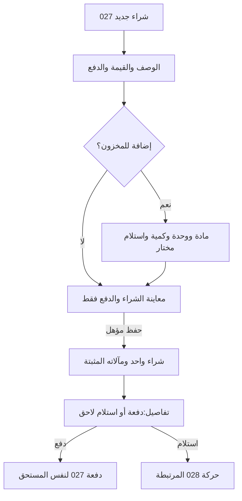

# JRN-004 — المشتريات والدفع والمخزون الاختياري

**النسخة:** V3 · **التاريخ:** 2026-10-26 — عمّان.
**الحالة:** معتمد من المالك في نطاق CONS-DEC ذات الصلة؛ التفاصيل غير المغطاة بحدودها. التنفيذ والاختبار لم يبدآ، ولا إغلاق شامل.

**المهمة:** «أسجل ما اشتريته وما دفعته وما بقي، وأتابع الكمية فقط إذا احتجت». الشراء ليس دفعًا أو استلامًا أو مصروفًا نقديًا عامًا ثانيًا. الملف يربط [027](../../03-New-Design/UNIT-027-المشتريات.md) و[028](../../03-New-Design/UNIT-028-المواد-والمخزون.md) و[037](../../03-New-Design/UNIT-037-العملاء-والموردون.md) و 022/024/017/013/016 ؛ [فهرس الرحلات](00-JOURNEYS-INDEX-AR.md) مرجع الترتيب.

## DATA-01 — بوابة البيانات المشتركة لكل النظام —2026-10-26

**الحالة:** مواصفات المنتج والقواعد المالية المعتمدة مرجع وظيفي؛ لا مخطط بيانات موحدًا مفحوصًا أو تصريح تنفيذ مستقل لهذا الملف. مراجعة التخزين والعلاقات والقواعد التقنية تشمل45 UNIT و10 رحلات، ثم يثبت العقد المشترك قبل تنفيذ الآثار المتأثرة. [DATA-01: النطاق والخطة والبوابة](../../01-Standards/02-System-Data-and-Financial-Readiness-AR.md#data-01-gate).

**المرحلة الحالية:** محلية على الجهاز. التوافق مع سحابة وAuthentication وAuthorization اتجاه مستقبلي للفحص، وليس إطلاقًا لها الآن. لا جداول مفروضة لكل مكوّن، ولا حساب دخول/أدوار/مزامنة/قفل جديد. تبقى حالة كل قدرة وإلغائها أو تأجيلها نافذة.

## مقابل JRN-010 —2026-10-26

الشراء والدفع والاستلام والمخزون الاختياري يحفظون معانيهم عند إدخال الماضي؛ قياس الكمية الحالية لا شراء، والشراء التاريخي المغطى لا يضاعف القياس.

**المصدر:** [الرحلة010](10-Account-Completion-and-Return-AR.md) و[002](../../03-New-Design/UNIT-002-استكمال-بيانات-المشروع.md#accounts-completion-20261026). هذه مقابلة ربط محددة، لا إعادة اعتماد فحوص الرحلة أو تشغيلها، ولا تغيير لمعرفاتها السابقة.

## اعتماد القرارات وتحديث أثرها على الرحلة —2026-10-26

**دليل الاعتماد:** قال المالك: «أنا موافق مية بالمية على كل اقتراحاتك»، ثم طلب صراحة تحديث القرارات التسعة أولًا. تاريخ التثبيت 2026-10-26، عمّان. يشمل الاعتماد التوصيات CONS-DEC01..09 ونطاقها وحدودها؛ لا يحتاج إعادة سؤال نفس القرارات. لا يتحول إلى اعتماد كل عبارة قديمة أو اختيار تفاصيل تخزين أو تصريح تنفيذ منتج.

**سجل تاريخي عند تثبيت القرارات التسعة، قبل اعتماد ACC-01/JRN-010 الأحدث أعلاه؛ لا يعمل كتعليمات حالية:** موضوع العودة بعد الانقطاع ومحاكاة جلسة النقاش ما زالا للنقاش، وليسا معتمدين أو مضافين في هذه الدفعة. «سجّل الموجود الآن» معتمد سابقًا ضمن CONS-DEC03 فقط؛ لا يثبت رحلة تعافٍ من انقطاع أو تحديد فترات مفقودة أو تسوية ديون/مخزون جماعية أو تاريخ تقريبي للعمليات. لا نُنشئ ملفًا لهذه الرحلة أو نصًا واجهيًا لها الآن.

**درجات الحالة:** المعنى والنطاق المعتمدان ثابتان؛ التهيئة الهندسية والمواصفة الإضافية للقياس/المرتجع عند لزومها، ثم التنفيذ، ثم التحقق والإغلاق حالات مستقلة. لا كود معدل أو اختبار ناجح من اعتماد الملف.

**المرجع:** [القرارات المعتمدة](../02-Consistency-Review-and-Decisions-AR.md#cons-decisions-approved-20261026).

| القرار | ما أصبح معتمدًا في هذا النطاق | الحالة |
|---|---|---|
| CONS-DEC01 | اعتماد التجربة المختصرة: اسم المشروع وحده للبداية، ونوع النشاط اختياري. الرئيسية للأفعال والمتابعة واللمحة، والمالية مدخل مختصر مع وظائف منظمة، والطلبات قائمة وتقويم لنفس المصادر. الإضافي عند الحاجة، ولا نموذج تفاعلي مستقل الآن. التحصيل لمستحق واحد محدد دون توزيع تلقائي، وحفظ الطرف أو المنتج لإعادة الاستخدام صريح واختياري. | معتمد من المالك؛ التنفيذ لم يبدأ |
| CONS-DEC02 | إظهار المعلومات المعلومة مع حدودها؛ نتيجة الفترة الكاملة غير محددة عند نقص بيانات مؤثرة. النتيجة الجزئية تسمى بنطاقها ولا تقدم ربح الفترة أو حدًا أدنى له. التقدير والاستبعاد الصريح مختلفان عن المجهول. التكلفة التسعيرية لا تكتب مصروفًا أو حق مالك تلقائيًا، ونفس الجزء المالي يحتسب مرة واحدة. تنسق سياسة 503 والقراء والميزانية والمخزون والمعدات وحقوق المالك قبل التنفيذ. | معتمد من المالك؛ التنفيذ لم يبدأ |
| CONS-DEC03 | اعتماد نطاق «سجّل الموجود الآن» كقياس نقد حالي مؤرخ عند الحاجة، مستقل عن افتتاح تاريخي أو إيراد أو مساهمة مالك. لا استنتاج للماضي ولا تسوية إلى صفر. هذه قدرة معتمدة تحتاج عقد قياس وتغطية وتصحيح وقراءة ونقل قبل إتاحتها. الحرس الحي يفرق المعلوم والمجهول وفشل القراءة؛ لا مال أو مصدر تمويل مختلق لتجاوز نقص الرصيد. | معتمد من المالك؛ التنفيذ لم يبدأ |
| CONS-DEC05 | إضافة مال المالك وسحبه بقصد صريح، لا بتوجيه تلقائي من وجود سياسات مستحقات. الإضافة ليست إيرادًا، والسحب الشخصي ليس مصروف تشغيل. المستحقات اختيارية وتسويتها مرتبطة بمستحق محدد، والإرجاع بأصل السحب وأثره. لا قرض أو استشارة سحب آمن جديدة. إصلاح وحدة 100 دينار→10000 وحدة صغرى مرة واحدة، لا تحويل جماعي للقديم. | معتمد من المالك؛ التنفيذ لم يبدأ |
| CONS-DEC06 | الوقائع المالية التي حدثت تسجل بتاريخ اليوم أو تاريخ سابق حقيقي؛ المستقبل موعد أو تذكير أو اتفاق لا قبض/دفع منجز. تاريخ البيع أو الاتفاق منفصل عن كل دفعة ووقت توثيقها. تعديل التكرار يؤثر افتراضيًا على الدورات المستقبلية غير المعالجة؛ السابق يراجع صراحة. ربط مصروف مسجل بدورة لا يكتب مصروفًا جديدًا. لا تاريخ وهمي أو إعادة تأريخ تلقائية للقديم. | معتمد من المالك؛ التنفيذ لم يبدأ |
| CONS-DEC08 | اعتماد ضرورة تصميم الإلغاء الحقيقي ورد المقدم/المبلغ من مصدره والمرتجع الكامل المؤهل قبل الإطلاق؛ المرتجع الجزئي والتقسيم المعقد مؤجلان إلى عقد مستقل. الموافقة على النطاق لا تعني جاهزية مواصفة الرد أو العكس أو المخزون. التصحيح الخاطئ مختلف عن رد مال حقيقي، ولا رد يتجاوز المقبوض أو عودة مخزون من مجرد رد المال أو إغلاق طلب يحبس حق العميل. | معتمد من المالك؛ التنفيذ لم يبدأ |

**المسار المستهدف بعد الاعتماد:** شراء واحد ودفع واستلام مستقل، ومخزون اختياري؛ سداد الدين لا يكرر المصروف. تمويل المالك والتاريخ والنقد بقصدها، والمرتجع الكامل المطلوب يحتاج مواصفته قبل الإطلاق.

**البوابات والقبول:** كل بوابة أدناه كانت تنتظر موافقة على أحد هذه القرارات أصبحت تنتظر التجهيز والتحقق في حد القرار نفسه؛ لا سؤال مالك متكرر ولا حذف للبوابة. المخطط والكاتب والقارئ والتصحيح والمعرفة والرجوع والنسخ، ثم اختبار الهاتف، باقية. قبول النطاق لا يجعل القياس الجديد أو المرتجع جاهزين للتنفيذ.

**حالة المتن السابق:** خطواته وفحوصه محفوظة؛ الحكم الأقدم المتعارض مع بطاقة معتمدة تاريخي في هذا الحد. الرحلة ليست كودًا منفذًا أو نتيجة اختبار؛ الإضافات المستقلة لم تعتمد تلقائيًا.228 قبولًا مخططًا ومعرفات J001..J009 محفوظة.

## A. أبسط مسار وبنية العرض

1. **تسجيل شراء** من المالية، أو اختصار الرئيسية، يفتح 027 نفسه.
2. **ماذا اشتريت؟** و**إجمالي الشراء**؛ التاريخ اليوم ظاهر قابل للمراجعة. تصنيف تنظيمي اختياري، لا سؤال محاسبي «شراء فقط أم مصروف فترة».
3. **الدفع:** لم أدفع / دفعت كاملًا / دفعت جزءًا. لا اختيار خفي يثبت دفعًا؛ الجزء يكشف المبلغ فقط. عند مبلغ فعلي يظهر مصدر الدفع. تعريف المورد المحفوظ اختياري؛ عند مستحق جديد يلزم تعريف بسيط وفق 037 ، لا ملف دائم أو هاتف.
4. **إضافة إلى المخزون** اختياري عند الحاجة. من لا يختاره لا يعرف مادة أو وحدة أو كمية أو استلامًا.
5. ملخص **القيمة · المدفوع · المتبقي** وأثر الاستلام إن اختير، ثم **حفظ الشراء**. لاحقًا يُسجّل الدفع أو الاستلام من الشراء نفسه دون إعادة بياناته.

الحقول المتقدمة مطوية وتفتح عند استخدامها أو خطئها؛ المساعدة العامة خلف! مسمى. المبلغ والمصدر وسبب التعذر والأثر الحالي ظاهرة مختصرة؛ لا تنبيهات طويلة. واجهة الهاتف RTL وأرقام 0–9 والمكتبة الحالية، لا تغيير هوية.

## B. الدخول والنتيجة والعودة

| المدخل | الفعل/المصدر | العودة |
|---|---|---|
|013 وظائف المالية أو 003 تسجيل شراء |027 إنشاء بقصد واحد، لا شراء داخل 004 |إلى المدخل الحقيقي بفترته وموضعه؛ لوحة الوظائف لا تعاد فتحها تلقائيًا |
|017 عرض المشتريات أو حساب 037 محدد |تفاصيل 027 ؛ ثم دفعة لهذا الشراء إن كان مؤهلًا |تفاصيل الشراء ثم السجل/الحساب مع بحثه ومرشحاته |
|028 من مادة تريد استلامها |027/محرر استلام 028 بسياق مادة وشراء قانونيين |نفس المادة/الشراء؛ لا شراء جديد من فتح السياق |
|إضافة مادة/مورد داخل النموذج |كاتب 028/037 الأصلي المختصر وفق عقده |نفس سطر الشراء ومدخلاته؛ التعريف لا يحفظ شراء أو دفعة |
|رابط دفع/استلام قديم |نفس المصدر بعد تحقق هويته وأهليته |أقرب إطار؛ المفقود/المحصل لا يستبدل بشراء آخر أو نموذج فارغ |

هذا رسم للمهمة، لا ادعاء أن جمع الشراء/الدفع/الاستلام ذري حاليًا. U027-D03 يحتاج تجهيزًا. إذا اختار استلامًا وكانت بياناته غير صالحة فلا يسقطه النظام صامتًا ليسمي بقية العملية نجاحًا كاملًا؛ يراجع المستخدم الاختيار قبل الحفظ، وتفصل النتيجة الملتزمة عند التعافي.

## C. البيانات والآثار عند كل خطوة

| الخطوة | المدخلات والافتراضي | الناتج/الأثر |
|---|---|---|
|تعريف الشراء |وصف صالح وقيمة موجبة؛ تاريخ محلي، وتصنيف اختياري |أصل شراء 027 ، لا مادة مخزنية أو مورد محفوظ تلقائيًا |
|الدفع الأول |حالة صريحة؛ مبلغ الجزء فارغ؛ مكان/مصدر مال معلوم أو غير محدد وفق عقده |قيمة المدفوع الفعلي فقط تخفض النقد/تحدد ممول الدفع بمعناه؛ لا دفع كامل من قيمة الفاتورة |
|المتبقي |مشتق من القيمة والمدفوع الصحيحين |مستحق هذا الشراء؛ لا إجمالي حساب المورد أو موعد استحقاق من تاريخ الإنشاء |
|تعريف الطرف |مورد محفوظ مختار أو تعريف محلي بسيط عند المستحق الجديد |لا حفظ دائم من الاسم أو مقاصة مع العميل نفسه؛ القديم غير المسمى بحدوده |
|الكمية الاختيارية |مادة موجودة أو تعريف مختصر 028 ، وحدة صالحة، كمية وتكلفة/معرفة بنطاقها |متابعة ما اختاره صاحب المشروع؛ لا تحويل كل مشترياته إلى مخزون |
|استلام الآن |اختيار صريح وكمية مستلمة فعلية وتاريخها؛ الكامل فقط إن كان المتوقع معلومًا |حركة الاستلام نفسها 027/028 ؛ لا رصيد افتتاح ثانٍ لنفس الكمية |
|استلام لاحق/جزئي |مرجع الشراء والبند والمادة، السابق للقراءة، الجديد فقط |يزيد المستلم بهذا المقدار مرة؛ لا إعادة قيمة الفاتورة أو الدفع |
|دفعة لاحقة |الشراء والمورد والمتبقي من المصدر، مبلغ جديد فارغ، مكان/وقت حسب السياسة |ينقص المتبقي ويخرج النقد مرة؛ ليس شراء أو تكلفة فترة جديدة |
|تفاصيل/تصحيح |هوية الشراء/الدفعة/الاستلام وأثر قبل/بعد |تصحيح عند مالك الواقعة، لا تحرير كل المدفوع داخل تغيير وصف |

**مثال مالي:** شراء 30.00 ودفع 10.00 ⇒ متبقٍ 20.00 وخروج نقد 10.00 فقط؛ دفع 20.00 لاحقًا ⇒ المدفوع 30.00 والمتبقي 0 وخروج 20.00 جديد. الاستلام بينهما لا يدفع 30.00 أو ينشئ شراء 30.00 آخر. معرف الواقعة وربطها يمنعان جمع الدفعات فوق إجمالي يتضمنها.

**مثال كمية:** متوقع 10 وحدات، استلم 4 ثم 6 ⇒ مستلم 10 لا 14 ؛ الدفع 30 لا يثبت أنه استلم 10. فاتورة ببندين لا ينسخ إجماليها كقيمة كل بند. دعم البنود المتعددة U027-D01 مقترح، ولا يفرض جدولًا على الشراء البسيط أو يوزع المدفوع عليها اعتباطيًا.

**التكلفة:** قرار المالك أن كل ما اشتراه شراء، وغير المتتبع من المواد اليومية ضمن فترة الشراء، والمتتبع وفق استخدامه. لا نعيد سؤال اختيار طريقة اعتراف. لكن تغطية الفترة والقديم والدقة والأصول والمواد المشتركة وتصحيح التاريخ تحتاج عقود 028-D02/503 ؛ الدفع ليس توقيت الاعتراف تلقائيًا. شراء معدات يفتح 034 بكيانه ولا يصنف مواد استهلاكية لإراحة النموذج. فاتورة تشغيل مستقلة عند 015 ، لا شراء ومصروف عام ثانٍ لنفس المبلغ.

## D. الفشل والرجوع والتصحيح

| الحالة | المعالجة المطلوبة |
|---|---|
|إلغاء أو تحديث قبل الحفظ |حماية المدخلات عند 027 ، لا شراء/دفع من حفظ نموذج للخروج |
|مورد/مادة موجودان أو فشل اقتراحهما |إعادة استخدام صحيح؛ الفشل لا يصبح قائمة فارغة أو تعريفًا بديلًا من الاسم وحده |
|تعذر قراءة النقد/التغطية |لا 0 أو رصيد كافٍ مختلق؛ يعالج وفق 022/024 و U027-D04 ، لا يستورد مسار قبض عميل ليتجاوز حرس صرف |
|دفع من مال المالك |يسجل الممول بمعناه وفق 020/015/027 إن كان عقده مؤهلًا؛ لا اختراع مساهمة ثم دفع أو خصم من صندوق لم يخرج منه المال |
|حفظ مجهول/نقر متكرر |استرداد نفس القصد والحمولة قبل إعادة الكتابة؛ لا مفتاح جديد لتجاوز الشك |
|نجاح واقعة وفشل تابع/قراءة |يفصل ما حُفظ وما بقي؛ يصلح التابع من معرف الحدث، لا إعادة الشراء أو الدفع أو الاستلام |
|تغير متبقٍ/رصيد/نسخة من نافذة أخرى |يبقي المدخلات ويعرض الفرق ومعاينة محدثة، وحرس حي داخل الالتزام |
|استلام كامل مجهول أو مادة غير متتبعة |لا استنتاج كمية من المدفوع، ولا فرض استلام مخزني لمادة بلا متابعة |
|تغيير وضع المتابعة |لا تصفير أو صرف قديم أو إعادة شراء؛ الوقف/الاستئناف عند 028 بتسوية معرفته ومساره |
|تصحيح شراء/دفعة/مكان/استلام |أفعال مختلفة، كل بمعرفه وسببه وأثره؛ تغيير المكان لا يرد المورد أو يعيد المواد |
|إلغاء تسجيل خاطئ/مرتجع فعلي |U027-D06 ومخارج 028/024 ؛ لا حذف آثار فعالة أو زر مرتجع تجاري عام يوهم دعم رد سلعة ومال |
|سجل مفقود/ملغى/مستحق 0 |حالة محددة وفتح الأصل/رجوع؛ لا دفعة 0 أو تبديل مصدر تلقائي |

## E. الملكية وإزالة التكرار

| يبقى عند | ما يزال ولماذا؟ | البديل وشرط الإزالة |
|---|---|---|
|027 شراء ودفعاته، 028 مادة وحركاتها |شراءان أو استلامان للفاتورة نفسها؛ لأن العرضين يصفان أصلًا واحدًا |ربط purchase/line/receipt الفعلي حسب المخطط، ومعاملة ومآل وتصحيح متوافقان |
|037 تعريف اختياري للطرف |تعريف مورد دائم لشراء مدفوع أو إعادة تعريف في الدفع؛ لا حاجة مستقلة لهما |إضافة سياقية وتعريف مستحق بسيط، وحفظ الاسم/المعرف القديم بلا دمج نصي |
|027 الأصل المالي و 015 المصروف المستقل |مصروف عام يدوي لتكرار الشراء/سداد دينه؛ لأنه يكرر التكلفة أو النقد |إسقاط واحد بمصدر وتغطية، وحفظ تاريخ الشراء والدفعات والنتيجة 013/016 |
|028 متابعة انتقائية |سؤال شراء فقط/مصروف، أو رصيد افتتاح فوق استلام جديد؛ لأنه قرار غير مطلوب أو تكرار كمية |الشراء مرة، وخيار إضافة إلى المخزون؛ سياسة التغطية والدقة قبل تفعيل الحساب |
|017 قائمة/تصفية، 027 محرر الأصل |دفتر شراء منافس أو دفعة داخل سجل عام؛ لأنه يكرر الكاتب ويفقد سياق العودة |تكافؤ البحث والدفع والاستلام والتاريخ والتصحيح قبل نقل المدخل، لا إخفاء صفحة فقط |

## F. بوابات التجهيز

| البوابة | المطلوب قبل التنفيذ |
|---|---|
| J004-G01 |027/037: تعريف محلي واختيارية المورد وفق القرار السابق؛ مواءمة قيد name الموروث دون فرض ملف دائم أو فقد القديم |
| J004-G02 |027-D01/D03 مع 028: بنود اختيارية واستلام صريح ومعرفة ونطاق، وقصد/مآلات وذرية مثبتة لا نداءان متتابعان موصوفان بالذرية |
| J004-G03 |027-D04/022/024/020: صلاحية الصرف والتغطية والممول ومصدره وتاريخ كل دفع؛ لا رصيد أو مكان أو إقرار مخفي |
| J004-G04 |028-D02/D03 مع 015/013/016/034/503: توقيت تكلفة المواد ونطاقها ومنع التغطية المزدوجة والدقة والتاريخ القديم |
| J004-G05 |027-D05/D06/028/024: مخارج تصحيح/إلغاء ومرتجع مؤهلة، وسجل المدفوع والاستلام محفوظ، و 044 ينقل النسخ الجديدة |
| J004-G06 |003/013/017/037/028 و NAV: رجوع أقرب إطار، قراءة نجاح منفصلة عن فشل العرض، وإتاحة/هاتف/تزامن/تخزين. مواصفة لا اختبارات ناجحة |

## G. فحوص القبول — مخططة

| الفحص | النتيجة المطلوبة |
|---|---|
| J004-AC01 | شراء مدفوع بلا مخزون أو مورد محفوظ، دون تعريفات إجبارية بعد تجهيز العقد. |
| J004-AC02 | شراء 30 ودفع 10 ثم 20: نقد−10 ثم−20 ومتَبقٍّ 0 ، دون شراء أو تكلفة ثانية. |
| J004-AC03 | لم يدفع: لا حركة 0 أو مكان نقد؛ المتبقي كامل بقصد واضح. |
| J004-AC04 | تعريف بسيط لدين جديد، دون هاتف أو ملف دائم أو دمج مورد بنفس الاسم. |
| J004-AC05 | بلا مخزون: وصف وقيمة ودفع فقط، دون كمية أو افتتاح أو سؤال شراء مقابل مصروف. |
| J004-AC06 | إضافة مخزون اختيارية: نفس المادة والوحدة، دون افتتاح ثانٍ فوق الاستلام. |
| J004-AC07 | متوقع 10 واستلام 4 ثم 6: مستلم 10 مرة، والدفع مستقل. |
| J004-AC08 | بنود متعددة بعد G02: لا نسخ إجمالي الفاتورة أو توزيع دفع صامت؛ البسيط بلا جدول. |
| J004-AC09 | كمية أو تكلفة مجهولة أو صفر صريح أو قراءة فاشلة: معانٍ مختلفة، لا كامل من الدفع. |
| J004-AC10 | تغيير التتبع لا يصرف أو يصفر القديم أو ينشئ شراءً جديدًا. |
| J004-AC11 | تعذر النقد أو التغطية أو المكان: حرس المصدر وقراره، دون رصيد كافٍ مفترض. |
| J004-AC12 | المالك دفع من ماله: الممول صحيح، دون خصم صندوق أو إيراد أو مساهمة مختلقة. |
| J004-AC13 | تكرار الحفظ أو جوابه المجهول: استرداد نفس القصد قبل كتابة أخرى. |
| J004-AC14 | استلام اختير ولم يجهز: لا إسقاط صامت أو نجاح كامل كاذب. |
| J004-AC15 | نجاح واقعة وتابع ناقص أو لمحة فاشلة: إصلاح التابع أو القراءة فقط. |
| J004-AC16 | إلغاء ورجوع وتحديث وإضافة مادة أو مورد: مدخلات محفوظة بلا مال من الفتح. |
| J004-AC17 | نافذتان أو تغير متبقٍ أو كمية: حرس حي ومعاينة متجددة دون سحق العمل. |
| J004-AC18 | فتح دفعة من 027 أو 037: المصدر ثابت، والعودة للشراء ثم المدخل الحقيقي. |
| J004-AC19 | دفع مستحق لا يدخل 026 لتحصيل عميل أو قيد مصروف عام. |
| J004-AC20 | تصحيح دفعة أو مكان أو استلام: أثر بمعناه، لا رد مالي أو مخزني مختلق. |
| J004-AC21 | قديم بلا مراجع أو سجل مفقود أو ملغى: حد معرفة، دون إنشاء بديل أو تاريخ مخترع. |
| J004-AC22 | مواد وفترة ومعدة: تغطية صحيحة بعد G04 ، دون اقتناء مصروف تلقائي أو تكلفة مزدوجة. |
| J004-AC23 | هاتف 360/390/430 و RTL و 0–9 ومفاتيح وتكبير وقارئ شاشة: الحقل والأثر والرجوع بلا قص. |
| J004-AC24 | دقة المال والكمية ونقل 044: لا تضاعف 100 أو تقريب يخلق حركة أو فقد مرجع. |

**الدليل والحدود:** قراءة أحدث 027/028/037/022/024/015/020 وقراء 013/016/017 والتنقل؛ لا تشغيل للكود الحالي. التنظيم السابق محفوظ، والتصميم الجديد مقترح وبواباته لا تغلق من هذا الملف.24 فحصًا في J004 ، لا إضافة إلى 427ACD أو 38DUP. معايير V6/24 سارية؛ روابط W3C الرسمية وتفسير الإلزام/الإرشاد في[الفهرس](00-JOURNEYS-INDEX-AR.md). التالي JRN-005 ، وتفصيل خدمات النقل/السوق خارج هذه الرحلة.
