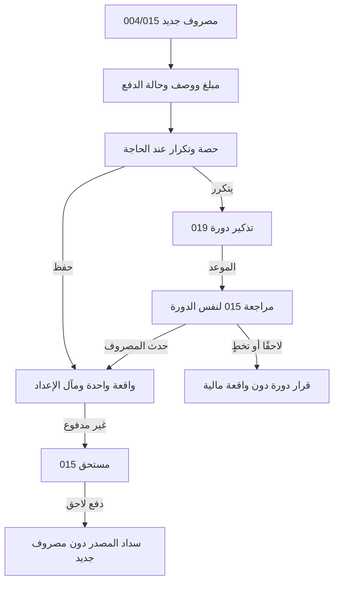

# JRN-005 — المصروف والمستحق والتكرار والحصة المشتركة

**النسخة:** V3 · **التاريخ:** 2026-10-26 — عمّان.
**الحالة:** معتمد من المالك في نطاق CONS-DEC ذات الصلة؛ التفاصيل غير المغطاة بحدودها. التنفيذ والاختبار لم يبدآ، ولا إغلاق شامل.

**المهمة:** «أسجل مصروفًا، أو أسدد مصروفًا مستحقًا، وأطلب تذكيري بما يتكرر دون إعادة الكتابة». [015](../../03-New-Design/UNIT-015-تسجيل-العمليات-المالية.md) يملك الواقعة، [019](../../03-New-Design/UNIT-019-تكرار-المصروف.md) التكرار، [004](../../03-New-Design/UNIT-004-التسجيل-السريع.md) العرض المختصر؛ [الفهرس](00-JOURNEYS-INDEX-AR.md) مرجع الترتيب.

## DATA-01 — بوابة البيانات المشتركة لكل النظام —2026-10-26

**الحالة:** مواصفات المنتج والقواعد المالية المعتمدة مرجع وظيفي؛ لا مخطط بيانات موحدًا مفحوصًا أو تصريح تنفيذ مستقل لهذا الملف. مراجعة التخزين والعلاقات والقواعد التقنية تشمل45 UNIT و10 رحلات، ثم يثبت العقد المشترك قبل تنفيذ الآثار المتأثرة. [DATA-01: النطاق والخطة والبوابة](../../01-Standards/02-System-Data-and-Financial-Readiness-AR.md#data-01-gate).

**المرحلة الحالية:** محلية على الجهاز. التوافق مع سحابة وAuthentication وAuthorization اتجاه مستقبلي للفحص، وليس إطلاقًا لها الآن. لا جداول مفروضة لكل مكوّن، ولا حساب دخول/أدوار/مزامنة/قفل جديد. تبقى حالة كل قدرة وإلغائها أو تأجيلها نافذة.

## مقابل JRN-010 —2026-10-26

المصروف الفعلي يختلف عن دورة التذكير؛ لا ملء الشهور الماضية كمدفوعة، ولا مصروف فوق مجموع يغطيه، والفاتورة المشتركة وفقCONS-DEC04.

**المصدر:** [الرحلة010](10-Account-Completion-and-Return-AR.md) و[002](../../03-New-Design/UNIT-002-استكمال-بيانات-المشروع.md#accounts-completion-20261026). هذه مقابلة ربط محددة، لا إعادة اعتماد فحوص الرحلة أو تشغيلها، ولا تغيير لمعرفاتها السابقة.

## اعتماد القرارات وتحديث أثرها على الرحلة —2026-10-26

**دليل الاعتماد:** قال المالك: «أنا موافق مية بالمية على كل اقتراحاتك»، ثم طلب صراحة تحديث القرارات التسعة أولًا. تاريخ التثبيت 2026-10-26، عمّان. يشمل الاعتماد التوصيات CONS-DEC01..09 ونطاقها وحدودها؛ لا يحتاج إعادة سؤال نفس القرارات. لا يتحول إلى اعتماد كل عبارة قديمة أو اختيار تفاصيل تخزين أو تصريح تنفيذ منتج.

**سجل تاريخي عند تثبيت القرارات التسعة، قبل اعتماد ACC-01/JRN-010 الأحدث أعلاه؛ لا يعمل كتعليمات حالية:** موضوع العودة بعد الانقطاع ومحاكاة جلسة النقاش ما زالا للنقاش، وليسا معتمدين أو مضافين في هذه الدفعة. «سجّل الموجود الآن» معتمد سابقًا ضمن CONS-DEC03 فقط؛ لا يثبت رحلة تعافٍ من انقطاع أو تحديد فترات مفقودة أو تسوية ديون/مخزون جماعية أو تاريخ تقريبي للعمليات. لا نُنشئ ملفًا لهذه الرحلة أو نصًا واجهيًا لها الآن.

**درجات الحالة:** المعنى والنطاق المعتمدان ثابتان؛ التهيئة الهندسية والمواصفة الإضافية للقياس/المرتجع عند لزومها، ثم التنفيذ، ثم التحقق والإغلاق حالات مستقلة. لا كود معدل أو اختبار ناجح من اعتماد الملف.

**المرجع:** [القرارات المعتمدة](../02-Consistency-Review-and-Decisions-AR.md#cons-decisions-approved-20261026).

| القرار | ما أصبح معتمدًا في هذا النطاق | الحالة |
|---|---|---|
| CONS-DEC01 | اعتماد التجربة المختصرة: اسم المشروع وحده للبداية، ونوع النشاط اختياري. الرئيسية للأفعال والمتابعة واللمحة، والمالية مدخل مختصر مع وظائف منظمة، والطلبات قائمة وتقويم لنفس المصادر. الإضافي عند الحاجة، ولا نموذج تفاعلي مستقل الآن. التحصيل لمستحق واحد محدد دون توزيع تلقائي، وحفظ الطرف أو المنتج لإعادة الاستخدام صريح واختياري. | معتمد من المالك؛ التنفيذ لم يبدأ |
| CONS-DEC02 | إظهار المعلومات المعلومة مع حدودها؛ نتيجة الفترة الكاملة غير محددة عند نقص بيانات مؤثرة. النتيجة الجزئية تسمى بنطاقها ولا تقدم ربح الفترة أو حدًا أدنى له. التقدير والاستبعاد الصريح مختلفان عن المجهول. التكلفة التسعيرية لا تكتب مصروفًا أو حق مالك تلقائيًا، ونفس الجزء المالي يحتسب مرة واحدة. تنسق سياسة 503 والقراء والميزانية والمخزون والمعدات وحقوق المالك قبل التنفيذ. | معتمد من المالك؛ التنفيذ لم يبدأ |
| CONS-DEC03 | اعتماد نطاق «سجّل الموجود الآن» كقياس نقد حالي مؤرخ عند الحاجة، مستقل عن افتتاح تاريخي أو إيراد أو مساهمة مالك. لا استنتاج للماضي ولا تسوية إلى صفر. هذه قدرة معتمدة تحتاج عقد قياس وتغطية وتصحيح وقراءة ونقل قبل إتاحتها. الحرس الحي يفرق المعلوم والمجهول وفشل القراءة؛ لا مال أو مصدر تمويل مختلق لتجاوز نقص الرصيد. | معتمد من المالك؛ التنفيذ لم يبدأ |
| CONS-DEC04 | اعتماد الفرع الشخصي للفواتير المشتركة: ما دفعه المشروع فعلًا وحصته ومن تحمل الباقي عند الحاجة. دفع 60 وحصة 30 وباقٍ شخصي مؤكد 30 يعطي نقد−60 ومصروف 30 وسحبًا شخصيًا 30 في قصد واحد، لا بافتراض النظام. دفع المشروع 30 لحصته 30 لا يضيف سحبًا آخر. الدفع من مال المالك يمر بمساره الصريح، ولا ينقص صندوقًا لم يدفع. | معتمد من المالك؛ التنفيذ لم يبدأ |
| CONS-DEC05 | إضافة مال المالك وسحبه بقصد صريح، لا بتوجيه تلقائي من وجود سياسات مستحقات. الإضافة ليست إيرادًا، والسحب الشخصي ليس مصروف تشغيل. المستحقات اختيارية وتسويتها مرتبطة بمستحق محدد، والإرجاع بأصل السحب وأثره. لا قرض أو استشارة سحب آمن جديدة. إصلاح وحدة 100 دينار→10000 وحدة صغرى مرة واحدة، لا تحويل جماعي للقديم. | معتمد من المالك؛ التنفيذ لم يبدأ |
| CONS-DEC06 | الوقائع المالية التي حدثت تسجل بتاريخ اليوم أو تاريخ سابق حقيقي؛ المستقبل موعد أو تذكير أو اتفاق لا قبض/دفع منجز. تاريخ البيع أو الاتفاق منفصل عن كل دفعة ووقت توثيقها. تعديل التكرار يؤثر افتراضيًا على الدورات المستقبلية غير المعالجة؛ السابق يراجع صراحة. ربط مصروف مسجل بدورة لا يكتب مصروفًا جديدًا. لا تاريخ وهمي أو إعادة تأريخ تلقائية للقديم. | معتمد من المالك؛ التنفيذ لم يبدأ |
| CONS-DEC09 | اعتماد تأجيل إنشاء أمانات جديدة من الواجهة العادية للإصدار الأول، مع حفظ قراءة وتصحيح ما يثبت من القديم وحدود ملكية المال. لا دفتر أموال للغير جديد أو توزيع للإجمالي القديم على أشخاص بالتخمين. عربون الطلب ودينه التجاري ومال المالك تبقى عند مصادرها، ولا أمانة بديلة تعيد قرضًا أو تخفي فرقًا. | معتمد من المالك؛ التنفيذ لم يبدأ |

**المسار المستهدف بعد الاعتماد:** مصروف واحد وتكرار للمراجعة لا للدفع، وحصة مشتركة تمثل النقد الفعلي والجزء الشخصي المؤكد. الأمانات الجديدة مؤجلة، والتأريخ والتغطية عند المصدر.

**البوابات والقبول:** كل بوابة أدناه كانت تنتظر موافقة على أحد هذه القرارات أصبحت تنتظر التجهيز والتحقق في حد القرار نفسه؛ لا سؤال مالك متكرر ولا حذف للبوابة. المخطط والكاتب والقارئ والتصحيح والمعرفة والرجوع والنسخ، ثم اختبار الهاتف، باقية. قبول النطاق لا يجعل القياس الجديد أو المرتجع جاهزين للتنفيذ.

**حالة المتن السابق:** خطواته وفحوصه محفوظة؛ الحكم الأقدم المتعارض مع بطاقة معتمدة تاريخي في هذا الحد. الرحلة ليست كودًا منفذًا أو نتيجة اختبار؛ الإضافات المستقلة لم تعتمد تلقائيًا.228 قبولًا مخططًا ومعرفات J001..J009 محفوظة.

## A. المسارات بحسب الحاجة

| المسار | أبسط ما يفعله المستخدم | النتيجة |
|---|---|---|
| مصروف دفعه |مبلغ ووصف؛ حالة مدفوع ومصدر الدفع واليوم ظاهرة؛ حفظ |مصروف واحد وخروج المال الصحيح، لا شراء أو سداد التزام ثانٍ |
| مصروف لم يدفعه |نفس النموذج بحالة غير مدفوع؛ يعرف المستحق بما يكفي عند المصدر دون ملف دائم |ذمة ومصروف بمعرفة/تاريخ الواقعة، لا حركة نقد من عدم الدفع |
| سداد مستحق قائم |يفتحه من تفاصيله/متابعة 018 ؛ مبلغ جديد أو كامل المتبقي ومصدره |نقد أقل وذمة أقل، لا مصروف جديد لنفس الفاتورة |
| يتكرر |خيار غير محدد في إنشاء جديد؛ يكشف دورة التكرار والتذكير القادم فقط |واقعة هذه المرة وإعداد تكرار معلوم المآل، لا مصاريف الأشهر المقبلة |
| تذكير فقط |وصف ودورة وتاريخ قادم؛ المبلغ اقتراح اختياري |إعداد تشغيلي، لا مصروف 0 أو التزام مالي مصنع |
| مشترك |يفتح الحصة ومعرفتها والأثر المناسب لنموذج 015 |حصة المشروع بمعناها، لا افتراض أن كل فاتورة المنزل مصروف مشروع |

لا ميزانية أو مخزون أو جهة محفوظة أو دورة تكرار شرطًا للمصروف البسيط. وصف المصروف حقل مستقل، والفئة اختياريًا لا تحل محله. لا نضيف «مدفوع جزئيًا» إلى إنشاء 015 دون عقد التزام وسداد مترابط؛ السداد الجزئي لمستحق محفوظ مسار أصلي مختلف، لا كتابة فاتورة ناقصة باسم المدفوع فقط.

## B. الدخول والعودة والخريطة

من 003 أو 013 يفتح 004/015 لنفس نوع العملية والقصد. من 017 يفتح الأصل لا محررًا عامًا يعيد قيده. من 018/012 يفتح المستحق/دورة 019 المحددة. الرجوع من السداد أو الدورة يعيد التفاصيل أولًا، ثم القائمة/المتابعة أو الرئيسية بفترتها وموضعها. فتح 019 من المصروف أو إضافة فئة/جهة يعيد النموذج ومدخلاته، لا يستبدلها بتهيئة جديدة. المصاريف المستقبلية المقترحة والتذكيرات لا تصبح دفعًا حاليًا من فتح رابط.

السهم إلى D من دورة لا يعني حفظ 015 ثم تأكيد 019 بحدث ثانٍ؛ الموسّع المشترك يثبت الواقعة وعلاقة الدورة مرة. رابط مصدر محدد فشل لا يتحول إلى سداد فاتورة أخرى بلا قصد.

## C. المدخلات والنتائج والقواعد

| القيمة/الفعل | المطلوب الآن | ما يُحفظ وما لا يعنيه |
|---|---|---|
| المبلغ والوصف |فارغان أولًا، قيمة صالحة ووصف فعلي |مقدار الواقعة، لا مصروف من اختيار فئة أو مثال placeholder |
| مدفوع/غير مدفوع |ظاهر من مدخل صريح/اختيار |يفصل النقد عن الذمة؛ لا تمويل مشروع/مالك بالتخمين |
| جهة المستحق |تعريف المصدر وفق 037 عند متابعة حق جديد؛ محفوظ اختياري |لا ملف/هاتف أو نص صوري؛ يستعمل وصف/تعريف صالح موجود دون تكرار، والقديم غير المنسوب لا يمنع من القراءة |
| مصدر الدفع |عند صرف فعلي، وفق FIN-005/015/022/024 |لا افتراض أن نجاح قبض بلا مكان يجيز صرفًا بأي حرس؛ عقد كل نوع محفوظ |
| تاريخ الواقعة/السداد |كلٌّ بمعناه، واليوم ظاهر |السداد لا ينقل تاريخ مصروف قديم أو ينشئه مجددًا؛ سياسة 015-D04/004-D08 ببوابتها |
| يتكرر |غير محدد للإنشاء؛ وصف/فئة من نفس المدخل |جدول ومقترحات 019 ، لا مبلغ مالي آخر أو اسم سلسلة مكرر |
| التذكير القادم |اقتراح معروف قابل للتعديل، وفاصل شهري 1–12 حسب المصدر |لا تكرار أسبوعي/دفع تلقائي/رسائل خارجية جديدة؛ اليوم 29–31 بسياسة الشهر القصير المراجعة |
| سداد مستحق |الالتزام والمتبقي من مصدره، مبلغ جديد فارغ واختصار كامل |0<M≤المتبقي الحي؛ لا مال على عموم حساب جهة أو توزيع تلقائي |

**مثال:** فاتورة مستحقة 40.00 ⇒ ذمة 40.00 ومصروفها بحسب معرفة الحصة، دون نقد. سداد 15.00 ثم 25.00 ⇒ المتبقي 25.00 ثم 0 ، والنقد−15 ثم−25 ؛ لا مصروف 40 آخر عند السداد. شراء مواد 027 لا يعاد هنا كفاتورة تشغيل، وسحب مالك 020 ليس مصروفًا.

### C1. الحصة المشتركة — الحقيقة قبل الاختصار

| النمط الحالي عند 015 | المال/الذمة المسجلان | التكلفة المحتسبة وحدها |
|---|---|---|
| حصة معلومة 30 |30 |30 |
| إجمالي 60×نسبة 50% |30 |30 ؛ ليس توثيق خروج 60 |
| حصة تقديرية 25 |25 |25 موسومة تقديرية |
| تحديد الحصة لاحقًا، إجمالي 60 |60 |غير محددة الآن، لا 0 معلوم |

لو خرج 60 فعلًا من مشروعه وحصته 30 ، فالنمط النسبي الحالي لا يمثل النقد كاملًا. هذه فجوة U015-D02 لا تعالج بإخفاء 30 أو تصنيفها سحب مالك/دين من تلقاء النظام. **التوصية:** يوضح النموذج مقدار المال الذي سيسجله قرب الحفظ، ولا يَعِد بتمثيل الدفع الكامل المختلف عن الحصة قبل حسم معنى الباقي وعقده. تسجل الحالة في G03 كمانع شحن للقدرة الموسعة، لا ادعاء أن المثال محلول. أداة حساب حصة الفاتورة 030 تساعد في التقدير فقط ولا تنقل قيدًا تلقائيًا.

### C2. دورة التكرار بدون مضاعفة

1. مراجعة «مصروف الإيجار — الشهر المحدد» تفتح 015 بالمقترح الصحيح وهوية السلسلة/الدورة، لا مصروفًا مثبتًا.
2. **حفظ المصروف** يثبت الواقعة وحالة الدورة بقصد واحد ومآل معلوم؛ المبلغ المستقبلي ليس دينًا أو مصروفًا.
3. **ذكّرني لاحقًا** يؤجل المراجعة فقط. **تخطي هذه الدورة** يعلن عدم تسجيل مصروف لها، لا أنه دفع بالفعل.
4. إذا سُجل يدويًا:الربط بسجل موجود اختيار صريح بعد اعتماد وتجهيز U019-D06 ، لا تطابق نصي أو حفظ جديد أو تخطٍ يوهم وجود القيد. حتى تجهيز العقد لا يعرض فعلًا مزيفًا.
5. تعديل هذه المرة لا يغير المستقبل، وتعديل التكرار القادم يبين أول دورة تتأثر. الإيقاف المؤقت لا يحذف الدورات القائمة، والاستئناف لا يسجل أشهر التوقف تلقائيًا. الإنهاء/الأرشفة وفق المصدر لا يمحوان ديونًا أو مالًا.

## D. الفشل والإلغاء والتصحيح

| الحالة | النتيجة الصحيحة |
|---|---|
|إلغاء/تبديل مشترك/توسيع 004 |نفس المدخلات الخام والمعرفة والقصد؛ القيم غير الفعالة لا تدخل الحساب، ولا حفظ مالي من الخروج |
|نجاح مصروف وفشل إعداد 019/مكان النقد |يظهر ما حفظ، ويستكمل الإعداد/024 وحده؛ لا مصروف ثانٍ أو مسح قصد التعافي مع مسودة النموذج |
|نتيجة حفظ مجهولة/تكرار/نافذتان |استرداد نفس القصد أولًا؛ حرس نسخة/دورة/متبقٍ حي، لا تخطٍ أو دفع جديد لإخفاء الشك |
|فشل قراءة المصدر/الفئة/المحافظ |حالة خاصة، لا 0 أو فاتورة جديدة/دورة فارغة؛ ما يلزم للفعل يمنعه حتى يعود وفق عقده |
|حصة مؤجلة/تقديرية/صفر صريح |حالات معرفة مختلفة، ولا اكتمال مصطنع أو تغيير المبلغ عند الطي |
|تصحيح واقعة أو سداد |عند 015 بمعاينة أثره على الذمة/النقد/الحصة/الفترة، ومكانه عند 024 ؛ لا تعديل ملخصات 013 أو حذف تاريخ |
|واقعة دورة صححت/ألغيت |ربط 019 مراجع وفق قواعده، لا إعادة توليد مصروف أو إحياء دورة/تذكير تلقائيًا |
|تجاوز ميزانية 013B |قراءة مقارنة لا تمنع دفع مصروف صحيح ولا تنشئ تمويلًا؛ تفصيلها JRN-007 |
|خسارة غير نقدية |مصدرها 028/034 أولًا عند وجوده؛ الحدث العام 015 لا يكرر هدرًا/إهلاكًا أو يخرج نقدًا |

الأمانة ومال المالك ليسا أنواع مصروف مخفية؛ لهما سياقهما في JRN-006 وفق مصدرهما، ولا إعادة إنشاء قروض 035/036 الملغاة/المؤجلة. لا 040 أو نسخ رسالة بديلة ولا إخطار خارجي جديد من تحديد التذكير.

## E. إزالة التكرار والملكية

| يبقى عند | الإزالة والسبب الحرفي | البديل وشرطه |
|---|---|---|
|015 الواقعة و 004 العرض |كاتب مصروف سريع/كامل مختلف؛ نفس العملية لا تحتاج سجلين |نواة وقصد وتحقيق واحد، وتوسيع يحفظ raw والمعرفة والعودة |
|019 جدول ودورة، 015 واقعة |حقول مالية/كاتب تأكيد دورة منافس؛ قد يسجل المصروف مرتين |محوّل دورة إلى الموسّع نفسه، مع ربط ومآل وتصحيح و 044 |
|015 مستحق وسداده |مصروف عام عند سداد فاتورة قديمة؛ يكرر التكلفة |سداد من المصدر المحدد بقيمة فعلية ومتَبقٍّ حي |
|019 هوية الدورة، 012/018 عرض |تنبيهين أو دينًا من مبلغ مقترح؛ المهمة نفسها ليست واقعتين |هوية سلسلة/دورة/نوع مهمة، والتذكير ليس سدادًا أو تاريخ واقعة |
|013B خطة اختيارية |فرض ميزانية/هدف قبل كل مصروف أو حجز نقد بمبلغ الخطة |قراءة نفقات نطاق معلوم بلا قيد مالي أو حظر؛ G03 الميزانية عند JRN-007 |

## F. بوابات التجهيز

| البوابة | شرط التنفيذ وحدوده |
|---|---|
| J005-G01 |004/015 نواة موحدة ومآل/نسخة/قصد، وتعريف مستحق 037 دون ملف إجباري، وصلاحية أنواع السداد دون تحصيل 026 |
| J005-G02 |019-D04..07/015/044:مصروف وسلسلة وتفعيل ودورة بحد ذرية أو مراحل صادقة؛ ربط يدوي اختياري مشروط بقراره، ولا تأكيد مزدوج |
| J005-G03 |015-D02/013B/013/016/503:الحصة والتقدير/التأجيل والدفع المختلف عن الحصة والتغطية ونطاق الميزانية؛ المجهول ليس 0 |
| J005-G04 |015-D04/D05 و 004-D08/022/024:تأريخ الواقعة/السداد وصرف المصدر والتغطية والممول؛ لا نقل افتراض نوع إلىآخر |
| J005-G05 |019 سياسات الشهر القصير والإيقاف/الاستئناف والإنهاء، 012/018 مهمة واحدة؛ لا أذونات أو دفع تلقائي أو تكرار أسبوعي جديد |
| J005-G06 |التصحيح والرجوع والإلغاء/التزامن/المآل المجهول ونقل 044 وإتاحة الهاتف؛ حماية القصد بعد نجاح جزئي، لا إغلاق من الوثيقة |

## G. فحوص القبول — مخططة

| الفحص | المطلوب |
|---|---|
| J005-AC01 | مصروف مدفوع بمبلغ ووصف فقط؛ لا مخزون أو ميزانية أو جهة دائمة أو تكرار إجباري. |
| J005-AC02 | الفئة لا تعوض الوصف؛ الفراغ والنص غير الصالح لا يصيران صفرًا معلومًا. |
| J005-AC03 | مستحق 40 ثم سداد 15 ثم 25: نقد 0 ثم−15 ثم−25 ، ومتَبقٍّ 0 دون مصروف جديد. |
| J005-AC04 | الدفع الجزئي عند إنشاء غير مجهز لا يمثل الفاتورة كاملة؛ عقد المستحق والسداد صحيح. |
| J005-AC05 | تعريف المستحق في مصدره دون ملف أو هاتف أو دمج أسماء؛ القديم بحدوده. |
| J005-AC06 | حصة 30 أو 60×50% تسجل 30 نقدًا لا 60 ؛ المعاينة توضح الحد. |
| J005-AC07 | دفع 60 وحصة 30: لا ادعاء دعمه قبل G03 ، ولا 30 سحب مالك أو دين مختلق. |
| J005-AC08 | تحديد الحصة لاحقًا: نقد أو ذمة 60 ، ومصروف غير محدد لا صفر معلوم. |
| J005-AC09 | تبديل نمط الحصة يحمي القيم ويتحقق من الفعال، دون إعادة تفسير الإجمالي صامتًا. |
| J005-AC10 | يتكرر غير محدد لإنشاء جديد؛ اختياره مصروف واحد وسلسلة واحدة، لا أحداث المستقبل. |
| J005-AC11 | تذكير فقط: لا مصروف 0 أو دفع أو ذمة أو مكان نقد مفروض. |
| J005-AC12 | دورة محددة تفتح 015 بهويتها ومقترحها؛ حفظ واحد ومآل مؤكد. |
| J005-AC13 | لاحقًا أو تخطي: لا مصروف أو ادعاء دفع؛ التأخر تأخر مراجعة. |
| J005-AC14 | ربط يدوي بعد تجهيز D06: اختيار ومصدر وحصرية وعكس، لا تطابق اسم أو حدث ثانٍ. |
| J005-AC15 | إيقاف واستئناف وإنهاء: لا محو دورات قائمة أو ديون أو تسجيل مال لأشهر التوقف. |
| J005-AC16 | يوم 29–31 وفبراير وسنة كبيسة: السياسة المحفوظة واضحة، ولا قبض من الموعد. |
| J005-AC17 | نجاح واقعة وفشل سلسلة أو مكان: إكمال التابع فقط ولو بعد تحديث الصفحة. |
| J005-AC18 | حفظ مجهول أو نافذتان: لا حدث أو دورة ثانية أو تخطٍ يخفي نتيجة مجهولة. |
| J005-AC19 | رجوع وتوسيع 004 وإلغاء وتحديث: مدخلات ومعرفة وقصد، لا كتابة مالية من مغادرة. |
| J005-AC20 | تصحيح واقعة أو سداد أو دورة: ذمة ونقد ومكان وفترة بأثر صادق وتاريخ محفوظ. |
| J005-AC21 | فشل القراءة ليس صفرًا أو فراغًا؛ تحديث اللمحة لا يعيد مصروفًا محفوظًا. |
| J005-AC22 | خسارة أو هدر أو إهلاك أو شراء: لا تكرار لنفس الجزء، ومال المالك ليس إيرادًا. |
| J005-AC23 | تجاوز الميزانية لا يمنع مصروفًا مشروعًا أو ينشئ تمويلًا، والمجهول بحدوده. |
| J005-AC24 | هاتف 360/390/430 و RTL و 0–9 ومفاتيح وتكبير وقارئ شاشة: أثر وخطأ ورجوع بلا قص. |

**الدليل والحدود:** قراءة 004/015/019/013B/018/037/022/024 و 013/016 والتنقل.24 قبولًا J005 لا نجاح تشغيل أو زيادة 427ACD/38DUP. القرارات المالية غير المحسومة معلنة، ونطاق الموافقة السابق محفوظ. المعايير V6/24 والمراجع الرسمية في[الفهرس](00-JOURNEYS-INDEX-AR.md). التالي JRN-006.
