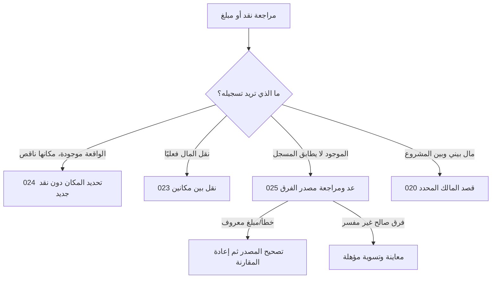

# JRN-006 — النقد وأماكنه وحركات مال المالك

**النسخة:** V3 · **التاريخ:** 2026-10-26 — عمّان.
**الحالة:** معتمد من المالك في نطاق CONS-DEC ذات الصلة؛ التفاصيل غير المغطاة بحدودها. التنفيذ والاختبار لم يبدآ، ولا إغلاق شامل.

## DATA-01 — بوابة البيانات المشتركة لكل النظام —2026-10-26

**الحالة:** مواصفات المنتج والقواعد المالية المعتمدة مرجع وظيفي؛ لا مخطط بيانات موحدًا مفحوصًا أو تصريح تنفيذ مستقل لهذا الملف. مراجعة التخزين والعلاقات والقواعد التقنية تشمل45 UNIT و10 رحلات، ثم يثبت العقد المشترك قبل تنفيذ الآثار المتأثرة. [DATA-01: النطاق والخطة والبوابة](../../01-Standards/02-System-Data-and-Financial-Readiness-AR.md#data-01-gate).

**المرحلة الحالية:** محلية على الجهاز. التوافق مع سحابة وAuthentication وAuthorization اتجاه مستقبلي للفحص، وليس إطلاقًا لها الآن. لا جداول مفروضة لكل مكوّن، ولا حساب دخول/أدوار/مزامنة/قفل جديد. تبقى حالة كل قدرة وإلغائها أو تأجيلها نافذة.

## مقابل JRN-010 —2026-10-26

الموجود الآن وافتتاح الفترة والنقد غير المحدد والقياس معانٍ مختلفة؛ لا مساهمة أو تسوية فرق أو سحب آمن مختلق. التأريخ المتأخر والقراء و044 عقد مشترك قبل التنفيذ.

**المصدر:** [الرحلة010](10-Account-Completion-and-Return-AR.md) و[002](../../03-New-Design/UNIT-002-استكمال-بيانات-المشروع.md#accounts-completion-20261026). هذه مقابلة ربط محددة، لا إعادة اعتماد فحوص الرحلة أو تشغيلها، ولا تغيير لمعرفاتها السابقة.

## اعتماد القرارات وتحديث أثرها على الرحلة —2026-10-26

**دليل الاعتماد:** قال المالك: «أنا موافق مية بالمية على كل اقتراحاتك»، ثم طلب صراحة تحديث القرارات التسعة أولًا. تاريخ التثبيت 2026-10-26، عمّان. يشمل الاعتماد التوصيات CONS-DEC01..09 ونطاقها وحدودها؛ لا يحتاج إعادة سؤال نفس القرارات. لا يتحول إلى اعتماد كل عبارة قديمة أو اختيار تفاصيل تخزين أو تصريح تنفيذ منتج.

**سجل تاريخي عند تثبيت القرارات التسعة، قبل اعتماد ACC-01/JRN-010 الأحدث أعلاه؛ لا يعمل كتعليمات حالية:** موضوع العودة بعد الانقطاع ومحاكاة جلسة النقاش ما زالا للنقاش، وليسا معتمدين أو مضافين في هذه الدفعة. «سجّل الموجود الآن» معتمد سابقًا ضمن CONS-DEC03 فقط؛ لا يثبت رحلة تعافٍ من انقطاع أو تحديد فترات مفقودة أو تسوية ديون/مخزون جماعية أو تاريخ تقريبي للعمليات. لا نُنشئ ملفًا لهذه الرحلة أو نصًا واجهيًا لها الآن.

**درجات الحالة:** المعنى والنطاق المعتمدان ثابتان؛ التهيئة الهندسية والمواصفة الإضافية للقياس/المرتجع عند لزومها، ثم التنفيذ، ثم التحقق والإغلاق حالات مستقلة. لا كود معدل أو اختبار ناجح من اعتماد الملف.

**المرجع:** [القرارات المعتمدة](../02-Consistency-Review-and-Decisions-AR.md#cons-decisions-approved-20261026).

| القرار | ما أصبح معتمدًا في هذا النطاق | الحالة |
|---|---|---|
| CONS-DEC02 | إظهار المعلومات المعلومة مع حدودها؛ نتيجة الفترة الكاملة غير محددة عند نقص بيانات مؤثرة. النتيجة الجزئية تسمى بنطاقها ولا تقدم ربح الفترة أو حدًا أدنى له. التقدير والاستبعاد الصريح مختلفان عن المجهول. التكلفة التسعيرية لا تكتب مصروفًا أو حق مالك تلقائيًا، ونفس الجزء المالي يحتسب مرة واحدة. تنسق سياسة 503 والقراء والميزانية والمخزون والمعدات وحقوق المالك قبل التنفيذ. | معتمد من المالك؛ التنفيذ لم يبدأ |
| CONS-DEC03 | اعتماد نطاق «سجّل الموجود الآن» كقياس نقد حالي مؤرخ عند الحاجة، مستقل عن افتتاح تاريخي أو إيراد أو مساهمة مالك. لا استنتاج للماضي ولا تسوية إلى صفر. هذه قدرة معتمدة تحتاج عقد قياس وتغطية وتصحيح وقراءة ونقل قبل إتاحتها. الحرس الحي يفرق المعلوم والمجهول وفشل القراءة؛ لا مال أو مصدر تمويل مختلق لتجاوز نقص الرصيد. | معتمد من المالك؛ التنفيذ لم يبدأ |
| CONS-DEC04 | اعتماد الفرع الشخصي للفواتير المشتركة: ما دفعه المشروع فعلًا وحصته ومن تحمل الباقي عند الحاجة. دفع 60 وحصة 30 وباقٍ شخصي مؤكد 30 يعطي نقد−60 ومصروف 30 وسحبًا شخصيًا 30 في قصد واحد، لا بافتراض النظام. دفع المشروع 30 لحصته 30 لا يضيف سحبًا آخر. الدفع من مال المالك يمر بمساره الصريح، ولا ينقص صندوقًا لم يدفع. | معتمد من المالك؛ التنفيذ لم يبدأ |
| CONS-DEC05 | إضافة مال المالك وسحبه بقصد صريح، لا بتوجيه تلقائي من وجود سياسات مستحقات. الإضافة ليست إيرادًا، والسحب الشخصي ليس مصروف تشغيل. المستحقات اختيارية وتسويتها مرتبطة بمستحق محدد، والإرجاع بأصل السحب وأثره. لا قرض أو استشارة سحب آمن جديدة. إصلاح وحدة 100 دينار→10000 وحدة صغرى مرة واحدة، لا تحويل جماعي للقديم. | معتمد من المالك؛ التنفيذ لم يبدأ |
| CONS-DEC06 | الوقائع المالية التي حدثت تسجل بتاريخ اليوم أو تاريخ سابق حقيقي؛ المستقبل موعد أو تذكير أو اتفاق لا قبض/دفع منجز. تاريخ البيع أو الاتفاق منفصل عن كل دفعة ووقت توثيقها. تعديل التكرار يؤثر افتراضيًا على الدورات المستقبلية غير المعالجة؛ السابق يراجع صراحة. ربط مصروف مسجل بدورة لا يكتب مصروفًا جديدًا. لا تاريخ وهمي أو إعادة تأريخ تلقائية للقديم. | معتمد من المالك؛ التنفيذ لم يبدأ |
| CONS-DEC08 | اعتماد ضرورة تصميم الإلغاء الحقيقي ورد المقدم/المبلغ من مصدره والمرتجع الكامل المؤهل قبل الإطلاق؛ المرتجع الجزئي والتقسيم المعقد مؤجلان إلى عقد مستقل. الموافقة على النطاق لا تعني جاهزية مواصفة الرد أو العكس أو المخزون. التصحيح الخاطئ مختلف عن رد مال حقيقي، ولا رد يتجاوز المقبوض أو عودة مخزون من مجرد رد المال أو إغلاق طلب يحبس حق العميل. | معتمد من المالك؛ التنفيذ لم يبدأ |
| CONS-DEC09 | اعتماد تأجيل إنشاء أمانات جديدة من الواجهة العادية للإصدار الأول، مع حفظ قراءة وتصحيح ما يثبت من القديم وحدود ملكية المال. لا دفتر أموال للغير جديد أو توزيع للإجمالي القديم على أشخاص بالتخمين. عربون الطلب ودينه التجاري ومال المالك تبقى عند مصادرها، ولا أمانة بديلة تعيد قرضًا أو تخفي فرقًا. | معتمد من المالك؛ التنفيذ لم يبدأ |

**المسار المستهدف بعد الاعتماد:** قياس الموجود الآن معتمد النطاق، مختلف عن الافتتاح القديم والمطابقة من مرجع معلوم؛ التحويل والربط لا يخلقان مالًا. سحب المالك بقصده، وإنشاء أمانة جديدة خارجالإصدار الأول.

**البوابات والقبول:** كل بوابة أدناه كانت تنتظر موافقة على أحد هذه القرارات أصبحت تنتظر التجهيز والتحقق في حد القرار نفسه؛ لا سؤال مالك متكرر ولا حذف للبوابة. المخطط والكاتب والقارئ والتصحيح والمعرفة والرجوع والنسخ، ثم اختبار الهاتف، باقية. قبول النطاق لا يجعل القياس الجديد أو المرتجع جاهزين للتنفيذ.

**حالة المتن السابق:** خطواته وفحوصه محفوظة؛ الحكم الأقدم المتعارض مع بطاقة معتمدة تاريخي في هذا الحد. الرحلة ليست كودًا منفذًا أو نتيجة اختبار؛ الإضافات المستقلة لم تعتمد تلقائيًا.228 قبولًا مخططًا ومعرفات J001..J009 محفوظة.

## A. اختر المهمة التي حدثت، دون تعلم محاسبة

| الفرع | حاجة المستخدم | الدخول وأقل إدخال | النتيجة والعودة |
|---|---|---|---|
| C1 معرفة النقد |كم عندي وأين؟ |013→022 ؛ قراءة الحالة والأماكن |قراءة فقط، ثم المكان/الحركة، والرجوع إلى 013 |
| C2 تعريف مكان |أريد متابعة الصندوق/مكان آخر |022 ؛ اسم ونوع ومعرفة افتتاح وتاريخه بحسب عقده |مكان بنفس هويته، لا مال مالك/بيع أو صفر افتتاح مختلق |
| C3 تحديد مكان مبلغ مسجل |استلمت/دفعت وسجلت الواقعة دون مكان |مصدر 005/015/027/غيره أو 022→024 ؛ المصدر والمبلغ للقراءة واختيار مكان |توزيع/نسبة لنفس النقد؛ العودة إلى الواقعة أو المكان، لا قبض/صرف جديد |
| C4 نقل فعلي بين مكانين |نقلت مالًا من الصندوق إلى البنك مثلًا |المكان 022→023 ؛ المصدر ظاهر، وجهة مختلفة ومبلغ وتاريخ |طرفا نقل مرتبطان؛ مجموع النقد ثابت، والعودة لحركات المصدر |
| C5 عدّ النقد |أريد مقارنة الموجود فعليًا بالمسجل |صندوق 022→025 ؛ مبلغ الموجود، المرجع ومعرفته للقراءة |مطابق بلا قيد، أو فرق مؤهل بمعاينة وسبب؛ العودة للصندوق |
| O1 إضافة من مالي |أضفت مالًا من مالي للمشروع |013→020 ؛ المبلغ والمكان والتاريخ، إضافة رأس مال ظاهرة |نقد ورأس مال بحسب القصد المؤهل، ليس مبيعات أو ربحًا |
| O2 سحب شخصي |أخذت مالًا من المشروع لنفسي |020 ؛ المبلغ والمصدر والتاريخ، ونوع القصد عند الحاجة |أثر على النقد ورأس المال/المستحق وفق قاعدة مصدره، لا مصروف تلقائي |
| O3 مستحقاتي الاختيارية |أريد حساب مبلغ لي وفق قاعدة |020 ؛ مبلغ عن فترة/شهري أو طريقة بدليل صالح، ثم مراجعة وتسجيل |مستحق موثق لا دفع آلي؛ تسويته فعل لاحق من مصدره |
| O4 رصيد مستحق سابق/إرجاع سحب |أدخل حقًا سابقًا أو أردّ سحبًا محددًا |020 من المصدر المناسب؛ اتجاه لي/علي أو أصل السحب ومتبقيه |معناه المحدد ببوابة G05 ، لا افتتاح نقد أو إضافة رأس مال عامة بالتخمين |
| **إنشاء جديد مؤجل؛قراءة/تصحيح القديم فقط.** X1 أموال للغير عند الحاجة |قبضت أمانة/سلّمتها |015 بقصد أمانة، حيث يدعم المصدر نطاقها |تغير نقد والتزام أمانة، لا إيراد/قرض/عربون طلب؛ الربط الفردي مشروط G06 |

لا نعرض كل هذه الاختيارات داخل كل نموذج مالي. المستخدم ذو مكان واحد لا يضطر للتحويل، ولا إنشاء كل الأماكن أو مستحقات مالك شرطًا لبدء عمله. حدود المعرفة والمبلغ والأثر والخطأ ظاهرة باختصار، والمساعدة العامة خلف ! مسمى. لا قفل 042 أو مشاركة 040 أو توقع «سحب آمن»021 المعطلة.

## B. فصل العمليات المتشابهة في الشكل

لا يختار المستخدم مسارًا من شكل إشارة السالب وحدها. عكس قيد خاطئ ليس نقل مال عكسيًا حدث فعلًا، والعدّ اليوم ليس رصيد افتتاح قديم. الرجوع من مراجعة مصدر إلى 025 يجدد المرجع ويحفظ المعدود كمدخل مؤقت؛ لا يسجل تسوية تلقائيًا من العودة.

## C. البيانات والمعرفة والأمثلة

### C1. النقد وأماكنه

القارئ يميز **رصيدًا معلومًا** و**صافي حركات** مع افتتاح مجهول، و**مكانًا لم يحدد** و**قراءة فاشلة**. لا يقال إن المشروع عنده 15.00 إجمالًا لمجرد قبض 15.00 إذا لم يعرف ما سبقه. المكان الوحيد لا يستوعب تلقائيًا جميع المبالغ القديمة؛ إنشاء المكان لا يوزع تاريخ النقد.

إضافة مكان تحتاج هوية ثابتة ونوعًا صالحًا واسمًا مفهومًا، وحالة افتتاح صريحة بحسب 022 ؛ الصفر معلوم فقط إذا صرح به المستخدم ضمن عقده. إضافة مكان أو تعديله لا ينشئ إضافة مالك أو بيعًا أو مزامنة بنك. لا حذف مكان له حركات لمجرد تبسيط القائمة؛ قراءة القديم وتصحيحه محفوظة.

**تحديد المكان:** قبض 5.00 بلا مكان، ثم تحديده للصندوق ⇒ النقد الكلي لا يزيد 5 مرة ثانية؛ نصيب المكان يزيد 5 وفق المصدر. إن كان القبض التراكمي لنفس البيع أصبح 15.00 ، لا يستعمل هذا الرقم لتخصيص دفعة 5 القديمة. صرف مستحق 40 سدد منه 10 يجعل مصدر التخصيص الدفعة 10 ، لا الفاتورة 40. المبلغ والاتجاه من الواقعة المثبتة، لا سؤال جديد للمستخدم لحساب الإشارة.

**تحويل:** صندوق 100.00 وبنك 20.00 ، نقل 30.00 ⇒70.00 و 50.00 ، والمجموع 120.00 ثابت. مبلغ موجب ومكانان مختلفان وهوية زوج وقصد واحد. رسوم نقل فعلية عند 015 بمصدر مستقل، لا مبلغ زائد داخل الطرفين. التطبيق يسجل النقل ولا يرسل مالًا للبنك. مصدر معلوم لا يغطي المبلغ يراجع؛ قبول نقل حدث مع افتتاح مجهول سياسة 023-D01 غير معتمدة، وتعذر القراءة ليس مجهولًا مقبولًا.

### C2. العدّ والمطابقة

المسجل 40 والموجود 40 ⇒ «المبلغ يطابق الرصيد المسجل» و**تم**، دون تسوية 0 أو سجل عدّ مالي مختلق. المسجل 40 والموجود 37 ⇒ فرق نقص 3 ؛ قبل الكتابة يمكن إعادة العد أو مراجعة مبلغ/مصدر مؤثر. إن كان أصل الفرق معروفًا يصحح عند مالكه بدل تسوية تعوّضه ثم تكرره لاحقًا.

التسوية المؤهلة بمقدار−3 تغير النقد المسجل فقط، لا المبيعات أو الربح تلقائيًا؛ مصدرها وسببها وتاريخها ومعرفها محفوظة. إذا كان المرجع غير معلوم لا يستبدل 0 لحساب فرق 37 ، ولا يزعم العدّ أنه أصلح تاريخ الافتتاح. سياسة المرجع والأماكن المؤهلة والتأريخ في 025-D01..05 و 022-D04/016 ، لا تغلق من المثال.

### C3. مال المالك

إضافة رأس مال 100.00 تزيد نقد المشروع 100.00 ورأس المال المسجل بحسب مصدره، دون إيراد بيع. **سحب شخصي عادي** يختلف عن **تسديد مستحق مسجل** و**سحب قبل المستحق**؛ اختيار النية بدل وجود قاعدة حساب نشطة توصية 020-D03 تحتاج اعتمادًا. لذلك لا تكتب الرحلة أن كل سحب ينقص رأس المال أو أن كل إرجاع يزيده؛ الواجهة تعرض معنى القصد المؤهل وأثره قبل الحفظ، لا أسماء مخازن أو event/movement.

020 ينظم المهمة و 015 يكتب الحدث حيث يحدده عقد peer-020 ؛ لا مساهمة مزدوجة في مخزنين. رد سحب مرتبط يحتاج أصلًا ومتبقيًا ونوع الأثر الصحيح وفق 020-D04 ، لا «إرجاع أو ضخ» موحد. إلغاء/عكس حركة يختلف عن حركة مالية جديدة حدثت فعلًا بالاتجاه المقابل.

**المستحق الاختياري:** مبلغ عن فترة أو شهري أولًا، وبقية الطرق عند الحاجة مع دليلها. وقت مخطط ليس وقتًا فعليًا، ونسبة نتيجة لا تحسب من الكاش أو المبيعات إذا كانت نتيجتها مجهولة، و fixed_shift لا يفعّل دون دليل ورديات صالح. المعاينة لا تصرف نقدًا؛ تسجيل المستحق ثم تسويته فعلان مختلفان. لا نطلب تفعيل المستحقات لمن يريد رأس مال أو سحبًا فقط.

**رصيد مستحق سابق:** مبلغ بالدينار واتجاه **لي / علي**، وليس حقل minor تقنيًا.100.00 د. أ يجب أن تخزن 10000 من وحدته المعتمدة مرة واحدة، لا 100 فتظهر 1.00. حق سابق لا ينشئ قبض 100 أو افتتاح صندوق 100. تصحيح بيانات قديمة مقترح بمصدر وحالة لكل سجل، لا ضرب جميع أرصدة المالك تلقائيًا في 100.

### C4. الأمانة — إنشاء الجديد مؤجل وفقCONS-DEC09؛التالي تفسير القديم وتصحيحه فقط

015 يملك أنواع الأمانة الحالية. القبض يزيد النقد والتزام الأموال للغير، والتسليم ينقصهما؛ ليس قرضًا أو إيرادًا أو عربون طلب. الحالي المجمع لا يوصف كرصيد مؤكد لكل شخص. ربط تسليم بقبض أصل ومستفيد ومتَبقٍّ ومعالجة القديم قرار U015-D03 ؛ لا يصبح جاهزًا من إدراج الفرع X1. تبقى القدرة خارج المسار العادي لمن لا يحتاجها، ولا تستعمل لتعويض نقص رصيد/قرض ملغى أو تسوية مجهولة.

## D. العودة والإلغاء والفشل

| الحالة | ما يجب أن يحدث |
|---|---|
|إلغاء/رجوع من نموذج أو! |لا كتابة؛ أقرب ورقة ثم المصدر 022/020 أو الواقعة الفعلية، مع حماية المدخلات |
|سياق مكان/مصدر معدوم أو فاشل |تعذر محدد، لا أول مكان/رصيد 0/مصدر مالي بديل |
|نقرة/تحديث/مآل حفظ مجهول |قصد وهوية وبصمة ومآل مسترد قبل الكتابة؛ لا زوج تحويل أو تسوية أو مال مالك ثانٍ |
|الواقعة محفوظة ومكانها ناقص |إصلاح 024 فقط من المبلغ والحدث المثبتين، لا تسجيل إضافة/صرف مرة أخرى |
|تعارض/نقلان/مصدر تغيّر أثناء العد |حرس حي داخل الكتابة وإبقاء المدخلات وإعادة المعاينة؛ لا حفظ على مرجع قديم |
|رصيد قديم أو غير محدد سالب |مراجعة مصادره وتغطيته؛ لا تبديل اتجاه من الإشارة أو افتتاح/قرض/مالك وهمي لإجبار التوازن |
|تصحيح تحويل |الزوج المؤهل مع سبب وأثر، لا عكس طرف واحد؛ النقل الحقيقي اللاحق قصد جديد بمبلغ وتاريخ جديدين |
|تصحيح تخصيص أو تسوية |عند مالكه وروابطه؛ لا رد مبلغ عميل أو تغيير مبيعات من تغيير المكان/عد الصندوق |
|نجاح مصدر وفشل لمحة/فترة |النجاح والقراءة منفصلان؛ تعاد القراءة لا الحدث |
|استعادة/إيقاف قدرة |التاريخ والهوية والمسارات المؤهلة للقراءة/التصحيح محفوظة؛ لا نقل مسودات لمالكه الجديد أو مسح حركات |

## E. أين نزيل التكرار ولماذا؟

| الأصل | الإزالة والسبب | البديل والشرط |
|---|---|---|
|022 مركز النقد |قوائم تحويل/توزيع/عد مستقلة متنافسة؛ تجمع المستخدم حسب مهمة المال لا تقنية المخزن |023–025 أفعال سياقية بملفاتها وهوية/نتيجة/رجوع، لا حذف خدماتها |
|024 نسبة المصدر |قبض/صرف عام لإصلاح المكان؛ يكرر الكلي أو يغير ذمة صحيحة |حدث المصدر ومبلغه ومعرفة الربط، ومخرج تصحيح يغطيه |
|025 عد وتسوية مؤهلة |محرر ضبط رصيد آخر أو إدخال مبلغ الفرق واتجاهه؛ الفرق مشتق بالفعل |إجراء واحد بموجود/مرجع/سبب ومعاينة، مع حفظ cash_adjustment واستعمالاته الأخرى |
|020 سياق المالك/015 حدثه |نموذجا إضافة أو مساهمتان لنفس القصد؛ اختلاف المكان لا يخلق مالًا جديدًا |تنسيق نوع الأصل والكاتب والمآل، لا إخفاء فرق رأس مال ومستحق وسحب |
|017 قراءة الحركات |قوائم وعكس مالي عام من كل سطح؛ قد تفقد صاحب التصحيح ومعنى الأثر |قراءة مشتركة وتفاصيل المصدر/الزوج وحرسه قبل إزالة عرض قديم |

## F. بوابات التنفيذ

| البوابة | ما بقي وحدوده |
|---|---|
| J006-G01 |022 قارئ معرفة وافتتاح حقيقي وصافي حركات وحدود القديم مع 013/016/017 ؛ لا مرساة حالية جديدة أو إعادة حساب صامت |
| J006-G02 |023-D01 و 024-D01..05:تغطية المصدر/الزوج والنسبة والحرس/الوقت/المآل والتصحيح، لا منع/قبول سالب جديد من واجهة |
| J006-G03 |025-D01..05/022/024:مرجع عد صالح وتداخل المصدر/التسوية وأهلية المكان والتاريخ؛ لا إصلاح افتتاح مجهول بعدّ اليوم |
| J006-G04 |020/015/022/024 قصد المالك وكاتب واحد ومصدر/مكان ومآل ونسخة/حتمية ونقل 044 ؛ ليس كشف مالك مستقلًا يكرر الحدث |
| J006-G05 |020-D03/D04/D05/D08 و 503:معنى السحب/الإرجاع/حقوق المالك وإثبات المدخل بالدينار واتجاه لي/علي؛ لا اعتمادها كلها من تبسيط الواجهة |
| J006-G06 |015-D03:أمانة أصل/مستفيد/تسليم ومتبقٍ وتصحيح، مع حدود المجمع القديم؛ لا دفتر أشخاص أو قرض جديد بغطاء أمانة |
| J006-G07 |الرجوع/الخطأ/تكرار/نافذتان/ذرية فعلية أو مراحل معلنة، الهاتف والإتاحة و 044 ؛ الاختبارات لم تنفذ |

## G. فحوص القبول — مخططة

| الفحص | المطلوب |
|---|---|
| J006-AC01 | فتح 022 و 020 أو مكان أو حركة قراءة فقط؛ العودة للمصدر الحقيقي. |
| J006-AC02 | مكان واحد دون تحويل مفروض أو بنك افتراضي أو توزيع القديم تلقائيًا. |
| J006-AC03 | افتتاح مجهول وصافي حركات ورصيد معلوم وفشل قراءة: حدود مختلفة لا صفر بديل. |
| J006-AC04 | تعريف مكان لا ينشئ مال مالك أو بيعًا أو قبضًا أو مزامنة بنك. |
| J006-AC05 | تحديد مكان قبض 5 بعد وصول التراكمي 15 يستعمل 5 فقط؛ الكلي ثابت. |
| J006-AC06 | مستحق 40 سدد 10: التخصيص للدفعة 10 لا كامل 40. |
| J006-AC07 | غير المحدد السالب لا يبدل الاتجاه أو يقبل مصدرًا مختلقًا؛ مراجعة التغطية. |
| J006-AC08 | تحويل 30 من 100 إلى 20:70 و 50 ومجموع 120 ، زوج واحد بلا إيراد أو مصروف. |
| J006-AC09 | نفس المكان أو مبلغ غير صالح أو تغطية ناقصة أو قراءة فاشلة: حرس صادق. |
| J006-AC10 | افتتاح مجهول: لا رصيد كامل أو مبلغ متاح مزعوم؛ سياسة القبول بعد G02. |
| J006-AC11 | تصحيح تحويل يعالج الزوج؛ النقل العكسي الفعلي حدث جديد لا محو للأول. |
| J006-AC12 | عد 40 ومرجع 40: تم بلا قيد 0 أو تاريخ حفظ مختلق. |
| J006-AC13 | عد 37 ومرجع 40: نقص 3 بمعاينة وسبب بعد أهلية المرجع، دون ربح أو مبيعات. |
| J006-AC14 | مرجع مجهول: لا فرق محسوب من 0 أو افتتاح اليوم أو تسوية كاذبة. |
| J006-AC15 | مصدر معروف يفسر الفرق: تصحيح الأصل ثم تجديد المرجع، لا تسوية ثانية. |
| J006-AC16 | إضافة مالك 100: نقد ورأس مال بمعنى الأصل، لا إيراد أو افتتاح بديل. |
| J006-AC17 | سحب عادي أو مستحق أو مسبق: أثر القصد المعتمد بعد G05 لا توجيه خفي من activePolicies. |
| J006-AC18 | إرجاع سحب مرتبط: سقف وأثر نوع الأصل، دون مستحق أو رأس مال مكرر. |
| J006-AC19 | حساب مستحق لا يدفع نقدًا؛ وقت أو نسبة نتيجة دون دليل لا يصبحان مبلغًا معلومًا. |
| J006-AC20 | حق سابق 100 د. أ يخزن 10000 مرة باتجاه لي/علي؛ لا 1.00 أو قبض 100 مختلق. |
| J006-AC21 | الأمانة ليست بيعًا أو قرضًا أو عربونًا، والمجمع القديم ليس رصيد شخص موثقًا. |
| J006-AC22 | حفظ متكرر أو جواب مجهول أو نافذتان: حدث أو زوج واحد ومعاينة حية. |
| J006-AC23 | نجاح مصدر ومكان أو لمحة ناقصة: إكمال التابع أو القراءة فقط. |
| J006-AC24 | هاتف 360/390/430 و RTL و 0–9 ومفاتيح وتكبير وقارئ شاشة: طرفا الأثر والرجوع واضحان. |

**الدليل والحدود:** قراءة 020/022–025/015/013/016/017 وقرارات القروض/القفل/التوقعات؛ لا كود حالي أو تشغيل.24 قبولًا J006 و 7 بوابات لا اعتماد لقواعدها أو زيادة 427ACD/38DUP. المراجع الرسمية والمعايير V6/24 في[الفهرس](00-JOURNEYS-INDEX-AR.md). التالي JRN-007.
