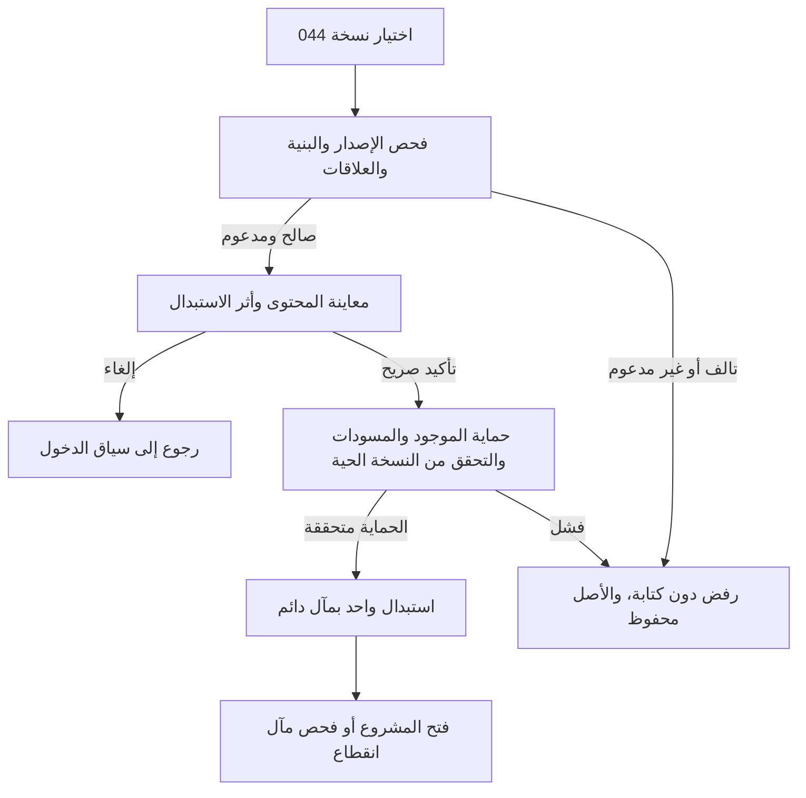

# JRN-008 — الإعدادات والصيانة والنسخ والاستعادة

**النسخة:** V3 · **التاريخ:** 2026-10-26 — عمّان.
**الحالة:** معتمد من المالك في نطاق CONS-DEC ذات الصلة؛ التفاصيل غير المغطاة بحدودها. التنفيذ والاختبار لم يبدآ، ولا إغلاق شامل.

**المراجع:** [038 الإعدادات](../../03-New-Design/UNIT-038-الإعدادات.md) · [039 بيانات المشروع](../../03-New-Design/UNIT-039-بيانات-المشروع-والمالك.md) · [002 بيانات البداية](../../03-New-Design/UNIT-002-استكمال-بيانات-المشروع.md) · [033 الفحص](../../03-New-Design/UNIT-033-فحص-البيانات.md) · [044 النسخ والاستعادة](../../03-New-Design/UNIT-044-النسخ-الاحتياطي-والاستعادة.md) · [JRN-001 البداية](01-First-Use-and-First-Task-AR.md) · [الفهرس](00-JOURNEYS-INDEX-AR.md).

## DATA-01 — بوابة البيانات المشتركة لكل النظام —2026-10-26

**الحالة:** مواصفات المنتج والقواعد المالية المعتمدة مرجع وظيفي؛ لا مخطط بيانات موحدًا مفحوصًا أو تصريح تنفيذ مستقل لهذا الملف. مراجعة التخزين والعلاقات والقواعد التقنية تشمل45 UNIT و10 رحلات، ثم يثبت العقد المشترك قبل تنفيذ الآثار المتأثرة. [DATA-01: النطاق والخطة والبوابة](../../01-Standards/02-System-Data-and-Financial-Readiness-AR.md#data-01-gate).

**المرحلة الحالية:** محلية على الجهاز. التوافق مع سحابة وAuthentication وAuthorization اتجاه مستقبلي للفحص، وليس إطلاقًا لها الآن. لا جداول مفروضة لكل مكوّن، ولا حساب دخول/أدوار/مزامنة/قفل جديد. تبقى حالة كل قدرة وإلغائها أو تأجيلها نافذة.

## مقابل JRN-010 —2026-10-26

مداخل استكمال الحسابات تفتح002 نفسه.044 يحفظ عائلات ومعرفة وتغطية الرحلة بعد اعتماد العقد، والاستعادة استبدال لا دمج أو إعادة أحداث؛ المحلي لا مزامنة.

**المصدر:** [الرحلة010](10-Account-Completion-and-Return-AR.md) و[002](../../03-New-Design/UNIT-002-استكمال-بيانات-المشروع.md#accounts-completion-20261026). هذه مقابلة ربط محددة، لا إعادة اعتماد فحوص الرحلة أو تشغيلها، ولا تغيير لمعرفاتها السابقة.

## اعتماد القرارات وتحديث أثرها على الرحلة —2026-10-26

**دليل الاعتماد:** قال المالك: «أنا موافق مية بالمية على كل اقتراحاتك»، ثم طلب صراحة تحديث القرارات التسعة أولًا. تاريخ التثبيت 2026-10-26، عمّان. يشمل الاعتماد التوصيات CONS-DEC01..09 ونطاقها وحدودها؛ لا يحتاج إعادة سؤال نفس القرارات. لا يتحول إلى اعتماد كل عبارة قديمة أو اختيار تفاصيل تخزين أو تصريح تنفيذ منتج.

**سجل تاريخي عند تثبيت القرارات التسعة، قبل اعتماد ACC-01/JRN-010 الأحدث أعلاه؛ لا يعمل كتعليمات حالية:** موضوع العودة بعد الانقطاع ومحاكاة جلسة النقاش ما زالا للنقاش، وليسا معتمدين أو مضافين في هذه الدفعة. «سجّل الموجود الآن» معتمد سابقًا ضمن CONS-DEC03 فقط؛ لا يثبت رحلة تعافٍ من انقطاع أو تحديد فترات مفقودة أو تسوية ديون/مخزون جماعية أو تاريخ تقريبي للعمليات. لا نُنشئ ملفًا لهذه الرحلة أو نصًا واجهيًا لها الآن.

**درجات الحالة:** المعنى والنطاق المعتمدان ثابتان؛ التهيئة الهندسية والمواصفة الإضافية للقياس/المرتجع عند لزومها، ثم التنفيذ، ثم التحقق والإغلاق حالات مستقلة. لا كود معدل أو اختبار ناجح من اعتماد الملف.

**المرجع:** [القرارات المعتمدة](../02-Consistency-Review-and-Decisions-AR.md#cons-decisions-approved-20261026).

| القرار | ما أصبح معتمدًا في هذا النطاق | الحالة |
|---|---|---|
| CONS-DEC01 | اعتماد التجربة المختصرة: اسم المشروع وحده للبداية، ونوع النشاط اختياري. الرئيسية للأفعال والمتابعة واللمحة، والمالية مدخل مختصر مع وظائف منظمة، والطلبات قائمة وتقويم لنفس المصادر. الإضافي عند الحاجة، ولا نموذج تفاعلي مستقل الآن. التحصيل لمستحق واحد محدد دون توزيع تلقائي، وحفظ الطرف أو المنتج لإعادة الاستخدام صريح واختياري. | معتمد من المالك؛ التنفيذ لم يبدأ |
| CONS-DEC02 | إظهار المعلومات المعلومة مع حدودها؛ نتيجة الفترة الكاملة غير محددة عند نقص بيانات مؤثرة. النتيجة الجزئية تسمى بنطاقها ولا تقدم ربح الفترة أو حدًا أدنى له. التقدير والاستبعاد الصريح مختلفان عن المجهول. التكلفة التسعيرية لا تكتب مصروفًا أو حق مالك تلقائيًا، ونفس الجزء المالي يحتسب مرة واحدة. تنسق سياسة 503 والقراء والميزانية والمخزون والمعدات وحقوق المالك قبل التنفيذ. | معتمد من المالك؛ التنفيذ لم يبدأ |
| CONS-DEC03 | اعتماد نطاق «سجّل الموجود الآن» كقياس نقد حالي مؤرخ عند الحاجة، مستقل عن افتتاح تاريخي أو إيراد أو مساهمة مالك. لا استنتاج للماضي ولا تسوية إلى صفر. هذه قدرة معتمدة تحتاج عقد قياس وتغطية وتصحيح وقراءة ونقل قبل إتاحتها. الحرس الحي يفرق المعلوم والمجهول وفشل القراءة؛ لا مال أو مصدر تمويل مختلق لتجاوز نقص الرصيد. | معتمد من المالك؛ التنفيذ لم يبدأ |
| CONS-DEC04 | اعتماد الفرع الشخصي للفواتير المشتركة: ما دفعه المشروع فعلًا وحصته ومن تحمل الباقي عند الحاجة. دفع 60 وحصة 30 وباقٍ شخصي مؤكد 30 يعطي نقد−60 ومصروف 30 وسحبًا شخصيًا 30 في قصد واحد، لا بافتراض النظام. دفع المشروع 30 لحصته 30 لا يضيف سحبًا آخر. الدفع من مال المالك يمر بمساره الصريح، ولا ينقص صندوقًا لم يدفع. | معتمد من المالك؛ التنفيذ لم يبدأ |
| CONS-DEC05 | إضافة مال المالك وسحبه بقصد صريح، لا بتوجيه تلقائي من وجود سياسات مستحقات. الإضافة ليست إيرادًا، والسحب الشخصي ليس مصروف تشغيل. المستحقات اختيارية وتسويتها مرتبطة بمستحق محدد، والإرجاع بأصل السحب وأثره. لا قرض أو استشارة سحب آمن جديدة. إصلاح وحدة 100 دينار→10000 وحدة صغرى مرة واحدة، لا تحويل جماعي للقديم. | معتمد من المالك؛ التنفيذ لم يبدأ |
| CONS-DEC06 | الوقائع المالية التي حدثت تسجل بتاريخ اليوم أو تاريخ سابق حقيقي؛ المستقبل موعد أو تذكير أو اتفاق لا قبض/دفع منجز. تاريخ البيع أو الاتفاق منفصل عن كل دفعة ووقت توثيقها. تعديل التكرار يؤثر افتراضيًا على الدورات المستقبلية غير المعالجة؛ السابق يراجع صراحة. ربط مصروف مسجل بدورة لا يكتب مصروفًا جديدًا. لا تاريخ وهمي أو إعادة تأريخ تلقائية للقديم. | معتمد من المالك؛ التنفيذ لم يبدأ |
| CONS-DEC08 | اعتماد ضرورة تصميم الإلغاء الحقيقي ورد المقدم/المبلغ من مصدره والمرتجع الكامل المؤهل قبل الإطلاق؛ المرتجع الجزئي والتقسيم المعقد مؤجلان إلى عقد مستقل. الموافقة على النطاق لا تعني جاهزية مواصفة الرد أو العكس أو المخزون. التصحيح الخاطئ مختلف عن رد مال حقيقي، ولا رد يتجاوز المقبوض أو عودة مخزون من مجرد رد المال أو إغلاق طلب يحبس حق العميل. | معتمد من المالك؛ التنفيذ لم يبدأ |
| CONS-DEC09 | اعتماد تأجيل إنشاء أمانات جديدة من الواجهة العادية للإصدار الأول، مع حفظ قراءة وتصحيح ما يثبت من القديم وحدود ملكية المال. لا دفتر أموال للغير جديد أو توزيع للإجمالي القديم على أشخاص بالتخمين. عربون الطلب ودينه التجاري ومال المالك تبقى عند مصادرها، ولا أمانة بديلة تعيد قرضًا أو تخفي فرقًا. | معتمد من المالك؛ التنفيذ لم يبدأ |

**المسار المستهدف بعد الاعتماد:** الإعدادات والنسخ والصيانة تحفظ السياسات المعتمدة دون إعادة تفعيل الملغى أو المؤجل. القرارات لا تثبت مخططًا أو ذرية أو اختبار استعادة؛ تجهيز العقود قبل توسعة الملف.

**البوابات والقبول:** كل بوابة أدناه كانت تنتظر موافقة على أحد هذه القرارات أصبحت تنتظر التجهيز والتحقق في حد القرار نفسه؛ لا سؤال مالك متكرر ولا حذف للبوابة. المخطط والكاتب والقارئ والتصحيح والمعرفة والرجوع والنسخ، ثم اختبار الهاتف، باقية. قبول النطاق لا يجعل القياس الجديد أو المرتجع جاهزين للتنفيذ.

**حالة المتن السابق:** خطواته وفحوصه محفوظة؛ الحكم الأقدم المتعارض مع بطاقة معتمدة تاريخي في هذا الحد. الرحلة ليست كودًا منفذًا أو نتيجة اختبار؛ الإضافات المستقلة لم تعتمد تلقائيًا.228 قبولًا مخططًا ومعرفات J001..J009 محفوظة.

## A. وظائف واضحة دون إعداد مالي إلزامي

| الفرع | ما يحتاجه المستخدم | أبسط تجربة والنتيجة |
|---|---|---|
| S1 بيانات المشروع |تغيير اسم العرض |038→039 ، الاسم الحالي ثم تعديل وحفظ؛ نفس الهوية/السجلات/المال، لا تأسيس جديد |
| S2 تفضيل ما يقدمه |منتجات/خدمات/كلاهما أو غير محدد |038 مصدر F03 الواحد؛ حفظ حقل صالح دون استبدال باقي التفضيلات، لا تغيير أنواع عمليات قديمة |
| S3 بيانات بداية عند الحاجة |أعمال/نقد/حقوق قبل مايكرو |002 يوجه إلى صاحب المعلومة بقواعده؛ ليس استعادة نسخة أو معالجًا إجباريًا أو 0 بدل غيابها |
| S4 فحص البيانات |مراجعة مشكلة أو تشخيص |038→033 تشغيل/نتيجة ضمن نطاق الفحوص المنفذة، ثم فتح مصدر محدد إن وجد؛ لا إصلاح مالي آلي |
| S5 حفظ نسخة |حماية نسخة خارج الجهاز |038→044 ، فعل حفظ واحد، تجهيز وتحقق وطلب حفظ الملف، دون اسم/أقسام/حساب جديد |
| S6 استعادة نسخة |العودة إلى بيانات محفوظة |044 اختيار ملف ثم فحص ثم معاينة أثر الاستبدال ثم تأكيد صريح وحماية الموجود |
| S7 الرجوع لما قبل استعادة |استرجاع اللقطة السابقة المتحققة |نفس مسار المعاينة/التأكيد والحماية، لا تبديل بيانات بمجرد فتح الإشعار |
| S8 مسح المشروع |بدء جديد بقصد صريح |038 خيارات متقدمة→044 ، نسخة وحماية/تأكيد كتابة «مسح» حسب عقده ثم مسح النطاق المعلن، لا زر ملاصق للحفظ المعتاد |

الإعدادات مدخل ثانوي خارج الوجهات الخمس، لا تبويب سفلي جديد. لا عملة/لغة/دارك مود/صيغة أرقام عامة جديدة؛ العربية RTL و 0–9 ود. أ والمظهر الفاتح. لا PIN/بصمة أو حساب دخول/مزامنة سحابية بديلًا عن 042 ، ولا مشاركة 040 أو بريد مطلوب لحفظ نسخة. تفاصيل الهوية القديمة تحفظ إلى أن يثبت جرد مستهلكيها قبل إزالة مدخلها.

## B. الدخول والعودة والحفظ المحلي

من 003 أو موضع الإعدادات المعتمد يفتح 038. فتح 039/033/044 ثم رجوع يعيد 038 أولًا، وبعده المدخل الحقيقي وفترته/موضعه. من رقم/معلومة ناقصة يفتح 002 أو أصلها السياقي ويعود إلى نفس المهمة، ولا يجبره على جولة إعداد كاملة. الرابط القديم أو فشل القراءة لا ينشئ مشروعًا أو اسمًا بديلًا.

تغيير الاسم: الاسم الحالي للقراءة، **تعديل اسم المشروع** ثم **حفظ التغيير/إلغاء**. الفراغ/المسافات خطأ لا «مشروعي» مخزنة خفية. الاسم عربي أو مختلط صالح، لا تحقق حكومي/اسم قانوني جديد بلا وظيفة. لا تغيير createdAt أو المعرف أو رأس المال/الدين عند حفظ الاسم. نجاح الهوية وفشل قراءة العرض بعده منفصلان؛ لا إعادة إنشاء.

تفضيل 038 لا يكتب workMode مواد/وقت كتفضيل منتجات/خدمات، ولا يفرض عميلًا أو موردًا أو مخزونًا عامًا. تجاوز نوع عملية واحدة محلي. إيقاف قدرة موروثة يحتاج جرد الكتّاب والقراء/المسارات وفق 038/B5 ؛ لا تختفي سجلاتها أو أهلية تصحيحها أو تعاد أفعال مؤجلة من تغيير إعداد. لا نحذف مفتاحًا له وظيفة مستقلة مثبتة باسم إزالة القفل.

## C. فحص البيانات دون ادعاء ضمان شامل

033 وظيفة صيانة في 038 ، لا أداة تخطيط أو اختبار على كل مستخدم عند كل دخول. حالات النتيجة منفصلة:

| الحالة | ما يراه المستخدم/يفعله |
|---|---|
|لم يجر الفحص |«لم تُفحص البيانات بعد» وفعل البدء، لا إنذار خطر لمجرد عدم تشغيله |
|اكتمل ضمن نطاقه بلا مكتشف |«لم نكتشف مشكلة ضمن الفحوص المنفذة»؛ تفاصيل النطاق عند الطلب، لا «كل الحسابات صحيحة» |
|مشكلة محددة |وصف وأثر يمكن إثباتهما، ثم **مراجعة العملية** إلى مصدرها إن عرف؛ لا سبب جذري مختلق |
|جزئي/قراءة فاشلة |حد ما تحقق وما تعذر مع إعادة المحاولة، لا نجاح شامل أو قائمة فارغة بديلة |
|غير منطبق/لا بيانات مناسبة |يسمى بنطاقه، لا نجاح تلقائي لكل البيانات |
|نتيجة قديمة أو تغير المصدر |وقت ونطاق وطلب إعادة فحص مناسب، لا شارة خضراء حالية من لقطة سابقة |

الرجوع من مصدر المشكلة يعيد موضع نتيجة الفحص؛ لا تشغيل/إصلاح تلقائي أو حذف قيد أو إضافة تسوية عامة. مشكلة محدودة لا تخفي كل المالية أو توقف فعلًا لا يعتمد عليها، ولا نتيجة قديمة تتجاوز حارس الكاتب. جدول الفحوص الفعلية وأثرها وتوقيت التشغيل الآلي G03 ، لا أسماء فحوص مختلقة من هذا الرسم. الخطأ المالي الحالي يظهر قرب رقمه مختصرًا؛ المساعدة وحدها لا تخفيه.

## D. حفظ نسخة: ما الذي ثبت فعلًا؟

1. **حفظ نسخة احتياطية** يقرأ لقطة متسقة ويجهز ملف Micro بإصدار معروف ويتحقق من بنيته وعلاقاته؛ لا منتقي أقسام أو اسم إجباري.
2. اسم ملف تلقائي بتاريخ/وقت دون بيانات عميل أو بريد. سطر قصير: **الملف يحتوي بيانات مشروعك؛ احتفظ به لنفسك** عند إخراجه، لا فقرة تخويف في كل شاشة.
3. إن كانت المنصة تثبت كتابة الملف فعلًا يمكن قول **تم حفظ الملف**. إذا كان المتاح طلب تنزيل من المتصفح فقط: **النسخة جاهزة. تأكد من حفظ الملف في مكان آمن**؛ لا استنتاج الحفظ من link.click أو نجاح تجهيز الذاكرة.
4. إلغاء منتقي معلوم إلغاء، وفشل تنزيل معلوم يتيح إعادة الحفظ من ملف جاهز متحقق؛ المآل غير المرصود يبقى غير مؤكد. فشل تحديث تفضيل «آخر نسخة» لا يمحو ملفًا نجح أو يعيد معاملة مالية.

النسخة ملف حماية، وكشف 016 ملف تقرير وليس ملف استعادة. لا إرسال لطرف آخر أو Web Share جديد، ولا وصفها مشفرة لأن لها بصمة سلامة. لا وعد تلقائي بحفظ خارجي يومي/سحابة/نسخ خادم غير موجودة.

## E. الاستعادة والحماية والرجوع

### E1. ما تقوله المعاينة

اسم المشروع وتاريخ إنشاء النسخة من المحتوى إن توفرا، وملخص محتواها ومعرفات/حالة مناسبة للتوافق، لا من اسم الملف. النص المؤثر ظاهر: **ستحل هذه النسخة محل بيانات المشروع على هذا الجهاز. لن تُدمج مع البيانات الحالية**. يوضح اختلاف المشروع/قدم النسخة/فراغها في موضعه دون checkbox روتيني أو تأكيد متكرر. الموافقة مرتبطة بنفس حمولة الملف ونسخة البيانات الحالية؛ تغير أحدهما يعيد المراجعة لا يعيد استعمال تأكيد قديم.

النسخة الفارغة الصالحة ليست تالفًا تلقائيًا؛ أثرها على موجود يوضح قبل التأكيد. النسخة غير المفهومة أو غير المدعومة ليست فراغًا. النجاح بلا هوية يعيد 001 ، والنجاح بهوية يستخدم هوية الملف وتفضيلاته دون قيم شاشة بداية مؤقتة فوقها. الدخول قبل أول إعداد مغطى JRN-001 ، وهنا الاستبدال على مشروع قائم؛ لا خدمتا استعادة.

### E2. ما يجب إثباته تقنيًا قبل الالتزام

- لقطة رجوع متسقة ومتحققة ودائمة تصمد أمام reload ، خارج نطاق الاستبدال نفسه، قبل أي كتابة. فشل قراءتها/حفظها/التحقق منها يمنع الالتزام. كائنواجهة أو إتاحة تنزيل بعد الاستبدال ليس حماية كافية.
- آخر لقطة رجوع صالحة لا تستبدل بمحاولة فاشلة أو تحذف من فتح معاينة؛ وسيلة تنزيلها/استرجاعها معلومة عند وجودها. ليست حماية من فقد الجهاز أو مسح تخزين المتصفح كله، ولا أرشيف نسخ غير محدود.
- مسودات النماذج العابرة تعزل مع بياناتها السابقة وتسترد بطريقة متوافقة، ولا تمحى خفية أو تستأنف على مشروع مختلف. مسودة طلب محفوظة 007 سجل أعمال، ليست مجرد كتابة نموذج مستثناة من النسخة.
- جميع الكتّاب والنوافذ منسقون تحت حرس اتساق، لا زر واجهة معطل وحده. البيانات القديمة أو الجديدة كاملة؛ لا استعادة نصفية أو تشغيل بيع/قبض/موعد/دورة/افتتاح مرة أخرى. الحرس التقني المؤقت ليس قفل التطبيق 042.
- إعادة فتح التطبيق بعد انقطاع تقرأ مآل العملية المحفوظ قبل أي محاولة؛ لا نجاح أو «لم يتغير شيء» مخترع. لا وعد بإلغاء يعكس نصف معاملة أثناء الالتزام.

### E3. نطاق البيانات والتوافق

044 يجرد كل عائلة حالية ومقترحة:هوية/حقوق/افتتاح، وقائع/مراجعات/قبض، سلاسل/دورات/مواعيد، خطط/سياسات ومعرفة، نقد/نسب/تحويل/تسوية، شراء/بنود/استلام، مواد/وحدات/قوالب، معدات/إهلاك، جهات/أرشفة، وحسابات 031 المحفوظة. لا×100 أخرى أو جمع إجماليات مشتقة فوق المصادر أو إعادة تسعير القديم أو حشو مجهول بصفر.

تاريخ 021/035/036 والروابط القديمة يُحفظ بمعناه ضمن توافق أو يرفض مبكرًا عند تعذره؛ لا إسقاط تاريخ أو تفعيل قدرة ملغاة/مؤجلة. لا PIN/جلسة/token أو سجل Console أو مفاتيح حساسة ضمن الحزمة؛ وظائف تشفير مستقلة إن وجدت تجرد قبل حذف مفاتيحها. المظهر/التفضيلات ترحل مع 038 ، ولا تتحول نسخة قديمة إلى إتاحة خدمة توصيل/AI أو موافقة على سياسة 503. حدود الحجم والذاكرة/الإصدار تقاس على الهاتف G04 ولا تحدد اعتباطيًا.

### E4. مسح البيانات — منفصل ومتقدم

ليس زر «ابدأ من جديد» قرب الحفظ. حسب 044:نسخة متحققة قبل المسح؛ إذا لم تثبت المنصة حفظها الخارجي يقر المستخدم بحفظ الملف، ثم يكتب **مسح** في التأكيد النهائي. يوضح نطاق حذف الأعمال والمسودات ولقطة الرجوع إن كانت ستُحذف. لا localStorage.clear عام أو حذف بعض الجداول بصمت، ولا PIN أو إعادة تنفيذ طلب معلق قديم. المآل المؤكد يعيد 001 بلا أعمال/هوية/صفر مالي مختلق. هذا توثيق مسار لاحق ولا أمر مسح ينفذ الآن.

## F. إزالة التكرار والفشل والرجوع

| موضع التكرار/الحالة | الإزالة أو المعالجة وسببها | البديل/المالك |
|---|---|---|
|هوية 001/039 أو محرر اسم في كل وجهة |لا إعادة تأسيس أو حقول اسم متنافسة؛ الاسم لنفس المشروع |039 مصدر واحد، 038 تفضيل، والعودة إلى نفس السياق |
|002 مقابل 044 |لا معالج استيراد افتتاح بدل نسخة كاملة؛ الأغراض مختلفة |002 يوجه إلى أصحاب بيانات البداية، 044 يستعيد ملفًا متحققًا |
|نسخة/استعادة من مداخل كثيرة |واجهة/مدقق/مخطط واحد؛ اختلاف المدخل لا يغير أثر الاستبدال |044 مع عقد دخول/عودة 001 أو 038 ، لا تقليل حماية لأن «أول تشغيل» |
|033 يصلح مالًا تلقائيًا أو يحل محل مدقق 044 |يزال؛ التشخيص ليس موافقة كتابة أو سياسة حساب |مصدر العملية يصحح نفسه، والفحص بعد استعادة لا ينقض نجاحها بلا دليل |
|تحديث/مآل مجهول/تعارض ملف أو بيانات |قصد وبصمة ونسخة حية، ومآل قبل إعادة الكتابة |تجهيز G04/G05 ، لا تكرار استبدال أو تشغيل مالي |
|فشل قراءة/حفظ/إلغاء |الحقيقة محفوظة مع مدخلات مناسبة ورجوع؛ لا نجاح/فراغ/0 بديل |الاسم/التفضيل عند 039/038 ، الملف/المآل عند 044 ، التشخيص عند 033 |

## G. بوابات التجهيز

| البوابة | ما يثبت قبل التنفيذ |
|---|---|
| J008-G01 |039/001/038:الهوية ثابتة ومستهلكو حقول المالك/البريد يجردون قبل إزالة المدخل، وتفضيل F03 لا workMode ؛ لا مسح بيانات قديمة |
| J008-G02 |002/038/القدرات:فتح اختياري ومصادر افتتاح منفصلة، وترحيل المفاتيح والحراس يحفظ التاريخ والقراءة/التصحيح |
| J008-G03 |033 سجل فحوص حقيقي ونطاق/نسخة/وقت وحالات جزئي/غير منطبق/فشل، وتوقيت تلقائي محسوب لا إصلاح عام |
| J008-G04 |044-D01/D03/D05:مصفوفة العائلات والنسخ/العلاقات/الدقة/الأحجام/الهاتف ودوران النسخة والقديم، لا ادعاء اكتمال من نجاح تصدير جزئي |
| J008-G05 |044-D02:لقطة رجوع دائمة ومسودات معزولة واتساق جميع الكتّاب/النوافذ، مآل دائم وحقن انقطاع/Quota عند الحدود؛ لا ضمان من الواجهة |
| J008-G06 |044-D04/038/042/040:مصير مفاتيح/حراس مستقلة، إلغاء القفل/المشاركة دون إضعاف مدقق/حماية مصدر، وحالة تحميل ملف صادقة |
| J008-G07 |مسح معاين منفصل ومؤكد بنطاقه وحماية نسخة، رجوع وإلغاء وهاتف وقارئ شاشة/تكبير/مفاتيح؛ لا أداة مسح حيّة هنا |

## H. فحوص القبول — مخططة

| الفحص | المطلوب |
|---|---|
| J008-AC01 | تغيير الاسم يحفظ نفس الهوية والتاريخ والمال؛ الفراغ خطأ لا مشروع جديد. |
| J008-AC02 | تفضيل محايد أو منتجات/خدمات وتجاوز محلي، دون workMode أو تغيير عمليات قديمة. |
| J008-AC03 | 002 اختياري؛ لا صفر افتتاح من غياب حقل أو استعادة تاريخ من تهيئة رصيد. |
| J008-AC04 | قدرة موروثة أو قفل ملغى: لا حذف تاريخ أو إعادة تفعيل أو تخطي حرس الكاتب. |
| J008-AC05 | 033 لم يفحص أو جزئي أو فشل أو غير منطبق أو قديم: نطاق صادق لا ضمان شامل للحسابات. |
| J008-AC06 | فتح مصدر مشكلة ثم رجوع: نفس نتيجة وموضع، لا إصلاح أو تشغيل مالي آلي. |
| J008-AC07 | تجهيز ملف وحفظ المنصة: النتيجة بحد الدليل، لا طلب تنزيل كإثبات كتابة. |
| J008-AC08 | إلغاء حفظ أو فشل تنزيل أو تفضيل آخر نسخة: حالة صادقة لا ملف محفوظ مزيف أو مال محذوف. |
| J008-AC09 | تصدير كل عائلة ودوران النسخة: المعرف والوحدة والمعرفة والسياسة والروابط ثابتة، لا×100 أخرى. |
| J008-AC10 | ملف تالف أو غير مدعوم أو يتجاوز حدود العقد: رفض مبكر مفهوم لا استبدال جزئي. |
| J008-AC11 | معاينة نسخة مختلفة أو قديمة أو فارغة صالحة: اسم ووقت ومحتوى وأثر استبدال واضح. |
| J008-AC12 | اختيار أو إلغاء قبل التأكيد: لا كتابة والعودة إلى 038 أو 001 بالمدخلات. |
| J008-AC13 | فشل لقطة الرجوع أو قراءتها أو حماية المسودات يمنع الالتزام، دون تخفيف باسم إزالة PIN. |
| J008-AC14 | تغير الملف أو البيانات بعد المعاينة: مراجعة وتأكيد جديدان، لا الموافقة القديمة. |
| J008-AC15 | انقطاع أو Quota أو نافذتان: حالة قديمة أو جديدة كاملة ومآل موثق، لا إعادة تطبيق المال. |
| J008-AC16 | مسودات قديمة لمشروع آخر: عزل وحفظ واسترداد متوافق، لا محو صامت أو استئناف مالي. |
| J008-AC17 | استرجاع اللقطة السابقة: معاينة وحماية للموجود وتأكيد، لا تبديل من نقرة إشعار. |
| J008-AC18 | ملف صالح بلا هوية بعد أثر موضح يعود 001 ؛ المجهول أو غير المدعوم ليس فارغًا. |
| J008-AC19 | فشل 033 بعد استعادة ناجحة: لا ادعاء عدم تغير شيء أو قيد تصحيح تلقائي. |
| J008-AC20 | قروض أو مشاركة أو قفل أو خدمة مستقبلية موروثة: توافق أو رفض قبل الكتابة، لا تفعيل أو إسقاط تاريخ. |
| J008-AC21 | كشف 016 ليس نسخة وحساب 031 ليس طلبًا؛ لا خلط أنواع أو حفظ عام للأدوات. |
| J008-AC22 | مسح متقدم: نسخة وحفظ بحد المنصة وتأكيد «مسح» ونطاق معلن؛ لا clear عام أو حذف خفي. |
| J008-AC23 | رجوع وتحديث وفشل 039/038: مدخلات وهوية ثابتة، ونجاح كتابة منفصل عن قراءة. |
| J008-AC24 | هاتف 360/390/430 و RTL و 0–9 ومفاتيح وتكبير وقارئ شاشة: المنتقي والأثر والرجوع واضحون. |

**الدليل والحدود:** قراءة أحدث 002/033/038/039/044 وعقد JRN-001/المكونات المجاورة؛ لا كود أو تجربة حفظ/تخزين/جهاز.24 قبولًا J008 و 7 بوابات، لا زيادة 427ACD/38DUP أوإغلاق 044. المعايير V6/24 والمراجع الرسمية في[الفهرس](00-JOURNEYS-INDEX-AR.md). التالي JRN-009.
